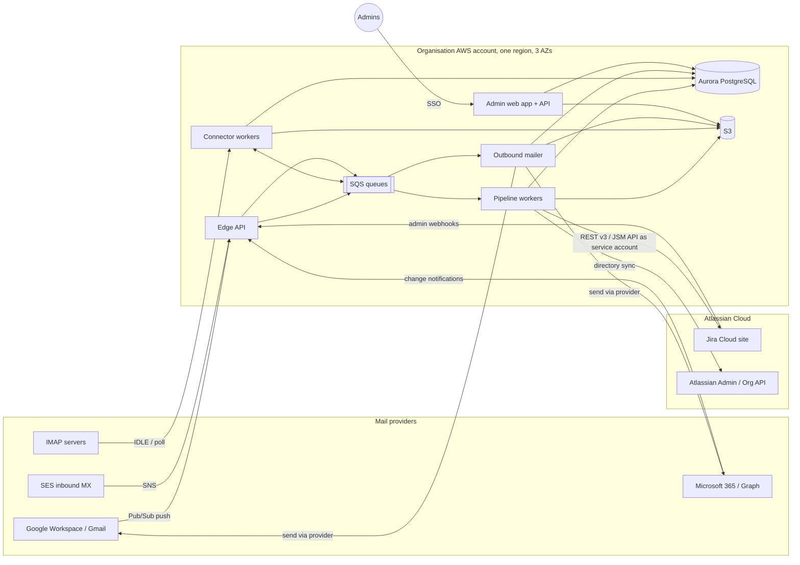
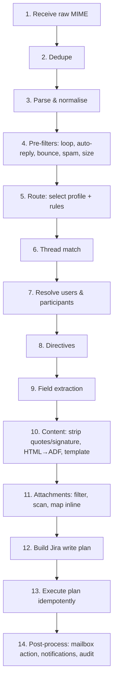

# Enterprise Mail Handler for Jira — Product & Technical Specification

| | |
|---|---|
| **Status** | Draft v0.2, for review |
| **Date** | 2026-10-12 |
| **Working name** | **MHJ** (Mail Handler for Jira). Placeholder; final name TBD |
| **Target platform** | Jira Cloud (Jira, Jira Service Management, Jira Work Management) |
| **Distribution** | Private deployment for a single organisation, hosted on AWS. Not listed on the Atlassian Marketplace |
| **Reference product** | Feature parity target: *Enterprise Mail Handler for Jira (JEMH)* by The Plugin People |

> **Clean-room note.** MHJ is an independent implementation. It aims for *functional* parity with the
> reference product, based only on publicly documented behaviour. We do not reuse its code, UI assets,
> help text, configuration file formats or trademarks.

---

## Decision log

| # | Date | Decision | Consequence |
|---|---|---|---|
| D1 | 2026-10-12 | **Private deployment for one organisation**, not a Marketplace app. | No Forge/Connect requirement. MHJ is a standalone AWS service that calls Jira as a service account. Single-tenant: no multi-tenant isolation, licensing or billing. Google CASA and Microsoft publisher verification are not required (internal-only OAuth apps). |
| D2 | 2026-10-12 | **Jira Cloud only.** | No Data Center/Server adapter. Jira REST API v3 and ADF only. JSM and Jira Work Management are in scope because they are Jira Cloud products. |
| D3 | 2026-10-12 | **App-authored comments with attribution are acceptable** ("potentially"). | v1 posts all comments as the MHJ service account with an attribution line. Posting as the real user is an optional later enhancement (§10.4). |
| D4 | 2026-10-12 | **AWS** hosting. | Terraform-managed stack in one AWS region (§4). |
| D5 | 2026-10-12 | **No import of JEMH configurations.** | MHJ has its own YAML config format only. |

---

## Table of contents

1. [Summary](#1-summary)
2. [Goals and non-goals](#2-goals-and-non-goals)
3. [Personas and key use cases](#3-personas-and-key-use-cases)
4. [Deployment model](#4-deployment-model)
5. [System architecture](#5-system-architecture)
6. [Mail connectors](#6-mail-connectors)
7. [Inbound processing pipeline](#7-inbound-processing-pipeline)
8. [Routing: profiles and rules](#8-routing-profiles-and-rules)
9. [Threading and correlation](#9-threading-and-correlation)
10. [Users and non-Jira participants](#10-users-and-non-jira-participants)
11. [Content handling and formatting templates](#11-content-handling-and-formatting-templates)
12. [Custom field extraction](#12-custom-field-extraction)
13. [Inline command directives](#13-inline-command-directives)
14. [Attachment handling](#14-attachment-handling)
15. [Outbound notifications](#15-outbound-notifications)
16. [Jira Service Management specifics](#16-jira-service-management-specifics)
17. [Administration UI](#17-administration-ui)
18. [Message log, audit, reprocessing and test bench](#18-message-log-audit-reprocessing-and-test-bench)
19. [Data model](#19-data-model)
20. [APIs](#20-apis)
21. [Security](#21-security)
22. [Privacy, retention and compliance](#22-privacy-retention-and-compliance)
23. [Non-functional requirements](#23-non-functional-requirements)
24. [Reliability and failure handling](#24-reliability-and-failure-handling)
25. [Observability and operations](#25-observability-and-operations)
26. [Technology stack and repository layout](#26-technology-stack-and-repository-layout)
27. [Testing strategy](#27-testing-strategy)
28. [Delivery phases](#28-delivery-phases)
29. [Open questions](#29-open-questions)
30. [Assumptions to validate (technical spikes)](#30-assumptions-to-validate-technical-spikes)
31. [Glossary](#31-glossary)

---

## 1. Summary

MHJ is a privately hosted service, running in the organisation's AWS account, that connects to the
organisation's Jira Cloud site and turns email into Jira work:

- **Ingestion and routing.** It reads mail from Gmail / Google Workspace, Microsoft 365 / Exchange Online,
  generic IMAP mailboxes and an MHJ-hosted inbound address. Ordered rules match on sender, recipients,
  headers and content, then create issues, add comments, transition issues, or drop/forward the message.
- **Participation without a Jira account.** Anyone with an email address can raise a ticket, be copied
  on it, receive templated notifications, and reply by email. Their replies thread back onto the same issue.
- **Rich processing.** Custom field extraction, inline command directives (for example setting the reporter
  or priority from the email text), HTML-to-Jira formatting, quote and signature stripping, and full
  attachment handling including inline images.
- **Enterprise posture.** OAuth 2.0 for every mail provider, encrypted credential storage, SSO for admins,
  full audit trail, reprocessing, dry-run testing, and production SLOs.

## 2. Goals and non-goals

### 2.1 Goals

| # | Goal |
|---|---|
| G1 | Convert inbound email into Jira issues, comments and field updates through configurable profiles and rules. |
| G2 | Let non-Jira users take part in issue conversations entirely through email. |
| G3 | Support custom field extraction, inline directives, formatting templates and attachments. |
| G4 | Connect to Gmail and Microsoft 365 with OAuth 2.0, plus generic IMAP and a hosted inbound address. |
| G5 | Run as a production-grade, highly available service in the organisation's AWS account. |
| G6 | Give administrators full visibility: message log, rule trace, audit history, reprocess and dry run. |
| G7 | Reach functional parity with the reference product's core Cloud feature set by end of Phase 2. |

### 2.2 Non-goals

- Atlassian Marketplace distribution, multi-tenancy, licensing and billing (D1).
- Jira Data Center or Server (D2).
- Importing JEMH configurations (D5).
- A general helpdesk UI. Jira and JSM remain the agent UI.
- Sending marketing or bulk email.
- Hosting full mailboxes. MHJ reads from and sends through the organisation's existing provider.
- POP3 (IMAP covers the legacy cases).
- Microsoft national clouds (GCC High, DoD, 21Vianet) and Google sovereign offerings.

## 3. Personas and key use cases

| Persona | Description |
|---|---|
| **MHJ admin** | Jira admin or platform owner. Connects mailboxes, owns global configuration and security settings. |
| **Project admin** | Manages profiles and rules scoped to their project(s) when delegated by an MHJ admin. |
| **Agent / team member** | Works the issues in Jira. Replies in Jira; MHJ emails external participants. |
| **External requester** | Customer, vendor or colleague with no Jira account. Only uses email. |
| **Internal Jira user (emailer)** | Has a Jira account but prefers email, for example comments from Outlook. |
| **Automated sender** | Monitoring tools, forms, CI systems that send structured email. |
| **Operator** | Runs the AWS deployment: upgrades, alerts, backups. May be the same team as the MHJ admin. |

### 3.1 User stories (acceptance-level)

1. **Support inbox.** Mail to `support@acme.com` creates an issue in `SUP`. The sender becomes the reporter
   if they are a Jira user or JSM customer; otherwise the default reporter is used and the sender is stored as
   an email participant. CC'd addresses become participants.
2. **Reply threading.** A reply from any participant, whether through their mail client or to MHJ's
   notification, is added as a comment on the original issue and is never duplicated.
3. **Agent replies by email.** A Jira user replies to a notification. The reply is added as a comment with
   an attribution line naming them; quoted history and signatures are removed.
4. **Routing by recipient and content.** Mail to `billing@` goes to `FIN`, and subjects matching
   `/^\[P1\]/` get priority Highest with label `p1`.
5. **Structured alerts.** A monitoring email with `Host: db-07` and `Severity: critical` in the body
   fills custom fields *Host* and *Severity*. Repeat alerts for the same host comment on the open issue instead of
   creating duplicates.
6. **Directive.** An internal user writes `#reporter jane@customer.com` and `#priority High` at the top of
   a forwarded email. The issue is created with Jane as reporter and priority High, and the directive lines do not
   appear in the description.
7. **Attachments.** Attachments and inline images arrive as Jira attachments. Inline images render in place
   inside the description or comment. Blocked types (for example `.exe`) are rejected and the rejection is noted on the issue.
8. **Notifications to externals.** When an agent comments publicly, every external participant gets a branded
   email from `support@acme.com` with the comment, and their reply threads back.
9. **Loop safety.** Auto-replies, bounces and mail sent by MHJ itself never create issues or comment loops.
10. **Audit and recovery.** An admin can see why a message went to the wrong project (rule trace), correct
    the rule, and reprocess the message.

## 4. Deployment model

### 4.1 Hosting

- A single-tenant deployment in **one AWS account owned by the organisation** (or a dedicated account operated on
  its behalf; see §29), provisioned entirely by Terraform.
- **One region**, chosen to match the organisation's Jira Cloud data residency location, deployed across
  **three Availability Zones**. Cross-region backup copies for disaster recovery (§24.5).
- Environments: `prod`, `staging` (connected to a Jira Cloud sandbox and test mailboxes), and ephemeral `dev`.

### 4.2 Connecting to Jira Cloud

MHJ calls Jira as a non-human identity with its own name (for example "Mail Handler") so that its actions are
clearly attributable in issue history.

| Option | How | Status |
|---|---|---|
| **A. Atlassian service account with OAuth 2.0 client credentials** (preferred) | Created in Atlassian Administration. MHJ exchanges client ID and secret for short-lived access tokens and calls `https://api.atlassian.com/ex/jira/{cloudId}/rest/api/3/…`. Scopes limited to what MHJ needs. | Validate availability on the organisation's plan (spike **S1**). |
| **B. Service account with a scoped API token** | Same identity; scoped API token stored in Secrets Manager and rotated on a schedule (tokens have a maximum lifetime). | Fallback if OAuth credentials are unavailable. |
| **C. Dedicated "bot" Atlassian user with an API token** | A normal user account reserved for MHJ. Consumes a Jira licence seat. | Last resort. |

The service account needs: *Browse*, *Create*, *Edit*, *Transition*, *Add comments*, *Create attachments*,
*Link issues*, *Modify reporter* and *Manage watchers* in the projects MHJ serves, plus JSM agent access in
service projects (and permission to create customers). Projects MHJ is not configured for need no access.

A private **Forge app is not required** for v1. It becomes an optional add-on in Phase 3 for an in-Jira issue
panel and for posting comments as the real user (§10.4).

### 4.3 Jira events (for outbound notifications)

Jira Cloud **admin webhooks** (configured once by a Jira admin, or through the REST API) send issue and
comment events to MHJ's webhook endpoint, filtered by JQL to the projects MHJ serves. Webhooks are signed with
a shared secret (HMAC) and verified by MHJ. A periodic reconciliation job queries recent changes through JQL
(`updated >= -10m`) to catch any missed deliveries (spike **S5**).

## 5. System architecture

### 5.1 Context diagram



### 5.2 Components

| Component | Responsibility |
|---|---|
| **Edge API** | Receives Gmail Pub/Sub push, Graph notifications, SES/SNS events and Jira webhooks. Verifies signatures and tokens, then enqueues. Does no heavy work. Behind an ALB with AWS WAF. |
| **Connector workers** | Per-mailbox sync state machines: subscription renewal, delta/history reconciliation, raw MIME fetch, post-fetch actions (label, move, mark read, delete). Long-lived IMAP connections. |
| **Pipeline workers** | Stateless stages from parse to Jira write (§7). Idempotent and horizontally scaled. |
| **Jira gateway** | Library used by the workers; the only code that calls Jira. Token acquisition and caching, rate limiting, retries, field-metadata cache. |
| **Directory sync** | Keeps an email → accountId directory of the organisation's managed Atlassian accounts, plus JSM customers (§10.1). |
| **Outbound mailer** | Renders notification templates and sends through the mailbox's own provider (Gmail API, Graph or SMTP), with correct threading headers. |
| **Scheduler** | EventBridge Scheduler jobs: subscription renewals, polling fallbacks, webhook reconciliation, directory sync, retention purges, credential rotation checks. |
| **Admin web app + API** | React single-page app (S3 + CloudFront) and the admin REST API: configuration, message log, reprocess, dry run, audit. SSO-protected (§17.1). |
| **Scanner** | Attachment malware scanning (ClamAV tasks, or a pluggable vendor). |

### 5.3 Key abstractions

```ts
interface MailConnector {            // Gmail, Graph, IMAP, SesInbound
  start(mailbox): Promise<void>;
  sync(mailbox, cursor): AsyncIterable<RawMessageRef>;
  fetchRaw(ref): Promise<Readable>;  // RFC 5322 bytes
  postProcess(ref, action): Promise<void>;
  send(mailbox, mime: Buffer, threadHint?): Promise<SentRef>;
}

interface JiraClient {               // Jira Cloud REST v3 + JSM API
  createIssue(plan): Promise<IssueRef>;
  addComment(issue, adf, opts): Promise<CommentRef>;
  updateFields(issue, fields): Promise<void>;
  transition(issue, transitionNameOrId, fields?): Promise<void>;
  addAttachments(issue, files): Promise<AttachmentRef[]>;
  setProperty(issue, key, value): Promise<void>;
  searchJql(jql, fields): Promise<IssueRef[]>;
  getCreateMeta(project, issueType): Promise<FieldMeta[]>;
  // JSM
  findOrCreateCustomer(email, displayName): Promise<JiraUser>;
  createRequest(plan): Promise<IssueRef>;
  addRequestParticipants(issue, accountIds): Promise<void>;
}
```

## 6. Mail connectors

Every mailbox ("Connection") has: provider, auth mode, address(es), the folder or label to watch,
post-fetch action, sync cursor, health status and a linked default profile.

### 6.1 Gmail / Google Workspace

| Aspect | Design |
|---|---|
| **Google Cloud project** | Owned by the organisation. OAuth consent screen set to **Internal**, so only the organisation's Workspace users can authorise and no Google app verification or CASA assessment is required. |
| **Auth modes** | (a) **Domain-wide delegation** (recommended): a Workspace super admin grants the MHJ service account's client ID the scopes below; MHJ impersonates each mailbox address. No per-mailbox consent and no refresh tokens to lose. (b) **Per-mailbox OAuth 2.0** (authorization code + PKCE, offline access) if DWD is not allowed by policy. |
| **Scopes** | `gmail.modify` (read, label, archive) and `gmail.send`. |
| **Change detection** | `users.watch` on the watched label, delivering to a Pub/Sub topic in the same project with an authenticated push subscription to the Edge API. On notification, call `users.history.list` from the stored `historyId`. Renew the watch every 24 h (it expires after 7 days). |
| **Reconciliation** | Every 5 min, plus on startup: `history.list`. If the `historyId` is too old (HTTP 404), run a full resync with `messages.list q="label:<watched> -label:<processed>"`. |
| **Fetch** | `messages.get format=raw` → base64url-decode → stream to S3. |
| **Post-fetch** | Configurable: add label `MHJ/Processed`, remove `INBOX`, mark read, or move to trash. Failures get label `MHJ/Failed`. |
| **Send** | `messages.send` with raw MIME and `threadId` so sent mail threads in the mailbox's Sent view. |
| **Quotas** | Per-user quota units tracked in a token bucket. Back off on 429/403 `rateLimitExceeded`. |

### 6.2 Microsoft 365 / Exchange Online (Microsoft Graph)

| Aspect | Design |
|---|---|
| **App registration** | A **single-tenant** Entra ID application in the organisation's tenant, authenticated with a **certificate** (not a client secret). No publisher verification needed. |
| **Auth modes** | (a) **Application permissions** (recommended): `Mail.ReadWrite` and `Mail.Send` with admin consent, restricted to the monitored mailboxes with Exchange Online *RBAC for Applications* (or legacy Application Access Policies). Supports shared mailboxes. (b) **Delegated**: `Mail.ReadWrite`, `Mail.Send`, `offline_access` for a single user mailbox. |
| **Change detection** | Graph subscriptions on `/users/{id}/mailFolders/{folder}/messages`, `changeType=created`, with `lifecycleNotificationUrl` for `reauthorizationRequired`, `subscriptionRemoved` and `missed`. Renew before expiry (maximum just under 7 days for messages; renew every 48 h). Notifications are validated with a per-subscription `clientState` secret; message content is fetched on demand. |
| **Reconciliation** | `messages/delta` on the folder every 5 min and after a `missed` lifecycle event. The delta token is stored as the cursor. |
| **Fetch** | `GET /users/{id}/messages/{mid}/$value` (MIME). |
| **Post-fetch** | Mark read, move to a configured folder (default `MHJ Processed`), set category, or delete. |
| **Send** | `POST /users/{id}/sendMail` with a MIME body (base64), so MHJ fully controls `Message-ID`, `In-Reply-To` and `References`. |
| **Throttling** | Honour `Retry-After`. Concurrency capped per mailbox (Graph allows about 4 concurrent requests per mailbox). |

### 6.3 Generic IMAP (Phase 2)

- IMAPS (993) or STARTTLS only; plaintext is refused.
- Auth: SASL `XOAUTH2` where supported, or username/password for other servers (Exchange on-premises, Zoho,
  Dovecot). Passwords are stored encrypted (§21.3).
- IDLE where supported, with a NOOP keep-alive and reconnect with jittered backoff; otherwise poll every 60 s.
- Tracks `UIDVALIDITY` and the highest processed `UID`. A `UIDVALIDITY` change triggers a resync with Message-ID dedupe.
- One long-lived connection per mailbox, assigned to connector tasks with a lease in Postgres so that exactly one
  task owns each mailbox; leases fail over if a task dies.

### 6.4 MHJ-hosted inbound address

- An organisation subdomain such as `jira-mail.acme.com` whose MX points to **Amazon SES** inbound receiving.
  Addresses on it (for example `support@jira-mail.acme.com`) are bound to profiles.
- SES receipt rules → S3 (encrypted) → SNS → Edge API.
- Useful for systems that can only send mail, and for forwarding from mail systems MHJ cannot connect to.
- SPF/DKIM/DMARC verdicts from SES are recorded and available to rules (§8) and directive security (§13.4).
- Outbound for hosted-only addresses goes through SES with the subdomain verified (DKIM, SPF via custom MAIL FROM,
  DMARC).

### 6.5 Connection health

States: `pending_auth` → `active` → `degraded` (repeated transient errors) → `auth_failed`
(consent removed or credential revoked) → `disabled`. A transition to `degraded` or `auth_failed` shows a banner
in the admin UI, emails the configured admin contacts, raises a CloudWatch alarm, and optionally creates a Jira
issue in an ops project.

## 7. Inbound processing pipeline

Each stage is a pure function over a `MessageContext` that is persisted after every stage, so any stage can
be retried or replayed. Stages are driven by SQS queues; ordering is preserved per mailbox and per thread where
it matters (§24.2).



| # | Stage | Details |
|---|---|---|
| 1 | Receive | Store raw bytes at `s3://…/{mailbox}/{yyyy}/{mm}/{msgUuid}.eml` (SSE-KMS). Create a `message` row with status `received`. |
| 2 | Dedupe | Key = `Message-ID`, falling back to a SHA-256 of normalised headers and body when Message-ID is missing. The same message arriving through two mailboxes (for example To and CC both monitored) is processed once, and the extra mailbox is recorded. |
| 3 | Parse | Streaming MIME parser with limits: depth ≤ 20, parts ≤ 500, header size ≤ 256 KB, total ≤ configured max (default 50 MB). Decode RFC 2047/2231, all charsets, TNEF `winmail.dat` extraction, S/MIME and PGP detection (encrypted bodies are not decrypted; the message is flagged). |
| 4 | Pre-filters | Drop or quarantine: messages from MHJ itself (signed `X-MHJ-Origin` header, §15.4); `Auto-Submitted` other than `no`; `Precedence: bulk/junk/list`; known auto-reply headers (`X-Autoreply`, `X-Autorespond`, `X-Auto-Response-Suppress`); DSN/`multipart/report` (routed to the bounce handler); sender on a deny list; DMARC fail (configurable); provider spam verdict; per-sender rate limit (default > 20 messages in 10 min to one issue → quarantine). |
| 5 | Route | Evaluate the profile and rule set for the receiving mailbox and recipient address (§8). Rules can stop processing (drop, forward, quarantine). |
| 6 | Thread match | Find the target issue if this is a reply (§9). This decides whether we create an issue or add a comment, unless a rule forces one. |
| 7 | Users | Resolve the sender, To and CC to Jira users, JSM customers or external participants (§10). |
| 8 | Directives | Parse, authorise, apply and strip directives (§13). |
| 9 | Field extraction | Run the profile's field processors (§12). Validate against Jira field metadata. |
| 10 | Content | Pick the body part, sanitise, strip quotes and signatures, convert to ADF, apply the formatting template, enforce size limits (§11). |
| 11 | Attachments | Filter, scan, dedupe, map inline `cid:` references (§14). |
| 12 | Plan | Produce a declarative `JiraWritePlan` (create or comment, fields, transitions, links, participants, attachments). It is stored for audit and dry run. |
| 13 | Execute | The Jira gateway applies the plan step by step. Each step has a deterministic idempotency key; completed steps are recorded so a retry resumes rather than repeats (§24.1). |
| 14 | Post-process | Mailbox post-fetch action, thread-map rows, outbound acknowledgement email if configured, metrics, status `processed`. |

Message states: `received`, `filtered`, `quarantined`, `processing`, `processed`, `deferred`
(retryable error), `failed` (non-retryable or retries exhausted), `deleted` (purged).

## 8. Routing: profiles and rules

### 8.1 Concepts

- **Profile:** a named bundle of processing behaviour: default project and issue type, user-matching
  policy, participant handling, field processors, directive policy, content templates, attachment
  policy, notification set and threading policy. Profiles are reusable across mailboxes.
- **Rule:** an ordered `condition → actions` entry inside a profile. Rules refine or override the profile's
  defaults for the matching message.
- **Mailbox → profile binding:** each mailbox has a default profile. Optional **address bindings** map specific
  recipient addresses or aliases (for example `billing@`, `support+fin@`) to other profiles.

Profile selection order:
1. Recipient address binding (exact address, then plus-address base, then domain).
2. Mailbox default profile.
3. Global fallback profile (which may simply be "quarantine").

### 8.2 Rule conditions

Conditions combine with `all` / `any` / `not`.

| Field | Operators |
|---|---|
| `from.address`, `from.domain`, `from.name` | `equals`, `in`, `matches` (RE2 regex), `in_list` (named list) |
| `to`, `cc`, `recipients` (to ∪ cc ∪ delivered-to) | `contains`, `contains_any`, `matches` |
| `subject` | `contains`, `starts_with`, `matches` |
| `body.text` | `contains`, `matches` (first 256 KB) |
| `header.<Name>` | `exists`, `equals`, `matches` |
| `attachment.count`, `attachment.name`, `attachment.type` | numeric and string operators |
| `auth.dmarc`, `auth.spf`, `auth.dkim` | `equals pass/fail/none` |
| `sender.kind` | `jira_user`, `jsm_customer`, `external`, `unknown` |
| `sender.in_group` | Jira group membership |
| `thread.matched`, `thread.issue.status_category`, `thread.issue.project` | for reply-specific rules |
| `time` | business-hours calendar, weekday |
| `size` | bytes |

Regexes use **RE2** (linear time) to rule out ReDoS.

### 8.3 Rule actions

| Action | Effect |
|---|---|
| `set_project`, `set_issue_type`, `set_request_type` | Override the create target. |
| `set_field` | Set any field to a literal or template expression. |
| `add_labels`, `set_components`, `set_priority`, `set_assignee`, `add_watchers` | Common shortcuts. |
| `force_create` / `force_comment` | Ignore or require a thread match. |
| `comment_policy` | For replies to resolved or closed issues: `comment`, `reopen` (transition name), `create_new_linked`, or `reject_with_notice`. |
| `transition` | Run a named transition after create or comment. |
| `link_to` | Link to an issue key (from a regex capture) with a link type. |
| `use_field_processor` | Run an extra named processor. |
| `drop` | Stop and mark `filtered` (with reason). |
| `quarantine` | Hold for admin review. |
| `forward` | Forward the raw message to an address (for example an escalation list). |
| `reply_with_template` | Send an auto-acknowledgement. |
| `stop` | Do not evaluate later rules. |

### 8.4 Example configuration (YAML)

```yaml
profile: support-default
defaults:
  project: SUP
  issueType: "[System] Service request"   # JSM request type resolved by name
  reporter:
    match: [jira_user, jsm_customer]
    createJsmCustomer: true
    fallback: { accountId: "5f1c...", recordSenderIn: "Email Participants" }
  participants: { addCc: true, addTo: true, excludeOwnMailboxes: true }
  threading: { onClosed: reopen, reopenTransition: "Reopen" }
  attachments: { maxBytes: 26214400, deny: [exe, js, vbs, scr, bat, cmd, ps1] }
  directives: { enabled: true, allowFrom: { groups: ["jira-servicedesk-users"] }, requireDmarcPass: true }
  fieldProcessors: [kv-basic]
rules:
  - name: Billing to FIN
    when: { any: [ { to: { contains: "billing@acme.com" } }, { subject: { matches: "(?i)invoice|refund" } } ] }
    then: [ { set_project: FIN }, { set_issue_type: Task }, { add_labels: [billing] } ]
  - name: P1 subject tag
    when: { subject: { matches: "^\\[P1\\]" } }
    then: [ { set_priority: Highest }, { add_labels: [p1] } ]
  - name: Drop newsletters
    when: { header.List-Unsubscribe: { exists: true } }
    then: [ { drop: "mailing list" }, { stop: true } ]
```

Configuration can be edited in the UI or imported/exported as YAML (validated against a published JSON Schema),
so it can live in source control and be promoted from `staging` to `prod`.

### 8.5 Config versioning

Every save creates an immutable config version. Messages record the version they were processed with. Admins
can diff versions and roll back. Reprocessing can use either the original or the current version.

## 9. Threading and correlation

Replies are matched to issues by the first successful strategy below. Each strategy can be switched off per profile.

| Order | Strategy | Notes |
|---|---|---|
| 1 | **Message-ID map** | `In-Reply-To` and `References` looked up in the `thread_map` table, which holds every inbound Message-ID we processed and every outbound Message-ID we sent, mapped to the issue (and comment). The most reliable strategy. |
| 2 | **Reply-address token** | Outbound notifications use `Reply-To: support+t.<token>@acme.com` (plus-addressing), where the token is an HMAC-signed issue reference. Works even when the client drops headers. Optional, because some mail systems or users dislike plus-addresses. |
| 3 | **Hidden body marker** | An invisible marker in outbound HTML plus a visible footer reference (`Ref: SUP-123 · do not edit`). |
| 4 | **Issue key in subject** | `[SUP-123]` or a configurable regex. Restricted to projects the profile is allowed to touch, and optionally to senders already on the issue (to stop key-guessing into unrelated issues). |
| 5 | **Content correlation** | Rule-driven, for alerts: "open issue in project X where field *Host* = extracted host" (JQL template). |

Security: a thread match into a project outside the profile's allowed project set is rejected and treated
as a new message. For external senders not already on the issue, the `onUnknownParticipantReply` policy
decides: `comment_and_add`, `comment_only`, `create_new`, or `quarantine`.

## 10. Users and non-Jira participants

### 10.1 Sender resolution order (configurable per profile)

1. **Directory lookup** of the organisation's managed Atlassian accounts. Jira's user search does not reliably
   return email addresses because of Atlassian's profile privacy settings, so MHJ keeps its own directory:
   - **Organization API sync** (nightly full sync plus incremental every 15 min) using an Atlassian
     organisation admin API key, which lists managed accounts with their email addresses;
   - an **alias table** maintained by admins for secondary addresses and non-managed accounts (for example
     contractors on other domains);
   - a direct Jira user search as a last resort.
   See spike **S2**.
2. **JSM customer** (JSM projects only): look up an existing customer, or create one if allowed by the profile.
3. **External participant**: no account. The sender is stored on the issue as an email participant.

### 10.2 Reporter

- Matched user or customer → reporter, if they can create issues in the project (or are a customer of the service project).
- Otherwise → the profile's **default reporter** (the MHJ service account or a nominated account). The real sender
  is recorded in the *Email Participants* field, an *Original Sender* field, and the description header.
- A directive can override the reporter (§13), subject to authorisation.

### 10.3 Email Participants

- Stored in MHJ's `participant` table (the source of truth for notification fan-out) and mirrored to a standard
  Jira custom field **Email Participants** (multi-line text, one `Name <address>` per line) so agents can see and
  edit it in Jira. An optional **Original Sender** text field holds the first sender.
- Agent edits to the field arrive through the `issue_updated` webhook and are synced back into the
  `participant` table, so agents can add or remove participants without leaving Jira.
- CC and To addresses (minus the monitored mailboxes and, if configured, internal domains) are added on
  create and on every reply.
- Participants can unsubscribe through an HMAC-signed link in every email (§15.5).
- Phase 3 option: replace the text field with a richer issue panel from a private Forge app.

### 10.4 Comment authorship

v1 (D3): every comment is created by the **MHJ service account**, with an attribution line at the top:

> **Jane Doe** (jane@acme.com) replied by email:

| Author | v1 behaviour |
|---|---|
| Matched Jira user | Attribution line with their name; optional `@mention` so they are linked. |
| JSM customer | Public comment through the JSM API, with attribution. |
| External participant | Attribution line. Visibility follows the profile (public by default for JSM; optional role/group restriction in Jira Software). |

Phase 3 option: post comments **as the real user** through a private Forge app with user impersonation, where the
user has granted consent. Only built if v1 attribution proves insufficient.

## 11. Content handling and formatting templates

### 11.1 Body selection and sanitisation

- Prefer `text/html` when present; otherwise `text/plain` (format=flowed aware); otherwise the first text part.
- Sanitise HTML with an allowlist (no scripts, styles, event handlers, forms, iframes or tracking pixels).
  Remote images are **not fetched** by default (SSRF and privacy); an optional allowlisted fetch proxy can be enabled.

### 11.2 Quote and signature stripping (replies)

- Our own marker `##- Reply above this line -##` in outbound mail is the most reliable cut point.
- Client-specific detectors: Gmail (`div.gmail_quote`), Outlook (`#divRplyFwdMsg`, "From: … Sent: …" blocks,
  `-----Original Message-----`), Apple Mail (`blockquote[type=cite]`), Thunderbird (`.moz-cite-prefix`),
  plain-text `>` blocks and "On <date>, <name> wrote:" in the organisation's languages (EN at launch; others configurable).
- Signatures: RFC 3676 `-- ` delimiter, mobile footers ("Sent from my iPhone"), and per-profile custom regexes.
- If stripping removes everything, fall back to the full body (never post an empty comment).
- A per-profile option attaches the original full email as `.eml` (always, never, or only when truncated or stripped).

### 11.3 Conversion to Jira format

- HTML → **ADF** converter (our own, fully tested): paragraphs, headings, bold/italic/strike/underline,
  links, lists (nested), tables, blockquote, code/pre, horizontal rule, inline images → ADF media nodes
  referencing uploaded attachments, mentions for matched users (optional).
- Size limit: Jira text fields default to a 32,767-character limit. Content over the limit is truncated with a
  notice, and the full body is attached as `email-body.html`.

### 11.4 Formatting templates

Admins choose how the description or comment is laid out, using a **sandboxed Liquid** engine (LiquidJS
with strict variables, no filesystem access, render timeout of 200 ms and output cap). The template produces a
Markdown subset, which MHJ converts to ADF.

Available variables (subset):

```text
message.subject, message.date, message.from.{name,address}, message.to[], message.cc[],
message.body (cleaned, as markup), message.body_full, message.headers['X-Foo'],
message.auth.{spf,dkim,dmarc}, mailbox.address, profile.name,
extracted.<fieldKey>, issue.key (comments only), sender.kind, attachments[]
```

Default *new issue* template:

```liquid
{{ message.body }}

----
| From | {{ message.from.name }} <{{ message.from.address }}> |
| To | {{ message.to | join: ", " }} |
| CC | {{ message.cc | join: ", " }} |
| Received | {{ message.date | date: "%Y-%m-%d %H:%M %Z" }} |
```

The **summary** has its own template (default `{{ message.subject | strip_reply_prefixes | default: "(no subject)" }}`,
truncated to 255 characters).

## 12. Custom field extraction

### 12.1 Field processors

A profile holds an ordered list of processors. Each emits candidate `(fieldRef, rawValue)` pairs.

| Processor | Description |
|---|---|
| **Key–value lines** | Lines like `Severity: critical` or `Customer ID = 4411`. Configurable separators, key aliases (`Sev`, `Severity` → *Severity*), case-insensitive, optionally limited to a delimited block (`--- details ---`). |
| **Regex** | RE2 patterns with named groups mapped to fields; scoped to subject, body, a header, or an attachment's text. |
| **HTML table** | Two-column tables (label/value), such as web-form emails. |
| **Header mapping** | For example `X-Priority: 1` → Priority Highest; `X-Customer` → custom field. |
| **Structured attachment** | JSON, XML (XPath) or CSV attachment → fields (for machine senders). |
| **Sender lookup** | Domain or address → value from a named lookup table (for example `acme.com` → Organization "Acme", Customer Tier "Gold"). |
| **Static** | Constant values. |
| **Template** | A Liquid expression combining other extracted values. |

### 12.2 Value conversion

MHJ loads field metadata (`createmeta` per project and issue type, cached for 10 min and invalidated on
error), then converts:

| Jira field type | Accepted input |
|---|---|
| Text / paragraph (ADF) | Any string; paragraphs go through the content converter. |
| Number | Locale-aware parsing (`1,234.5`, `1.234,5`). |
| Date / date-time | ISO 8601 and common formats, plus natural phrases (`tomorrow`, `next friday`) in the profile's time zone. |
| Select / radio / multi-select / checkbox | Match option value case-insensitively, plus an alias map; unknown values follow a policy (`ignore`, `fail`, `default`). |
| Cascading select | `Parent > Child`. |
| User / multi-user picker | Email or accountId, resolved through §10.1. |
| Labels | Space- or comma-separated; normalised (no spaces). |
| Components / versions / fix versions | By name. |
| Priority, issue type, request type, organization (JSM) | By name. |
| URL | Validated URL. |
| Assets object (Phase 3) | AQL lookup. |

Extraction outcomes are written to the message trace. A field that cannot be converted never blocks issue
creation unless the field is marked `required` in the processor config; in that case the policy is `fail`
(and the message is deferred for admin attention) or `use_default`.

## 13. Inline command directives

Directives let trusted senders steer processing from inside the email.

### 13.1 Syntax

- A directive is a line whose first non-space characters are `#` followed by a registered directive name.
  Directives are recognised only in the **directive block**: the leading lines of the body before the
  first ordinary text line (configurable to also allow a trailing block, or the subject).
- An alternative prefix (for example `@mhj`) can be configured for teams who use hashtags in normal text.
- Values may be quoted. Multiple values are comma-separated.

```ebnf
directive   = ws* prefix name ( ws+ | ws* ("=" | ":") ws* ) value? ws* EOL ;
prefix      = "#" | configured-prefix ;
name        = letter { letter | digit | "-" | "_" } ;
value       = quoted | bare { ws* "," ws* (quoted | bare) } ;
quoted      = '"' { any-char-but-quote | '\"' } '"' ;
```

Example:

```text
#reporter jane.doe@customer.com
#priority High
#labels vip, renewal
#field "Customer Tier" = Gold
#watchers ops-lead@acme.com

Hi team, please see the forwarded request below...
```

### 13.2 Built-in directives

| Directive | Effect | Applies to |
|---|---|---|
| `#project KEY` | Target project. | create |
| `#issuetype Name` / `#requesttype Name` | Issue or request type. | create |
| `#summary text` | Override summary. | create, update |
| `#reporter email|accountId` | Set reporter. | create |
| `#assignee email|accountId|unassigned|me` | Set assignee. | create, comment |
| `#priority Name` | Set priority. | create, comment |
| `#labels a, b` / `#label+ x` / `#label- y` | Set, add or remove labels. | create, comment |
| `#component(s) A, B` | Set components. | create, comment |
| `#duedate 2026-11-01 | +3d` | Due date. | create, comment |
| `#watchers a@x, b@y` | Add watchers (Jira users). | create, comment |
| `#cc a@x` / `#uncc a@x` | Add or remove email participants. | create, comment |
| `#field "Name" = value` | Set any field, converted per §12.2. | create, comment |
| `#transition "In Progress"` | Run a transition. | comment |
| `#resolve [Resolution]` | Transition to done with a resolution. | comment |
| `#link KEY [link-type]` | Create an issue link. | create, comment |
| `#internal` / `#public` | JSM comment visibility. | comment |
| `#nocomment` | Apply directives but don't post the body. | comment |
| `#new` | Force a new issue even if a thread matches. | any |

### 13.3 Processing

1. Parse the directive block, then **strip** the directive lines from the body before content processing.
2. Validate each directive (known name, value converts, target exists).
3. Authorise each directive (§13.4).
4. Apply to the write plan. Results (applied, rejected, and why) are logged in the message trace and optionally
   reported to the sender in a "directive results" reply.

### 13.4 Security model

MHJ writes to Jira as a privileged service account, so directives must not let a sender do more than they could
do themselves:
- **Off by default.** Enabled per profile.
- **Sender allow policy:** Jira groups, specific addresses or domains. External participants can never use
  directives unless explicitly allowlisted.
- **Authenticated mail required:** by default the message must pass **DMARC** (or SPF+DKIM alignment) according
  to the receiving provider's `Authentication-Results`. This stops spoofed `From:` headers from applying directives.
- **Per-directive allowlist:** each profile chooses which directives are enabled (for example allow `#priority`,
  deny `#reporter`).
- **Permission check:** when the sender is a Jira user, a directive is applied only if that user holds the
  matching Jira permission in the project (for example *Modify Reporter*, *Assign Issues*, *Transition Issues*),
  checked with the bulk permissions API for their accountId.

## 14. Attachment handling

| Concern | Design |
|---|---|
| **Sources** | Regular attachments, inline parts (`Content-Disposition: inline` with `Content-ID`), TNEF contents, attached `.eml`/`message/rfc822` (option: attach as file, or extract its attachments as well). |
| **Filtering** | Per-profile allow/deny by extension *and* sniffed MIME type (magic bytes; a mismatch is treated as deny). Minimum size to ignore tracking pixels and tiny signature logos (default < 2 KB images in a signature block). Optional "ignore duplicate images already on this issue" using a SHA-256 hash. |
| **Size limits** | Per file and per message; also capped by the Jira site's attachment limit (read from `/rest/api/3/attachment/meta`). Oversize files are skipped with a notice comment and logged. |
| **Malware scanning** | Each file is scanned in an isolated scanner task before upload. Infected files are dropped and noted; on scanner outage the policy is `hold` (default) or `allow_unscanned`. |
| **Archives** | Not expanded. Nested `.eml` depth is limited. |
| **Naming** | Decode RFC 2231 filenames, strip path characters, de-duplicate with suffixes (`image (1).png`); unnamed inline images get `inline-<n>.<ext>`. |
| **Inline mapping** | `cid:` references in HTML are replaced with ADF media nodes pointing at the uploaded attachment. If the media reference can't be resolved, fall back to the attachment name and a link (spike **S4**). |
| **Comments** | Attachments on replies are attached to the issue and referenced in the comment ("Attachments: a.pdf, b.png"). |
| **Upload** | Streaming multipart upload to `/rest/api/3/issue/{key}/attachments` (`X-Atlassian-Token: no-check`), up to 3 in parallel, each step idempotent by hash + issue. |
| **Outbound** | Notifications may include new issue attachments (configurable, size-capped) or links only. |

## 15. Outbound notifications

### 15.1 Triggers

Jira admin webhooks (§4.3) for `jira:issue_created`, `jira:issue_updated`, `comment_created`,
`comment_updated` and JSM events where available. Events caused by MHJ's own writes are recognised (the plan
step ID is stored as an issue/comment property, and the actor is the service account) so they can be suppressed
or treated differently.

### 15.2 Notification rules

Per project (or profile):
- **Event → template → recipients.** Recipients can be email participants, reporter (if external),
  assignee, watchers who opted into email, or static addresses.
- Conditions: comment visibility (never send internal JSM comments or role-restricted comments to externals),
  author kind, issue type, status category, field values (predicate evaluated on the event payload).
- Batching: changes within 60 s are combined into one email per recipient (configurable).
- The sender's own action is not echoed back to them (configurable).
- Digest mode (Phase 3): hourly or daily summaries.

### 15.3 Templates

- Liquid templates for subject, HTML body and text body, with a responsive base layout and organisation
  branding (logo, colours, footer, legal text).
- Variables: `issue.*` (key, summary, status, fields by name), `event.*`, `comment.*` (rendered from ADF to
  email-safe HTML), `recipient.*`, `links.view` (JSM portal link for customers; Jira link for users),
  `links.unsubscribe`.
- Per-language variants chosen by recipient locale (from JSM customer, Jira user, or a profile default).
- Live preview against a real issue in the admin UI; test-send to the admin.

### 15.4 Sending and headers

- Sent through the **same mailbox connection** the thread came in on (or a configured default per project), so
  mail comes from `support@acme.com`, with the provider's DKIM signing and Sent-folder history.
- Headers: unique `Message-ID` (`<mhj.{uuid}@{domain}>`), `In-Reply-To` and `References` built from the thread map,
  `Reply-To` (optional plus-token, §9), `Auto-Submitted: auto-generated` for automated acknowledgements,
  `X-MHJ-Origin` (an HMAC over the message ID, used for loop detection), and `List-Unsubscribe` with
  `List-Unsubscribe-Post`.
- Subject format default: `[{{issue.key}}] {{issue.summary}}`.

### 15.5 Bounces and suppression

- DSNs (from §7 stage 4) are parsed (RFC 3464). Hard bounces mark the participant `bouncing` and stop sends;
  a note is added to the issue.
- Unsubscribe links set the participant to `unsubscribed` for that issue (or for all issues, per policy).
- A global suppression list is available.

## 16. Jira Service Management specifics

- Create requests through the JSM API (`/rest/servicedeskapi/request`) with `requestTypeId`, `raiseOnBehalfOf`
  (the customer) and `requestParticipants`, so SLAs, portal visibility and customer notifications behave natively.
- Optionally create customers for unknown senders and add them to an **Organization** chosen by a domain lookup table.
- Comment visibility: replies from customers are **public**; replies from agents are public unless `#internal`.
  Externals are never notified of internal comments.
- MHJ notifications can complement or replace JSM's own customer notifications. Recommended setup: let JSM
  notify JSM customers and let MHJ handle non-customer participants. A configuration check in the UI warns about
  double notifications.
- Approvals by email (Phase 3): only possible if comments can be made as the real user (§10.4).

## 17. Administration UI

A standalone React single-page app served from CloudFront, with deep links to Jira issues.

### 17.1 Sign-in and roles

- **SSO through the organisation's identity provider** (Microsoft Entra ID or Google Workspace) using OIDC, via
  Amazon Cognito. MFA is enforced by the IdP.
- Roles are mapped from IdP groups: `mhj-admin` (everything), `mhj-project-admin` (profiles and notification
  rules for assigned projects only), `mhj-viewer` (read-only message log), `mhj-operator` (health and
  operations pages).
- Every API call is authorised server-side; the UI only hides what the role cannot use.

### 17.2 Pages

| Page | Purpose |
|---|---|
| **Getting started** | Guided setup: connect Jira → connect a mailbox → pick a project → send a test email → see the issue. |
| **Jira connection** | Service account status, granted scopes, per-project permission check ("can MHJ create issues in SUP?"), webhook status. |
| **Mailboxes** | Add, authorise and re-authorise connections; health, last sync, backlog; pause/resume; post-fetch action. |
| **Profiles** | Defaults, user and participant policy, threading, attachments, directives, templates; clone; YAML import/export. |
| **Rules** | Ordered rule editor with a visual condition builder, raw YAML view, and per-rule hit counts. |
| **Field processors** | Processor editor with a live test panel (paste text, see extracted fields). |
| **Templates** | Content and notification templates, with a code editor, variable reference, preview and test-send. |
| **Notifications** | Per-project notification rules and branding. |
| **Users & participants** | Directory sync status, alias table, lookup tables, suppression list, bounce status. |
| **Message log** | Search and filter; detail view (§18). |
| **Quarantine** | Review, release (with profile choice) or delete. |
| **Test bench** | Dry run (§18.3). |
| **Audit log** | Configuration changes: who, what, when, diff. |
| **Settings** | Data retention, security policies (DMARC requirement, remote images), admin contacts. |
| **Operations** | Queue depths, error rates, connector status, version and deployment info. |

Accessibility: WCAG 2.1 AA.

## 18. Message log, audit, reprocessing and test bench

### 18.1 Message log

- Columns: received time, mailbox, from, subject, status, profile, result (issue key, comment link),
  duration, and errors.
- Filters: status, mailbox, date range, sender, issue key, free text (subject/from).
- Detail view: headers, authentication results, rendered body, attachments with scan results, a **rule trace**
  (each rule: matched or not, and why), directive results, extraction results, the Jira write plan, executed steps
  with Jira responses, and timings.
- Actions: **Reprocess** (same or different profile, original or current config version), download `.eml`,
  release from quarantine, delete message (privacy request), and download a redacted diagnostic bundle.

### 18.2 Audit log

Immutable, append-only record of configuration changes, connection auth events, reprocess and delete actions,
and admin sign-ins. Exportable as CSV/JSON. Retained for 1 year by default.

### 18.3 Test bench (dry run)

- Input: upload `.eml`, paste raw MIME, compose a simple message, or pick a logged message.
- Choose mailbox/profile and config version (current or draft).
- Output: everything in §18.1's detail view **without any Jira write or email send**, plus a preview of the
  resulting issue and comment, and the notifications that would be sent.
- **Draft configs:** admins can edit a draft profile, run the test bench against it, then publish.

## 19. Data model

Single-tenant Aurora PostgreSQL. Main tables:

| Table | Key columns |
|---|---|
| `jira_connection` | id, cloud_id, site_url, auth_mode, credential_ref, scopes[], status, checked_at |
| `mailbox` | id, provider, auth_mode, address, aliases[], watch_folder, post_action, default_profile_id, status, cursor (jsonb), lease_owner, lease_until, last_sync_at |
| `credential` | id, mailbox_id, kind (oauth/dwd/certificate/password), secret_arn or ciphertext, scopes[], expires_at, rotated_at |
| `profile` / `profile_version` | id, name, current_version_id, allowed_projects[]; version: id, config (jsonb, schema-validated), created_by, created_at, is_draft |
| `address_binding` | address_pattern, profile_id, priority |
| `named_list` / `lookup_table` | name, entries (jsonb) |
| `template` / `template_version` | id, kind (content/summary/notification), locale, body, version |
| `notification_rule` | id, project_key, event, condition (jsonb), template_id, recipients (jsonb) |
| `message` | id, mailbox_id, message_id_hdr, dedupe_hash, from_addr, subject, received_at, status, profile_version_id, issue_key, s3_key, size, error_code, trace (jsonb, or S3 if large) |
| `plan_step` | message_id, seq, kind, idempotency_key, status, jira_response_ref, attempts |
| `thread_map` | message_id_hdr, issue_id, comment_id, direction (in/out), created_at |
| `participant` | issue_id, address, display_name, role, status (active/unsubscribed/bouncing), account_id? |
| `directory_user` | account_id, email, display_name, active, source (org_api/alias/search), synced_at |
| `outbound_message` | id, issue_id, event_id, recipients, message_id_hdr, status, provider_ref, sent_at |
| `suppression` | address, reason, created_at |
| `audit_event` | id, actor, action, target, diff (jsonb), at, ip_hash |

Raw MIME, large traces and attachment staging live in S3 (SSE-KMS, lifecycle rules applying retention).

## 20. APIs

### 20.1 Inbound endpoints (Edge API)

| Endpoint | Caller | Verification |
|---|---|---|
| `POST /hooks/jira` | Jira admin webhooks | HMAC signature with the shared secret; replay window on timestamp; source checks. |
| `POST /hooks/gmail` | Google Pub/Sub push | OIDC token from the push subscription's service account; audience check. |
| `POST /hooks/graph` | Microsoft Graph | Validation-token handshake; `clientState` secret per subscription. |
| `POST /hooks/ses` | SNS | SNS message signature verification; topic ARN allowlist. |
| `GET /oauth/{provider}/callback` | Browser (per-mailbox OAuth only) | `state` (signed, bound to admin session + nonce), PKCE verifier. |
| `GET /u/{token}` | Recipient | HMAC-signed unsubscribe/preferences link. |

All public endpoints sit behind AWS WAF with rate limiting. The admin API is only reachable with a valid Cognito
session.

### 20.2 Admin API

REST, JSON, versioned at `/v1`. Resources: `jira-connection`, `mailboxes`, `profiles` (+ `versions`, `drafts`,
`import`, `export`), `rules`, `field-processors`, `templates`, `notification-rules`, `lookups`, `aliases`,
`messages` (+ `reprocess`, `raw`, `release`), `dry-run`, `audit`, `settings`, `health`. An OpenAPI 3.1 document is
generated from the code (zod schemas) and used to type the UI client.

### 20.3 Config deployment API (Phase 2)

A scoped, rotatable API key for CI/CD so configuration can be promoted from source control
(`PUT /v1/profiles/{name}` with YAML).

## 21. Security

### 21.1 Threat model highlights

| Threat | Mitigation |
|---|---|
| Spoofed sender sets reporter or fields | DMARC/SPF/DKIM verdicts; directives off by default and allowlisted; per-user permission checks (§13.4). |
| Privilege escalation through the service account | Profiles have an explicit allowed-project list; service account limited to MHJ projects; directive permission checks; every action audited. |
| Reply injection into unrelated issues | Project scope check on thread match; HMAC-signed reply tokens; unknown-participant policy (§9). |
| Mail loops and floods | Origin header, auto-reply detection, per-sender and per-issue rate limits, quarantine. |
| Malicious attachments | Type sniffing, deny lists, malware scanning, no archive expansion. |
| XSS through HTML email | Strict sanitiser; ADF output only (no raw HTML rendered in Jira); outbound templates escape by default. |
| SSRF via remote images or templates | No remote fetch by default; template sandbox has no network or filesystem access; workers' egress restricted. |
| ReDoS through admin regexes | RE2 only; per-message processing time budget. |
| Parser exploits | Hardened streaming parser with limits; processing in memory-capped worker containers. |
| Credential theft | Secrets Manager + KMS; least-privilege IAM per service; credentials never sent to the browser; access logged in CloudTrail. |
| Forged webhooks | Signature/OIDC verification on every inbound hook (§20.1). |

### 21.2 Network

- Workers and the database run in private subnets. Egress only through NAT gateways to an allowlist (AWS Network
  Firewall or proxy): Atlassian, Google and Microsoft API endpoints, configured IMAP servers.
- VPC endpoints for S3, SQS, Secrets Manager, KMS and CloudWatch.
- TLS 1.2+ everywhere (TLS 1.3 preferred); HSTS on public endpoints; IMAP/SMTP require TLS.

### 21.3 Secrets and keys

- Jira credentials, Google service-account key (or Workload Identity Federation, preferred, so no long-lived Google
  key exists), Entra certificate, IMAP passwords and per-mailbox refresh tokens are stored in **AWS Secrets Manager**
  encrypted with a customer-managed KMS key. Decrypted only in the process that needs them.
- Rotation: Jira API token / client secret and Entra certificate at least every 90 days, automated where the
  provider allows, with expiry alarms 30 and 7 days ahead.
- HMAC keys (reply tokens, unsubscribe links, origin header) support key rotation with overlap.

### 21.4 Application security

- Secure SDLC: threat modelling per feature, mandatory code review, SAST (Semgrep/CodeQL), dependency scanning,
  container scanning, secret scanning, signed images.
- Penetration test before go-live and annually.
- Production access: SSO + MFA, just-in-time, audited; no standing access to message content.

## 22. Privacy, retention and compliance

- **Data processed:** email content, addresses, names, attachments, Jira accountIds. All of it stays in the
  organisation's AWS account and region.
- **Retention defaults** (configurable): raw MIME 30 days (0–365), message metadata and traces 90 days,
  audit log 1 year, outbound log 90 days. Content written into Jira is governed by Jira's own retention.
- **Data subject requests:** admin-initiated search and erasure by email address across messages, participants,
  thread map and S3 objects; erasure is audited.
- **Closed Atlassian accounts:** the directory sync marks them inactive and removes their emails from the
  directory.
- **Organisation policies:** the deployment inherits the organisation's AWS controls (CloudTrail, Config,
  GuardDuty, Security Hub). Compliance requirements (for example SOC 2, ISO 27001, HIPAA) are open (§29).

## 23. Non-functional requirements

Sized for a single organisation. Numbers to be confirmed against real mail volumes (§29).

| Category | Requirement |
|---|---|
| Availability | 99.9% monthly for ingestion and outbound (excluding provider and Atlassian outages). Admin UI 99.5%. |
| Latency (push providers) | p50 ≤ 15 s, p95 ≤ 60 s from provider receipt to Jira write, for messages ≤ 5 MB. |
| Latency (polling/IMAP) | p95 ≤ 2 min. |
| Outbound latency | p95 ≤ 90 s from Jira event to send (excluding batching window). |
| Throughput | 20,000 inbound messages/day sustained, bursts of 10 messages/s for 10 min, with autoscaling headroom to 5× without redesign. |
| Message size | Up to 50 MB by default (provider maximums permitting); configurable up to 150 MB. |
| Durability | No accepted message is lost: raw MIME is durably stored before the provider message is marked or moved. |
| RPO / RTO | RPO ≤ 5 min (Aurora point-in-time recovery); RTO ≤ 1 h for an AZ or service failure; ≤ 8 h for a full region loss (restore from cross-region backups). |
| Config scale | ≥ 100 mailboxes, 100 profiles and 1,000 rules without UI degradation. |
| Internationalisation | UI in English; full Unicode in mail and fields; time zones per profile. |

## 24. Reliability and failure handling

### 24.1 Idempotency and exactly-once effects

- Queues are at-least-once; effects are made **effectively once** by:
  - message dedupe (§7 stage 2);
  - plan steps with deterministic idempotency keys (`hash(messageUuid, stepSeq, kind)`), stored before the
    Jira call;
  - for creates, an issue property `mhj.sourceMessage=<uuid>` is set right after creation, and on retry MHJ
    first searches for it (JQL on the property, plus a fallback on a hidden marker in the description) to avoid
    duplicate issues;
  - comments carry a comment property, which is checked before re-posting.
- The provider-side post-fetch action runs only after durable storage (stage 1), and is itself retried.

### 24.2 Ordering and backpressure

- SQS FIFO message groups keyed by mailbox for ingestion and by issue for writes, so two replies to one issue are
  applied in order and never race.
- Jira gateway concurrency is adaptive: honour `Retry-After` and rate-limit headers, slow down on 429s.
- If Jira is down or rate-limited, messages wait in `deferred` with exponential backoff (max 24 h). Raw mail is safe
  in S3. Admins see a backlog indicator.

### 24.3 Error classes

| Class | Examples | Handling |
|---|---|---|
| Transient | 5xx, 429, timeouts, token refresh races | Retry with jittered exponential backoff (up to 10 attempts / 24 h). |
| Config | Unknown project, invalid field value, missing permission | `failed` with an actionable error ("Field 'Severity' option 'crit' not found"); admin notified (digest); reprocess after fix. |
| Content | Unparseable MIME, encrypted body | Process what is possible (raw `.eml` attached) or quarantine per policy. |
| Auth | Revoked consent, expired Jira credential | Pause the mailbox or the Jira writes; keep messages in the provider mailbox; alert. |

Dead-letter queues per stage, with alarms and a replay tool.

### 24.4 Deployments

Rolling deployments on ECS with health checks and automatic rollback; backward-compatible DB migrations
(expand/contract); feature flags; changes go to `staging` first and are promoted to `prod`.

### 24.5 Backup and disaster recovery

- Aurora: automated backups (35 days) with point-in-time recovery; daily snapshot copied to a second region.
- S3: versioning on configuration exports; cross-region replication of raw MIME optional (cost vs RTO).
- Infrastructure is fully reproducible from Terraform; DR runbook rehearsed twice a year.

## 25. Observability and operations

- **Logs:** structured JSON in CloudWatch Logs, message UUID on every line, PII-minimised (no bodies; addresses
  hashed in platform logs; full detail only in the admin message log).
- **Metrics:** messages by status and stage, stage latency histograms, Jira API latency and 429 rate, provider
  sync lag, subscription expiry horizon, queue depth and age, DLQ size, outbound send success and bounce rate.
- **Tracing:** OpenTelemetry (AWS X-Ray or the organisation's APM) across Edge → queue → stages → Jira.
- **Alerting:** SLO burn-rate alarms, DLQ non-empty, connection `auth_failed`, credential expiry, subscription
  renewal failures; routed to the organisation's on-call tool (SNS → email/Slack/PagerDuty).
- **Runbooks** for every alarm, plus upgrade, rotation and DR procedures.
- **Indicative AWS cost** (one region, production, before mail volume tuning): roughly USD 600–1,000/month
  (Fargate services, Aurora multi-AZ, NAT gateways, ALB/WAF, CloudFront, CloudWatch; SES, SQS and S3 are small).
  Staging adds about 40%.

## 26. Technology stack and repository layout

| Layer | Choice | Reason |
|---|---|---|
| Language | TypeScript (Node.js 22 LTS), backend and UI | One language, shared schemas (zod) and types end to end. |
| Admin UI | React 18, Atlassian Design System components (`@atlaskit`) | Familiar look for Jira users. |
| Compute | AWS ECS Fargate services (Edge API, pipeline workers, connectors, outbound, scanner); EventBridge Scheduler | Long-running connectors, no cold starts on hot paths, simple autoscaling. |
| Queues | Amazon SQS (FIFO with message groups where ordering matters; standard elsewhere) + DLQs | Managed, durable. |
| Database | Amazon Aurora PostgreSQL 16, multi-AZ, PITR | Relational config + log queries. Also used for mailbox leases and rate-limit counters, so no Redis is needed. |
| Object storage | S3 with SSE-KMS | Raw MIME, attachment staging, large traces. |
| Inbound SMTP | Amazon SES receiving | Managed MX with authentication verdicts. |
| Identity | Amazon Cognito federated to the organisation's IdP | SSO and group-based roles. |
| Secrets | AWS Secrets Manager + KMS (customer-managed key) | Rotation and audit. |
| MIME | `postal-mime`/`mailparser` (streaming), `libmime`, TNEF decoder | Proven libraries, wrapped with limits. |
| HTML → ADF | In-house converter on `parse5`, validated with `@atlaskit/adf-schema` | Correctness and full control. |
| Templates | LiquidJS (sandboxed) | Safe, admin-friendly. |
| Regex | `re2` bindings | ReDoS safety. |
| AV | ClamAV tasks (pluggable) | Data stays in the account. |
| IaC / CI/CD | Terraform; GitHub Actions with OIDC to AWS | Repeatable environments, no long-lived AWS keys. |
| Observability | CloudWatch + OpenTelemetry/X-Ray | Native; can export to the organisation's APM. |

Proposed monorepo (pnpm workspaces), to live in a **dedicated private repository** rather than this site repo:

```text
mhj/
  apps/
    edge-api/           # webhooks, admin API
    admin-ui/           # React SPA
    worker-pipeline/    # stages 2–14
    worker-connectors/  # Gmail, Graph, IMAP, SES
    worker-outbound/    # notification rendering + send
  packages/
    core/               # MessageContext, rules engine, directives, extraction, threading
    adf/                # HTML/Markdown → ADF, ADF → email HTML
    jira-client/        # Jira Cloud REST v3 + JSM API, auth, rate limiting
    mail-connectors/    # provider SDK wrappers
    directory/          # Atlassian Organization API sync, alias resolution
    config-schema/      # zod + JSON Schema for profiles/rules/templates
    db/                 # migrations (Kysely or Drizzle)
  infra/terraform/      # modules + env stacks (staging, prod)
  test/                 # corpus of real-world .eml fixtures, e2e harness
  docs/                 # this spec, ADRs, runbooks
```

## 27. Testing strategy

| Level | Scope |
|---|---|
| Unit | Rules engine, directive parser (property-based tests), extractors, HTML → ADF (golden files), quote stripping (per-client corpus), threading. Target ≥ 90% line coverage in `core` and `adf`. |
| Email corpus | ≥ 1,000 anonymised real-world `.eml` fixtures (Outlook desktop/web/mobile, Gmail web/mobile, Apple Mail, Thunderbird, ticket-system notifications, DSNs, auto-replies, TNEF, S/MIME, odd charsets, malformed MIME), ideally seeded from the organisation's own mail. Golden outputs for summary, body ADF, attachments and extraction. |
| Fuzzing | MIME parser and HTML sanitiser fuzzing in CI (nightly). |
| Contract | Recorded and replayed Jira, JSM, Gmail and Graph API contracts; schema drift alarms. |
| Integration | Docker Compose stack with LocalStack (SQS/S3/SES), Postgres, GreenMail (IMAP/SMTP), and a Jira fake for fast CI. |
| End-to-end | Nightly against `staging`: a Jira Cloud sandbox with JSM, a Google Workspace test OU or domain, and a Microsoft 365 test tenant or mailbox. Scenario suite covers every user story in §3.1. |
| Security | Authorisation tests for every admin API route and role, webhook signature tests, DAST on public endpoints, pre-go-live pentest. |
| Load | k6 / custom generators at 5× expected volume, with Jira rate-limit simulation and a provider outage game day. |
| Chaos | Kill workers mid-plan to verify no duplicates (§24.1). |

## 28. Delivery phases

Estimates assume 3–4 engineers and 1 QA/SDET, with a part-time designer. Confirm after spikes.

| Phase | Scope | Indicative duration |
|---|---|---|
| **0. Spikes and setup** | S1–S5 (§30); architecture decision records; AWS account, Terraform baseline, CI/CD; Jira service account, Google Cloud project, Entra app registration. | 2–3 weeks |
| **1. MVP (pilot with one support mailbox)** | Gmail (DWD) and M365 (application permissions) connectors; SES inbound address; create and comment with Message-ID and subject-key threading; core rules (sender/recipient/subject); directory sync + default reporter; Email Participants; attachments with inline images; HTML → ADF; quote and signature stripping; outbound notifications for public comments to participants; message log + reprocess; basic test bench; audit log; SSO admin UI. | 8–10 weeks |
| **2. Production rollout** | Full rule conditions/actions; field processors; directives with security model; JSM deep integration (customers, organizations, request types, visibility); template editors with branding and locales; IMAP; malware scanning; quarantine; config versioning, drafts, YAML import/export and deployment API; project-admin delegation; bounce/unsubscribe handling; DR rehearsal; pentest; go-live for all mailboxes. | 10–12 weeks |
| **3. Enhancements (as needed)** | Private Forge app for issue panel and real-user comment authorship; email approvals; digests; Assets fields; optional AI-assisted classification and extraction (opt-in, in-account). | ongoing |

## 29. Open questions

Answered questions are recorded in the [Decision log](#decision-log). Still open:

1. **Who operates the AWS deployment?** The organisation's own platform team in its own account, or a team
   operating a dedicated account on its behalf? This affects access, on-call and change management.
2. **Mail volumes and mailboxes:** how many mailboxes, and roughly how many messages per day at peak? (Used to
   confirm §23 sizing and cost.)
3. **Mail platform mix:** Google Workspace, Microsoft 365, or both? Are DWD and Exchange RBAC for Applications
   allowed by the organisation's security policy?
4. **Identity provider for admin SSO:** Entra ID, Google Workspace, Okta or other?
5. **JSM vs Jira Software priority:** which projects and workflows come first in the pilot?
6. **Atlassian plan:** which Jira Cloud plan and is Atlassian Guard in place? (Affects service-account options and
   Organization API access, spikes S1 and S2.)
7. **Compliance requirements** (SOC 2 controls, ISO 27001, HIPAA, data residency region).
8. **Product name** and the subdomain for hosted inbound addresses.
9. **Repository:** create a new private repository for the implementation and move this spec there?

## 30. Assumptions to validate (technical spikes)

| ID | Assumption | Why it matters | Exit criteria |
|---|---|---|---|
| **S1** | An Atlassian service account with OAuth 2.0 client credentials (or a scoped API token) is available on the organisation's plan and can perform every Jira and JSM operation MHJ needs, including creating JSM customers and setting the reporter. | Core write path. | A prototype creates an issue, JSM request, customer, comment, attachment and transition as the service account; otherwise fall back to option B or C (§4.2). |
| **S2** | The Atlassian Organization API (or another route) gives reliable email → accountId mapping for managed accounts. | Reporter matching and directives. | Measured match rate on the real directory; alias-table UX decided for the remainder. |
| **S3** | Gmail Pub/Sub push and Graph change notifications give p95 < 60 s end to end. | Latency SLO. | Measured over 1,000 messages per provider. |
| **S4** | HTML → ADF with inline images (media nodes referencing uploaded attachments) renders correctly in the Jira issue view and the JSM portal. | Content quality. | Golden corpus renders correctly on the sandbox site. |
| **S5** | Jira admin webhooks deliver every needed event (including JSM comment visibility) with HMAC signing, and JQL reconciliation catches missed deliveries. | Outbound notifications. | Event coverage matrix completed; a missed-webhook test passes. |

## 31. Glossary

| Term | Meaning |
|---|---|
| **ADF** | Atlassian Document Format, the JSON rich-text format used by Jira Cloud REST API v3. |
| **DWD** | Google Workspace domain-wide delegation. |
| **DMARC / SPF / DKIM** | Email authentication standards used to verify the sender's domain. |
| **DSN** | Delivery Status Notification (bounce). |
| **Service account** | A non-human Atlassian identity that MHJ uses to call Jira. |
| **Profile** | A reusable bundle of processing behaviour applied to messages (§8). |
| **Directive** | A command line in an email body that sets values or triggers actions (§13). |
| **Email participant** | A person on an issue conversation identified only by email address. |
| **Write plan** | The declarative list of Jira operations derived from one message (§7). |
