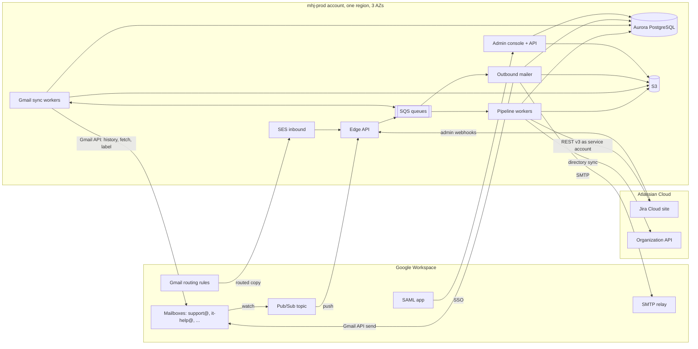
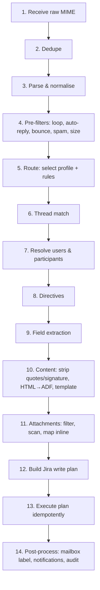

# Enterprise Mail Handler for Jira — Product & Technical Specification

| | |
|---|---|
| **Status** | Draft v0.3, for review |
| **Date** | 2026-10-12 |
| **Working name** | **MHJ** (Mail Handler for Jira). Placeholder; final name TBD |
| **Target platform** | Jira Cloud Enterprise with Atlassian Guard Premium. Jira Software first |
| **Mail platform** | Google Workspace only |
| **Distribution** | Private deployment for a single organisation, in the organisation's AWS accounts, operated by its own team |
| **Reference product** | Feature parity target: *Enterprise Mail Handler for Jira (JEMH)* by The Plugin People |

> **Clean-room note.** MHJ is an independent implementation. It aims for *functional* parity with the
> reference product, based only on publicly documented behaviour. We do not reuse its code, UI assets,
> help text, configuration file formats or trademarks.

---

## Decision log

| # | Date | Decision | Consequence |
|---|---|---|---|
| D1 | 2026-10-12 | **Private deployment for one organisation**, not a Marketplace app. | Standalone AWS service calling Jira as a service account. Single-tenant: no multi-tenant isolation, licensing or billing. No Forge/Connect requirement. |
| D2 | 2026-10-12 | **Jira Cloud only.** | Jira REST API v3 and ADF only. No Data Center/Server adapter. |
| D3 | 2026-10-12 | **App-authored comments with attribution are acceptable.** | v1 posts all comments as the MHJ service account with an attribution line (§10.4). |
| D4 | 2026-10-12 | **AWS** hosting. | Terraform-managed stacks (§26). |
| D5 | 2026-10-12 | **No import of JEMH configurations.** | MHJ has its own YAML config format only. |
| D6 | 2026-10-12 | **Operated by the organisation's own team** in its own AWS accounts. | Infrastructure requirements, ownership and operating procedures are part of this spec (§26). |
| D7 | 2026-10-12 | **Multiple mailboxes per domain** must be supported. | Domain → mailbox → alias model (§6.1); onboarding many mailboxes is a routine admin task. |
| D8 | 2026-10-12 | **Google Workspace only.** Domain-wide delegation (DWD) **only when the security team says it is absolutely required.** | Microsoft 365 and generic IMAP removed. Mailbox access defaults to per-mailbox OAuth or a mailbox-free routed copy; DWD is an exception path (§6.2). |
| D9 | 2026-10-12 | **Jira Software first.** | Pilot targets Jira Software projects. JSM-specific features move to Phase 3 (§16). External comment policy designed for Jira Software (§15.2). |
| D10 | 2026-10-12 | **Jira Cloud Enterprise with Atlassian Guard Premium.** | Service accounts and the Organization API are expected to be available (spikes S1, S2). Guard data security policies and IP allowlisting must include MHJ (§26.10). |
| D11 | 2026-10-12 | *Proposed:* **Google Workspace is the sign-in provider for the MHJ admin console.** | SAML app in Google Workspace, group-based roles (§17.1). Pending confirmation. |

---

## Table of contents

1. [Summary](#1-summary)
2. [Goals and non-goals](#2-goals-and-non-goals)
3. [Personas and key use cases](#3-personas-and-key-use-cases)
4. [Deployment model](#4-deployment-model)
5. [System architecture](#5-system-architecture)
6. [Google Workspace mail integration](#6-google-workspace-mail-integration)
7. [Inbound processing pipeline](#7-inbound-processing-pipeline)
8. [Routing: profiles and rules](#8-routing-profiles-and-rules)
9. [Threading and correlation](#9-threading-and-correlation)
10. [Users and non-Jira participants](#10-users-and-non-jira-participants)
11. [Content handling and formatting templates](#11-content-handling-and-formatting-templates)
12. [Custom field extraction](#12-custom-field-extraction)
13. [Inline command directives](#13-inline-command-directives)
14. [Attachment handling](#14-attachment-handling)
15. [Outbound notifications](#15-outbound-notifications)
16. [Jira Service Management (Phase 3)](#16-jira-service-management-phase-3)
17. [Administration console](#17-administration-console)
18. [Message log, audit, reprocessing and test bench](#18-message-log-audit-reprocessing-and-test-bench)
19. [Data model](#19-data-model)
20. [APIs](#20-apis)
21. [Security](#21-security)
22. [Privacy, retention and compliance](#22-privacy-retention-and-compliance)
23. [Non-functional requirements](#23-non-functional-requirements)
24. [Reliability and failure handling](#24-reliability-and-failure-handling)
25. [Observability](#25-observability)
26. [Infrastructure requirements](#26-infrastructure-requirements)
27. [Technology stack and repository layout](#27-technology-stack-and-repository-layout)
28. [Testing strategy](#28-testing-strategy)
29. [Delivery phases](#29-delivery-phases)
30. [Open questions](#30-open-questions)
31. [Assumptions to validate (technical spikes)](#31-assumptions-to-validate-technical-spikes)
32. [Glossary](#32-glossary)

---

## 1. Summary

MHJ is a privately hosted service, running in the organisation's AWS accounts and operated by its own team. It
connects the organisation's Google Workspace mailboxes to its Jira Cloud site and turns email into Jira work:

- **Ingestion and routing.** It receives mail for any number of Google Workspace mailboxes across one or more
  domains. Ordered rules match on sender, recipients, headers and content, then create issues, add comments,
  transition issues, or drop/forward the message.
- **Participation without a Jira account.** Anyone with an email address can raise a ticket, be copied
  on it, receive templated notifications, and reply by email. Their replies thread back onto the same issue.
- **Rich processing.** Custom field extraction, inline command directives (for example setting the reporter
  or priority from the email text), HTML-to-Jira formatting, quote and signature stripping, and full
  attachment handling including inline images.
- **Enterprise posture.** Least-privilege Google access (no domain-wide delegation by default), OAuth 2.0,
  secrets in AWS Secrets Manager, SSO for admins, full audit trail, reprocessing, dry-run testing and
  production SLOs.

## 2. Goals and non-goals

### 2.1 Goals

| # | Goal |
|---|---|
| G1 | Convert inbound email into Jira issues, comments and field updates through configurable profiles and rules. |
| G2 | Let non-Jira users take part in issue conversations entirely through email. |
| G3 | Support custom field extraction, inline directives, formatting templates and attachments. |
| G4 | Support many Google Workspace mailboxes and aliases per domain, with least-privilege access. |
| G5 | Run as a production-grade, highly available service in the organisation's AWS accounts, operable by its own team. |
| G6 | Give administrators full visibility: message log, rule trace, audit history, reprocess and dry run. |
| G7 | Reach functional parity with the reference product's core Cloud feature set for Jira Software by end of Phase 2. |

### 2.2 Non-goals

- Atlassian Marketplace distribution, multi-tenancy, licensing and billing (D1).
- Jira Data Center or Server (D2).
- Importing JEMH configurations (D5).
- Microsoft 365, Exchange, generic IMAP or POP3 mailboxes (D8).
- JSM-specific features before Phase 3 (D9).
- A general helpdesk UI. Jira remains the agent UI.
- Sending marketing or bulk email.
- Hosting mailboxes. MHJ reads from and sends through Google Workspace.

## 3. Personas and key use cases

| Persona | Description |
|---|---|
| **MHJ admin** | Owns MHJ configuration: mailboxes, profiles, rules, templates, security settings. |
| **Project admin** | Manages profiles and notification rules for their project(s) when delegated by an MHJ admin. |
| **Agent / team member** | Works the issues in Jira. Comments in Jira; MHJ emails external participants. |
| **External requester** | Customer, vendor or colleague with no Jira account. Only uses email. |
| **Internal Jira user (emailer)** | Has a Jira account but prefers email. |
| **Automated sender** | Monitoring tools, forms, CI systems that send structured email. |
| **Platform team** | Operates the AWS deployment: provisioning, upgrades, on-call, backups (§26.1). |
| **Google Workspace admin** | Grants mailbox access, sets routing rules, manages the SAML app and SMTP relay. |
| **Atlassian org admin** | Creates the service account, webhooks, custom fields, and Guard policy exceptions. |
| **Security team** | Approves access models (per mailbox), reviews DWD exceptions, receives security alerts. |

### 3.1 User stories (acceptance-level)

1. **Team inbox.** Mail to `platform-requests@acme.com` creates a Task in Jira Software project `PLAT`. The sender
   becomes the reporter if they have a Jira account; otherwise the default reporter is used and the sender is stored
   as an email participant. CC'd addresses become participants.
2. **Many mailboxes, one domain.** `it-help@`, `facilities@` and `security-reports@acme.com` each route to their
   own project and issue type. Adding a new mailbox takes an admin minutes, not a deployment.
3. **Reply threading.** A reply from any participant, whether through their mail client or to MHJ's
   notification, is added as a comment on the original issue and is never duplicated.
4. **Internal user replies by email.** A Jira user replies to a notification. The reply is added as a comment with
   an attribution line naming them; quoted history and signatures are removed.
5. **Routing by recipient and content.** Mail to `billing@` goes to `FIN`, and subjects matching
   `/^\[P1\]/` get priority Highest with label `p1`.
6. **Structured alerts.** A monitoring email with `Host: db-07` and `Severity: critical` in the body
   fills custom fields *Host* and *Severity*. Repeat alerts for the same host comment on the open issue instead of
   creating duplicates.
7. **Directive.** An internal user writes `#reporter jane@acme.com` and `#priority High` at the top of
   a forwarded email. The issue is created with Jane as reporter and priority High, and the directive lines do not
   appear in the description.
8. **Attachments.** Attachments and inline images arrive as Jira attachments. Inline images render in place
   inside the description or comment. Blocked types (for example `.exe`) are rejected and the rejection is noted on the issue.
9. **Notifications to externals.** When an agent adds an unrestricted comment, every external participant gets a
   branded email from the project's mailbox address with the comment, and their reply threads back. Restricted
   comments are never emailed out.
10. **Loop safety.** Auto-replies, bounces and mail sent by MHJ itself never create issues or comment loops.
11. **Audit and recovery.** An admin can see why a message went to the wrong project (rule trace), correct
    the rule, and reprocess the message.

## 4. Deployment model

### 4.1 Hosting and ownership

- Single-tenant deployment in the organisation's AWS accounts (`mhj-prod`, `mhj-staging`), operated by the
  organisation's platform team. Full infrastructure requirements are in §26.
- **One primary region**, matching the organisation's Jira Cloud data residency location, across **three
  Availability Zones**, with backups copied to a second region for disaster recovery.

### 4.2 Connecting to Jira Cloud

MHJ calls Jira as a non-human identity with its own name ("Mail Handler"), so its actions are clearly
attributable in issue history and in Atlassian Guard audit logs.

| Option | How | Status |
|---|---|---|
| **A. Atlassian service account with OAuth 2.0 client credentials** (preferred) | Created in Atlassian Administration. MHJ exchanges client ID and secret for short-lived access tokens and calls `https://api.atlassian.com/ex/jira/{cloudId}/rest/api/3/…`. Scopes limited to what MHJ needs. | Expected to be available on Enterprise with Guard Premium; confirm in spike **S1**. |
| **B. Service account with a scoped API token** | Same identity; token stored in Secrets Manager and rotated before expiry. | Fallback. |

The service account is added to a Jira group `mhj-service` that receives, in the permission schemes of the projects
MHJ serves only: *Browse projects*, *Create issues*, *Edit issues*, *Transition issues*, *Add comments*,
*Create attachments*, *Link issues*, *Modify reporter*, *Assign issues* and *Manage watchers*.

A private **Forge app is not required** for v1. It becomes an optional add-on in Phase 3 for an in-Jira issue
panel and for posting comments as the real user (§10.4).

### 4.3 Jira events (for outbound notifications)

Jira Cloud **admin webhooks** send issue and comment events to MHJ, filtered by JQL to the projects MHJ serves.
Webhooks are signed with a shared secret (HMAC) and verified by MHJ. A reconciliation job queries recent changes
through JQL (`updated >= -10m`) to catch missed deliveries (spike **S5**).

## 5. System architecture

### 5.1 Context diagram



### 5.2 Components

| Component | Responsibility |
|---|---|
| **Edge API** | Receives Gmail Pub/Sub pushes, SES/SNS events and Jira webhooks. Verifies signatures and tokens, then enqueues. Does no heavy work. Behind an ALB with AWS WAF. |
| **Gmail sync workers** | Per-mailbox sync state machines for Gmail API mailboxes: watch renewal, history reconciliation, raw MIME fetch, post-fetch labelling. |
| **Pipeline workers** | Stateless stages from parse to Jira write (§7). Idempotent and horizontally scaled. |
| **Jira gateway** | Library used by the workers; the only code that calls Jira. Token acquisition and caching, rate limiting, retries, field-metadata cache. |
| **Directory sync** | Keeps an email → accountId directory of the organisation's managed Atlassian accounts (§10.1). |
| **Outbound mailer** | Renders notification templates and sends through the Gmail API or Google Workspace SMTP relay, with correct threading headers (§6.5). |
| **Scheduler** | EventBridge Scheduler jobs: watch renewals, reconciliation, webhook catch-up, directory sync, retention purges, credential checks. |
| **Admin console + API** | React single-page app (S3 + CloudFront) and the admin REST API. SSO through Google Workspace (§17.1). |
| **Scanner** | Attachment malware scanning (ClamAV tasks, or a pluggable vendor). |

### 5.3 Key abstractions

```ts
interface MailSource {               // GmailApiSource, RoutedCopySource (SES), DwdSource
  start(mailbox): Promise<void>;
  sync(mailbox, cursor): AsyncIterable<RawMessageRef>;
  fetchRaw(ref): Promise<Readable>;  // RFC 5322 bytes
  postProcess(ref, action): Promise<void>;   // no-op for routed copy
}

interface MailSender {               // GmailApiSender, SmtpRelaySender, SesSender
  send(fromAddress, mime: Buffer, threadHint?): Promise<SentRef>;
}

interface JiraClient {               // Jira Cloud REST v3
  createIssue(plan): Promise<IssueRef>;
  addComment(issue, adf, opts): Promise<CommentRef>;
  updateFields(issue, fields): Promise<void>;
  transition(issue, transitionNameOrId, fields?): Promise<void>;
  addAttachments(issue, files): Promise<AttachmentRef[]>;
  setProperty(issue, key, value): Promise<void>;
  searchJql(jql, fields): Promise<IssueRef[]>;
  getCreateMeta(project, issueType): Promise<FieldMeta[]>;
  checkPermissions(accountId, project, permissions): Promise<Record<string, boolean>>;
}
```

## 6. Google Workspace mail integration

### 6.1 Domains, mailboxes and aliases

MHJ models mail in three levels so that one domain can have many monitored addresses:

| Level | Meaning | Examples |
|---|---|---|
| **Mail domain** | A Google Workspace primary or secondary domain (or a domain alias). Holds defaults: outbound method, branding, fallback profile, internal-domain flag. | `acme.com`, `acme.co.uk` |
| **Mailbox** | One monitored Google Workspace user mailbox, with its own access mode (§6.2), sync state, health and default profile. | `support@acme.com`, `it-help@acme.com` |
| **Address** | Any address that lands in a mailbox: the mailbox itself, its Workspace user aliases, and Google Groups it belongs to. Each address can be bound to its own profile. | `billing@acme.com` (alias of `support@`), `sec-team@acme.com` (group) |

- The address that was actually used is taken from `Delivered-To`, then `To`/`CC` matched against known addresses,
  so one mailbox can serve several projects.
- Adding a mailbox is an admin-console task: choose access mode, authorise, bind a profile, send a test email.
  Bulk onboarding imports a CSV of addresses and profiles; each mailbox then needs its authorisation step.
- **Google Groups and collaborative inboxes** cannot be read through the Gmail API. Either add a monitored
  mailbox as a group member, or use routed-copy mode (§6.4).
- Sizing target: at least 200 mailboxes across at least 10 domains (§23).

### 6.2 Access modes (per mailbox)

DWD gives an app access to *every* mailbox in the domain, so it is only used when the security team approves it
(D8). Each mailbox uses one of three modes:

| Mode | How MHJ gets mail | Google access granted | Pros | Cons |
|---|---|---|---|---|
| **A. Routed copy** | A Gmail routing rule (or group membership) delivers a copy of the mailbox's mail to an MHJ address on the SES inbound subdomain. | **None to any mailbox.** MHJ never reads mailboxes. | Least privilege; works for groups and collaborative inboxes; no tokens to expire. | No "processed" labels in Gmail; outbound needs the SMTP relay; SPF/DMARC must be read from Google's ARC headers (spike **S6**). |
| **B. Per-mailbox OAuth** (default when mailbox state matters) | Gmail API with an OAuth token granted by signing in *as that mailbox account* once. | `gmail.modify` and `gmail.send` on **that mailbox only**. | Full feature set: labels, reconciliation from Gmail history, sends appear in the mailbox's Sent folder. | Mailbox must be a licensed user; the token is revoked if the mailbox password changes and must be re-authorised (health alert). |
| **C. Domain-wide delegation** (exception only) | Gmail API, service account impersonating each mailbox. | Gmail scopes for **all** users in the domain. | No per-mailbox consent; tokens never expire. | Broadest access; only with written security-team approval, recorded in the audit log. |

The security team chooses the mode per mailbox. The admin console shows the mode of every mailbox, and changes to
mode C require the `mhj-security-approver` role (§17.1).

### 6.3 Gmail API mailboxes (modes B and C)

| Aspect | Design |
|---|---|
| **Google Cloud project** | Owned by the organisation (`mhj-prod`, `mhj-staging`). Gmail API and Pub/Sub enabled. OAuth consent screen set to **Internal**, so only the organisation's users can authorise and Google app verification is not required. |
| **OAuth client** | Web client; authorization code + PKCE; `access_type=offline`. Marked **Trusted** in Admin console → Security → API controls, so app-access policies do not block it, and exempted from Google Cloud session-control reauthentication. |
| **Scopes** | `https://www.googleapis.com/auth/gmail.modify`, `https://www.googleapis.com/auth/gmail.send`. |
| **Authorisation flow (mode B)** | An MHJ admin starts "Authorise mailbox"; the mailbox account signs in (the person holding its credentials, typically IT). The refresh token is stored in Secrets Manager. The signed-in address must equal the mailbox address, otherwise the token is rejected. |
| **Change detection** | `users.watch` on the watched label, delivering to one Pub/Sub topic per environment with an authenticated push subscription to the Edge API. The notification carries the mailbox address and `historyId`; MHJ then calls `users.history.list`. Watches renew every 24 h (they expire after 7 days). |
| **Reconciliation** | Every 5 min, plus on startup: `history.list`. If the `historyId` is too old (HTTP 404), full resync with `messages.list q="label:<watched> -label:MHJ/Processed"`. |
| **Fetch** | `messages.get format=raw` → base64url-decode → stream to S3. |
| **Post-fetch** | Configurable per mailbox: add label `MHJ/Processed`, remove `INBOX`, mark read. Failures get label `MHJ/Failed`. MHJ never deletes mail. |
| **Quotas** | Per-mailbox token bucket for Gmail quota units; back off on 429/403 `rateLimitExceeded`. |
| **Token loss** | `invalid_grant` → mailbox state `auth_failed`, mail stays in Gmail, alert to admins; after re-authorisation, reconciliation catches up from the last `historyId`. |

### 6.4 Routed-copy mailboxes (mode A) and the SES inbound subdomain

- A dedicated subdomain such as `mhj-in.acme.com` has its MX pointed to **Amazon SES** inbound receiving.
- For each mode A mailbox, the Google Workspace admin adds a Gmail **routing rule** for that recipient: "also
  deliver to" `support.acme.com@mhj-in.acme.com` (or adds that address as a member of the group). Spam is not
  forwarded.
- SES receipt rules → S3 (encrypted) → SNS → Edge API. Unknown recipients on the subdomain are rejected.
- **Authenticity:** after Google relays the message, SES's SPF/DMARC verdicts describe Google's relay, not the
  original sender. MHJ validates the **ARC** chain and trusts the `ARC-Authentication-Results` sealed by
  `google.com` as the original verdict (spike **S6**). If the ARC chain is broken, the verdict is `unknown` and
  directives are refused.
- The subdomain can also receive mail directly (for example from monitoring tools), with SES's own verdicts.

### 6.5 Outbound sending

| Method | Used for | Notes |
|---|---|---|
| **Gmail API send** | Mode B/C mailboxes. | Sent as the mailbox (`From: support@acme.com`), threaded with `threadId`, appears in Sent, DKIM-signed by Google. Sending as an alias requires the alias to be a verified "Send mail as" address in that mailbox. |
| **Google Workspace SMTP relay** (`smtp-relay.gmail.com:587`, TLS) | Mode A mailboxes, and any mailbox where the admin prefers it. | Authenticated by the MHJ NAT gateway IPs (allowlisted in the relay settings), optionally with SMTP AUTH. Relay restricted to "only addresses in my domains". DKIM-signed by Google. Sent mail is not stored in the mailbox. Subject to Workspace relay sending limits. |
| **Amazon SES** | Addresses on the MHJ subdomain only. | DKIM and custom MAIL FROM on the subdomain. |

### 6.6 Mailbox health

States: `pending_auth` → `active` → `degraded` (repeated transient errors, watch renewal failing) →
`auth_failed` (token revoked) → `disabled`. For mode A, health means "mail received in the expected window"
(configurable silence alarm per mailbox, for example 24 h). A transition to `degraded` or `auth_failed`
shows a banner in the admin console, emails the admin contacts, raises a CloudWatch alarm, and optionally creates a
Jira issue in an ops project.

## 7. Inbound processing pipeline

Each stage is a pure function over a `MessageContext` that is persisted after every stage, so any stage can
be retried or replayed. Stages are driven by SQS queues; ordering is preserved per mailbox and per thread where
it matters (§24.2).



| # | Stage | Details |
|---|---|---|
| 1 | Receive | Store raw bytes at `s3://…/{mailbox}/{yyyy}/{mm}/{msgUuid}.eml` (SSE-KMS). Create a `message` row with status `received`. |
| 2 | Dedupe | Key = `Message-ID`, falling back to a SHA-256 of normalised headers and body when Message-ID is missing. The same message arriving in two monitored mailboxes (for example To and CC) is processed once, and the extra mailbox is recorded. |
| 3 | Parse | Streaming MIME parser with limits: depth ≤ 20, parts ≤ 500, header size ≤ 256 KB, total ≤ configured max (default 25 MB, Gmail's receive limit). Decode RFC 2047/2231, all charsets, TNEF `winmail.dat`, S/MIME and PGP detection (encrypted bodies are not decrypted; the message is flagged). Authentication results taken from Gmail's `Authentication-Results` (modes B/C) or the ARC chain (mode A). |
| 4 | Pre-filters | Drop or quarantine: messages from MHJ itself (signed `X-MHJ-Origin` header, §15.4); `Auto-Submitted` other than `no`; `Precedence: bulk/junk/list`; known auto-reply headers; DSN/`multipart/report` (to the bounce handler); sender on a deny list; DMARC fail (configurable); Gmail spam label; per-sender rate limit (default > 20 messages in 10 min to one issue → quarantine). |
| 5 | Route | Evaluate the profile and rule set for the receiving address (§8). Rules can stop processing (drop, forward, quarantine). |
| 6 | Thread match | Find the target issue if this is a reply (§9). This decides create vs comment, unless a rule forces one. |
| 7 | Users | Resolve the sender, To and CC to Jira users or external participants (§10). |
| 8 | Directives | Parse, authorise, apply and strip directives (§13). |
| 9 | Field extraction | Run the profile's field processors (§12). Validate against Jira field metadata. |
| 10 | Content | Pick the body part, sanitise, strip quotes and signatures, convert to ADF, apply the formatting template, enforce size limits (§11). |
| 11 | Attachments | Filter, scan, dedupe, map inline `cid:` references (§14). |
| 12 | Plan | Produce a declarative `JiraWritePlan` (create or comment, fields, transitions, links, participants, attachments). Stored for audit and dry run. |
| 13 | Execute | The Jira gateway applies the plan step by step. Each step has a deterministic idempotency key; completed steps are recorded so a retry resumes rather than repeats (§24.1). |
| 14 | Post-process | Gmail label (modes B/C), thread-map rows, acknowledgement email if configured, metrics, status `processed`. |

Message states: `received`, `filtered`, `quarantined`, `processing`, `processed`, `deferred`
(retryable error), `failed` (non-retryable or retries exhausted), `deleted` (purged).

## 8. Routing: profiles and rules

### 8.1 Concepts

- **Profile:** a named bundle of processing behaviour: default project and issue type, allowed projects,
  user-matching policy, participant handling, field processors, directive policy, content templates, attachment
  policy, notification set and threading policy. Profiles are reusable across mailboxes.
- **Rule:** an ordered `condition → actions` entry inside a profile. Rules refine or override the profile's
  defaults for the matching message.
- **Address binding:** maps an address (mailbox, alias or group, §6.1) to a profile.

Profile selection order:
1. Address binding for the address the message was delivered to (exact address, then plus-address base).
2. Mailbox default profile.
3. Mail domain fallback profile (which may simply be "quarantine").

### 8.2 Rule conditions

Conditions combine with `all` / `any` / `not`.

| Field | Operators |
|---|---|
| `from.address`, `from.domain`, `from.name` | `equals`, `in`, `matches` (RE2 regex), `in_list` (named list) |
| `to`, `cc`, `recipients` (to ∪ cc ∪ delivered-to) | `contains`, `contains_any`, `matches` |
| `subject` | `contains`, `starts_with`, `matches` |
| `body.text` | `contains`, `matches` (first 256 KB) |
| `header.<Name>` | `exists`, `equals`, `matches` |
| `attachment.count`, `attachment.name`, `attachment.type` | numeric and string operators |
| `auth.dmarc`, `auth.spf`, `auth.dkim` | `equals pass/fail/none/unknown` |
| `sender.kind` | `jira_user`, `external`, `unknown` |
| `sender.in_group` | Jira group membership |
| `sender.internal` | sender's domain is one of the organisation's mail domains |
| `thread.matched`, `thread.issue.status_category`, `thread.issue.project` | for reply-specific rules |
| `time` | business-hours calendar, weekday |
| `size` | bytes |

Regexes use **RE2** (linear time) to rule out ReDoS.

### 8.3 Rule actions

| Action | Effect |
|---|---|
| `set_project`, `set_issue_type` | Override the create target (must be in the profile's allowed projects). |
| `set_field` | Set any field to a literal or template expression. |
| `add_labels`, `set_components`, `set_priority`, `set_assignee`, `add_watchers` | Common shortcuts. |
| `force_create` / `force_comment` | Ignore or require a thread match. |
| `comment_policy` | For replies to resolved issues: `comment`, `reopen` (transition name), `create_new_linked`, or `reject_with_notice`. |
| `transition` | Run a named transition after create or comment. |
| `link_to` | Link to an issue key (from a regex capture) with a link type. |
| `use_field_processor` | Run an extra named processor. |
| `drop` | Stop and mark `filtered` (with reason). |
| `quarantine` | Hold for admin review. |
| `forward` | Forward the raw message to an address (for example an escalation list). |
| `reply_with_template` | Send an auto-acknowledgement. |
| `stop` | Do not evaluate later rules. |

### 8.4 Example configuration (YAML)

```yaml
profile: platform-requests
defaults:
  project: PLAT
  allowedProjects: [PLAT, INFRA]
  issueType: Task
  reporter:
    match: [jira_user]
    fallback: { accountId: "5f1c...", recordSenderIn: "Email Participants" }
  participants: { addCc: true, addTo: true, excludeOwnMailboxes: true }
  threading: { onResolved: reopen, reopenTransition: "Reopen" }
  attachments: { maxBytes: 26214400, deny: [exe, js, vbs, scr, bat, cmd, ps1] }
  directives: { enabled: true, allowFrom: { groups: ["jira-software-users"] }, requireDmarcPass: true }
  fieldProcessors: [kv-basic]
rules:
  - name: Infra alerts
    when: { all: [ { from.domain: { equals: "monitoring.acme.com" } }, { subject: { matches: "(?i)^\\[alert\\]" } } ] }
    then: [ { set_project: INFRA }, { set_issue_type: Bug }, { use_field_processor: alert-kv } ]
  - name: P1 subject tag
    when: { subject: { matches: "^\\[P1\\]" } }
    then: [ { set_priority: Highest }, { add_labels: [p1] } ]
  - name: Drop newsletters
    when: { header.List-Unsubscribe: { exists: true } }
    then: [ { drop: "mailing list" }, { stop: true } ]
```

Configuration can be edited in the console or imported/exported as YAML (validated against a published JSON
Schema), so it can live in source control and be promoted from `staging` to `prod`.

### 8.5 Config versioning

Every save creates an immutable config version. Messages record the version they were processed with. Admins
can diff versions and roll back. Reprocessing can use either the original or the current version.

## 9. Threading and correlation

Replies are matched to issues by the first successful strategy below. Each strategy can be switched off per profile.

| Order | Strategy | Notes |
|---|---|---|
| 1 | **Message-ID map** | `In-Reply-To` and `References` looked up in the `thread_map` table, which holds every inbound Message-ID processed and every outbound Message-ID sent, mapped to the issue (and comment). The most reliable strategy. |
| 2 | **Reply-address token** | Outbound notifications use `Reply-To: support+t.<token>@acme.com` (Gmail plus-addressing), where the token is an HMAC-signed issue reference. Works even when the client drops headers. Optional. |
| 3 | **Hidden body marker** | An invisible marker in outbound HTML plus a visible footer reference (`Ref: PLAT-123 · do not edit`). |
| 4 | **Issue key in subject** | `[PLAT-123]` or a configurable regex. Restricted to the profile's allowed projects, and optionally to senders already on the issue (to stop key-guessing into unrelated issues). |
| 5 | **Content correlation** | Rule-driven, for alerts: "open issue in project X where field *Host* = extracted host" (JQL template). |

Security: a thread match into a project outside the profile's allowed projects is rejected and treated as a new
message. For external senders not already on the issue, the `onUnknownParticipantReply` policy decides:
`comment_and_add`, `comment_only`, `create_new`, or `quarantine`.

## 10. Users and non-Jira participants

### 10.1 Sender resolution

1. **Directory lookup.** Jira's user search does not reliably return email addresses because of Atlassian profile
   privacy settings, so MHJ keeps its own directory:
   - **Organization API sync** (nightly full sync plus incremental every 15 min) using a read-only Atlassian
     organisation API key, which lists managed accounts with their email addresses (spike **S2**);
   - an **alias table** maintained by admins for secondary addresses and Workspace aliases that are not the primary
     Atlassian email;
   - a direct Jira user search as a last resort.
2. **External participant:** no Jira account. The sender is stored on the issue as an email participant.

### 10.2 Reporter

- Matched Jira user → reporter, if they can create issues in the project (checked with the permissions API).
- Otherwise → the profile's **default reporter** (the MHJ service account or a nominated account). The real sender
  is recorded in the *Email Participants* field, an *Original Sender* field, and the description header.
- A directive can override the reporter (§13), subject to authorisation.

### 10.3 Email Participants

- Stored in MHJ's `participant` table (the source of truth for notification fan-out) and mirrored to a Jira custom
  field **Email Participants** (multi-line text, one `Name <address>` per line) so agents can see and edit it in
  Jira. An optional **Original Sender** text field holds the first sender.
- Agent edits to the field arrive through the `issue_updated` webhook and are synced back into the `participant`
  table, so agents can add or remove participants without leaving Jira.
- CC and To addresses (minus monitored addresses and, if configured, internal domains) are added on create and on
  every reply.
- Participants who are Jira users are recorded but, by default, not emailed by MHJ, because Jira notifies them
  itself (configurable).
- Participants can unsubscribe through an HMAC-signed link in every email (§15.5).

### 10.4 Comment authorship

v1 (D3): every comment is created by the **MHJ service account**, with an attribution line at the top:

> **Jane Doe** (jane@acme.com) replied by email:

For matched Jira users the attribution can include an `@mention`. Visibility follows the profile: unrestricted by
default, or restricted to a role/group (for example for mail from external senders that should be triaged first).

Phase 3 option: post comments **as the real user** through a private Forge app with user impersonation, where the
user has granted consent. Only built if attribution proves insufficient.

## 11. Content handling and formatting templates

### 11.1 Body selection and sanitisation

- Prefer `text/html` when present; otherwise `text/plain` (format=flowed aware); otherwise the first text part.
- Sanitise HTML with an allowlist (no scripts, styles, event handlers, forms, iframes or tracking pixels).
  Remote images are **not fetched** by default (SSRF and privacy); an optional allowlisted fetch proxy can be enabled.

### 11.2 Quote and signature stripping (replies)

- Our own marker `##- Reply above this line -##` in outbound mail is the most reliable cut point.
- Client-specific detectors: Gmail (`div.gmail_quote`), Outlook (`#divRplyFwdMsg`, "From: … Sent: …" blocks,
  `-----Original Message-----`), Apple Mail (`blockquote[type=cite]`), Thunderbird (`.moz-cite-prefix`),
  plain-text `>` blocks and "On <date>, <name> wrote:" (English at launch; other languages configurable).
- Signatures: RFC 3676 `-- ` delimiter, mobile footers ("Sent from my iPhone"), and per-profile custom regexes.
- If stripping removes everything, fall back to the full body (never post an empty comment).
- A per-profile option attaches the original full email as `.eml` (always, never, or only when truncated or stripped).

### 11.3 Conversion to Jira format

- HTML → **ADF** converter (our own, fully tested): paragraphs, headings, bold/italic/strike/underline,
  links, lists (nested), tables, blockquote, code/pre, horizontal rule, inline images → ADF media nodes
  referencing uploaded attachments, mentions for matched users (optional).
- Size limit: Jira text fields default to a 32,767-character limit. Content over the limit is truncated with a
  notice, and the full body is attached as `email-body.html`.

### 11.4 Formatting templates

Admins choose how the description or comment is laid out, using a **sandboxed Liquid** engine (LiquidJS
with strict variables, no filesystem access, render timeout of 200 ms and output cap). The template produces a
Markdown subset, which MHJ converts to ADF.

Available variables (subset):

```text
message.subject, message.date, message.from.{name,address}, message.to[], message.cc[],
message.body (cleaned, as markup), message.body_full, message.headers['X-Foo'],
message.auth.{spf,dkim,dmarc}, mailbox.address, address.used, profile.name,
extracted.<fieldKey>, issue.key (comments only), sender.kind, attachments[]
```

Default *new issue* template:

```liquid
{{ message.body }}

----
| From | {{ message.from.name }} <{{ message.from.address }}> |
| To | {{ message.to | join: ", " }} |
| CC | {{ message.cc | join: ", " }} |
| Received | {{ message.date | date: "%Y-%m-%d %H:%M %Z" }} |
```

The **summary** has its own template (default `{{ message.subject | strip_reply_prefixes | default: "(no subject)" }}`,
truncated to 255 characters).

## 12. Custom field extraction

### 12.1 Field processors

A profile holds an ordered list of processors. Each emits candidate `(fieldRef, rawValue)` pairs.

| Processor | Description |
|---|---|
| **Key–value lines** | Lines like `Severity: critical` or `Customer ID = 4411`. Configurable separators, key aliases (`Sev`, `Severity` → *Severity*), case-insensitive, optionally limited to a delimited block (`--- details ---`). |
| **Regex** | RE2 patterns with named groups mapped to fields; scoped to subject, body, a header, or an attachment's text. |
| **HTML table** | Two-column tables (label/value), such as web-form emails. |
| **Header mapping** | For example `X-Priority: 1` → Priority Highest; `X-Customer` → custom field. |
| **Structured attachment** | JSON, XML (XPath) or CSV attachment → fields (for machine senders). |
| **Sender lookup** | Domain or address → value from a named lookup table (for example `vendor.com` → Vendor "Vendor Ltd"). |
| **Static** | Constant values. |
| **Template** | A Liquid expression combining other extracted values. |

### 12.2 Value conversion

MHJ loads field metadata (`createmeta` per project and issue type, cached for 10 min and invalidated on error),
then converts:

| Jira field type | Accepted input |
|---|---|
| Text / paragraph (ADF) | Any string; paragraphs go through the content converter. |
| Number | Locale-aware parsing (`1,234.5`, `1.234,5`). |
| Date / date-time | ISO 8601 and common formats, plus natural phrases (`tomorrow`, `next friday`) in the profile's time zone. |
| Select / radio / multi-select / checkbox | Match option value case-insensitively, plus an alias map; unknown values follow a policy (`ignore`, `fail`, `default`). |
| Cascading select | `Parent > Child`. |
| User / multi-user picker | Email or accountId, resolved through §10.1. |
| Labels | Space- or comma-separated; normalised (no spaces). |
| Components / versions / fix versions / sprint | By name (sprint: open sprints on the project's board). |
| Priority, issue type, parent (epic) | By name or key. |
| URL | Validated URL. |
| JSM request type, organization, Assets (Phase 3) | By name / AQL lookup. |

Extraction outcomes are written to the message trace. A field that cannot be converted never blocks issue
creation unless the field is marked `required` in the processor config; in that case the policy is `fail`
(and the message is deferred for admin attention) or `use_default`.

## 13. Inline command directives

Directives let trusted senders steer processing from inside the email.

### 13.1 Syntax

- A directive is a line whose first non-space characters are `#` followed by a registered directive name.
  Directives are recognised only in the **directive block**: the leading lines of the body before the
  first ordinary text line (configurable to also allow a trailing block, or the subject).
- An alternative prefix (for example `@mhj`) can be configured for teams who use hashtags in normal text.
- Values may be quoted. Multiple values are comma-separated.

```ebnf
directive   = ws* prefix name ( ws+ | ws* ("=" | ":") ws* ) value? ws* EOL ;
prefix      = "#" | configured-prefix ;
name        = letter { letter | digit | "-" | "_" } ;
value       = quoted | bare { ws* "," ws* (quoted | bare) } ;
quoted      = '"' { any-char-but-quote | '\"' } '"' ;
```

Example:

```text
#reporter jane.doe@acme.com
#priority High
#labels vip, renewal
#field "Customer Tier" = Gold
#watchers ops-lead@acme.com

Hi team, please see the forwarded request below...
```

### 13.2 Built-in directives

| Directive | Effect | Applies to |
|---|---|---|
| `#project KEY` | Target project (must be in the profile's allowed projects). | create |
| `#issuetype Name` | Issue type. | create |
| `#summary text` | Override summary. | create, update |
| `#reporter email|accountId` | Set reporter. | create |
| `#assignee email|accountId|unassigned|me` | Set assignee. | create, comment |
| `#priority Name` | Set priority. | create, comment |
| `#labels a, b` / `#label+ x` / `#label- y` | Set, add or remove labels. | create, comment |
| `#component(s) A, B` | Set components. | create, comment |
| `#fixversion V` / `#sprint Name` / `#epic KEY` | Planning fields. | create, comment |
| `#duedate 2026-11-01 | +3d` | Due date. | create, comment |
| `#watchers a@x, b@y` | Add watchers (Jira users). | create, comment |
| `#cc a@x` / `#uncc a@x` | Add or remove email participants. | create, comment |
| `#field "Name" = value` | Set any field, converted per §12.2. | create, comment |
| `#transition "In Progress"` | Run a transition. | comment |
| `#resolve [Resolution]` | Transition to done with a resolution. | comment |
| `#link KEY [link-type]` | Create an issue link. | create, comment |
| `#internal` | Restrict the comment to the profile's internal role/group; it is never emailed to externals. | comment |
| `#nocomment` | Apply directives but don't post the body. | comment |
| `#new` | Force a new issue even if a thread matches. | any |

### 13.3 Processing

1. Parse the directive block, then **strip** the directive lines from the body before content processing.
2. Validate each directive (known name, value converts, target exists).
3. Authorise each directive (§13.4).
4. Apply to the write plan. Results (applied, rejected, and why) are logged in the message trace and optionally
   reported to the sender in a "directive results" reply.

### 13.4 Security model

MHJ writes to Jira as a privileged service account, so directives must not let a sender do more than they could
do themselves:
- **Off by default.** Enabled per profile.
- **Sender allow policy:** Jira groups, specific addresses or domains. External participants can never use
  directives unless explicitly allowlisted.
- **Authenticated mail required:** the message must pass **DMARC** (or SPF+DKIM alignment) according to Gmail's
  `Authentication-Results` (modes B/C) or the validated ARC chain (mode A). This stops spoofed `From:` headers from
  applying directives.
- **Per-directive allowlist:** each profile chooses which directives are enabled (for example allow `#priority`,
  deny `#reporter`).
- **Permission check:** a directive is applied only if the sender's Jira account holds the matching Jira permission
  in the project (for example *Modify Reporter*, *Assign Issues*, *Transition Issues*), checked with the bulk
  permissions API for their accountId.

## 14. Attachment handling

| Concern | Design |
|---|---|
| **Sources** | Regular attachments, inline parts (`Content-Disposition: inline` with `Content-ID`), TNEF contents, attached `.eml`/`message/rfc822` (option: attach as file, or extract its attachments as well). Google Drive links in Gmail are left as links. |
| **Filtering** | Per-profile allow/deny by extension *and* sniffed MIME type (magic bytes; a mismatch is treated as deny). Minimum size to ignore tracking pixels and tiny signature logos (default < 2 KB images in a signature block). Optional "ignore duplicate images already on this issue" using a SHA-256 hash. |
| **Size limits** | Per file and per message; also capped by the Jira site's attachment limit (read from `/rest/api/3/attachment/meta`). Oversize files are skipped with a notice comment and logged. |
| **Malware scanning** | Each file is scanned in an isolated scanner task before upload. Infected files are dropped and noted; on scanner outage the policy is `hold` (default) or `allow_unscanned`. |
| **Archives** | Not expanded. Nested `.eml` depth is limited. |
| **Naming** | Decode RFC 2231 filenames, strip path characters, de-duplicate with suffixes (`image (1).png`); unnamed inline images get `inline-<n>.<ext>`. |
| **Inline mapping** | `cid:` references in HTML are replaced with ADF media nodes pointing at the uploaded attachment. If the media reference can't be resolved, fall back to the attachment name and a link (spike **S4**). |
| **Comments** | Attachments on replies are attached to the issue and referenced in the comment ("Attachments: a.pdf, b.png"). |
| **Upload** | Streaming multipart upload to `/rest/api/3/issue/{key}/attachments` (`X-Atlassian-Token: no-check`), up to 3 in parallel, each step idempotent by hash + issue. |
| **Outbound** | Notifications may include new issue attachments (configurable, size-capped) or links only. |

## 15. Outbound notifications

### 15.1 Triggers

Jira admin webhooks (§4.3) for `jira:issue_created`, `jira:issue_updated` and `comment_created` /
`comment_updated`. Events caused by MHJ's own writes are recognised (the actor is the service account and the plan
step ID is stored as an issue/comment property) so they can be suppressed or treated differently.

### 15.2 External comment policy (Jira Software)

Jira Software has no built-in "public vs internal" comment, so each project chooses what is emailed to external
participants:

| Policy | Behaviour |
|---|---|
| `unrestricted` (default) | Every comment **without** a visibility restriction is emailed; comments restricted to a role or group never are. |
| `marked_only` | Only comments that start with a configured marker (for example `[reply]`) are emailed, with the marker removed. |
| `none` | No comment notifications; only status-change notifications if configured. |

### 15.3 Notification rules

Per project (or profile):
- **Event → template → recipients.** Recipients can be external email participants, an external reporter,
  or static addresses. Jira users are left to Jira's own notifications unless explicitly included.
- Conditions: comment policy (§15.2), author kind, issue type, status category, field values (predicate evaluated on
  the event payload).
- Batching: changes within 60 s are combined into one email per recipient (configurable).
- The sender's own action is not echoed back to them (configurable).
- Digest mode (Phase 3): hourly or daily summaries.

### 15.4 Templates

- Liquid templates for subject, HTML body and text body, with a responsive base layout and organisation
  branding (logo, colours, footer, legal text) per mail domain.
- Variables: `issue.*` (key, summary, status, fields by name), `event.*`, `comment.*` (rendered from ADF to
  email-safe HTML), `recipient.*`, `links.unsubscribe`. Jira links are only included for recipients who are Jira users.
- Per-language variants chosen by a profile default (English at launch).
- Live preview against a real issue in the admin console; test-send to the admin.

### 15.5 Sending and headers

- Sent from the **address the thread came in on** (or a configured default per project), using the sending method
  of that mailbox (§6.5).
- Headers: unique `Message-ID` (`<mhj.{uuid}@{domain}>`), `In-Reply-To` and `References` built from the thread map,
  `Reply-To` (optional plus-token, §9), `Auto-Submitted: auto-generated` for automated acknowledgements,
  `X-MHJ-Origin` (an HMAC over the message ID, used for loop detection), and `List-Unsubscribe` with
  `List-Unsubscribe-Post`.
- Subject format default: `[{{issue.key}}] {{issue.summary}}`.

### 15.6 Bounces and suppression

- DSNs (from §7 stage 4) are parsed (RFC 3464). Hard bounces mark the participant `bouncing` and stop sends;
  a note is added to the issue.
- Unsubscribe links set the participant to `unsubscribed` for that issue (or for all issues, per policy).
- A global suppression list is available.

## 16. Jira Service Management (Phase 3)

Deferred by D9. When needed, MHJ adds: request creation through the JSM API (`requestTypeId`, `raiseOnBehalfOf`,
`requestParticipants`), customer creation and Organization assignment, native public/internal comment visibility,
coordination with JSM's own customer notifications, and request type / organization / Assets field conversion. The
pipeline and `JiraClient` are designed so these slot in without restructuring.

## 17. Administration console

The **admin console** is the MHJ web application where admins connect mailboxes, edit profiles and rules, manage
templates and look at the message log. It is a standalone React single-page app served from CloudFront, with deep
links to Jira issues. Agents and requesters never use it; they use Jira and email.

### 17.1 Sign-in and roles

- **Single sign-on with Google Workspace** (D11, proposed): a custom SAML app in the Google Admin console, federated
  into an Amazon Cognito user pool. Access to the SAML app is limited to an organisational unit or group, and Google's
  2-Step Verification policy applies.
- Roles come from Google Groups sent as a SAML attribute:

| Google Group | MHJ role | Can do |
|---|---|---|
| `mhj-admins@` | Admin | Everything except approving DWD. |
| `mhj-project-admins@` | Project admin | Profiles, rules, templates and notification rules for the projects assigned to them in MHJ. |
| `mhj-viewers@` | Viewer | Read-only message log and dashboards. |
| `mhj-operators@` | Operator | Health, queues, reprocess, quarantine release. |
| `mhj-security-approvers@` | Security approver | Approve mode C (DWD) mailboxes and security policy changes. |

- Every API call is authorised server-side; the UI only hides what the role cannot use.
- Sessions: 8 h maximum, 30 min idle timeout.

### 17.2 Pages

| Page | Purpose |
|---|---|
| **Getting started** | Guided setup: verify Jira connection → add a mail domain → add a mailbox → bind a project → send a test email → see the issue. |
| **Jira connection** | Service account status, granted scopes, per-project permission check ("can MHJ create issues in PLAT?"), webhook status, directory sync status. |
| **Mail domains** | Domains, outbound method, branding, fallback profile, internal-domain flag. |
| **Mailboxes** | Add (single or CSV bulk), choose access mode, authorise / re-authorise, health, last mail received, backlog, pause/resume, post-fetch labels, address list (aliases, groups) and their profile bindings. Setup instructions for routing rules (mode A) are generated per mailbox. |
| **Profiles** | Defaults, allowed projects, user and participant policy, threading, attachments, directives, templates; clone; YAML import/export. |
| **Rules** | Ordered rule editor with a visual condition builder, raw YAML view, and per-rule hit counts. |
| **Field processors** | Processor editor with a live test panel (paste text, see extracted fields). |
| **Templates** | Content and notification templates, with a code editor, variable reference, preview and test-send. |
| **Notifications** | Per-project external comment policy (§15.2), notification rules and branding. |
| **Users & participants** | Directory sync status, alias table, lookup tables, suppression list, bounce status. |
| **Message log** | Search and filter; detail view (§18). |
| **Quarantine** | Review, release (with profile choice) or delete. |
| **Test bench** | Dry run (§18.3). |
| **Audit log** | Configuration changes and approvals: who, what, when, diff. |
| **Settings** | Data retention, security policies (DMARC requirement, remote images), admin contacts. |
| **Operations** | Queue depths, error rates, mailbox health summary, version and deployment info. |

Accessibility: WCAG 2.1 AA.

## 18. Message log, audit, reprocessing and test bench

### 18.1 Message log

- Columns: received time, mailbox, address used, from, subject, status, profile, result (issue key, comment link),
  duration, and errors.
- Filters: status, domain, mailbox, date range, sender, issue key, free text (subject/from).
- Detail view: headers, authentication results, rendered body, attachments with scan results, a **rule trace**
  (each rule: matched or not, and why), directive results, extraction results, the Jira write plan, executed steps
  with Jira responses, and timings.
- Actions: **Reprocess** (same or different profile, original or current config version), download `.eml`,
  release from quarantine, delete message (privacy request), and download a redacted diagnostic bundle.

### 18.2 Audit log

Immutable, append-only record of configuration changes, mailbox authorisations and access-mode changes (including
DWD approvals), reprocess and delete actions, and admin sign-ins. Exportable as CSV/JSON and streamed to the
organisation's SIEM (§26.8). Retained for 1 year by default.

### 18.3 Test bench (dry run)

- Input: upload `.eml`, paste raw MIME, compose a simple message, or pick a logged message.
- Choose mailbox/address, profile and config version (current or draft).
- Output: everything in §18.1's detail view **without any Jira write or email send**, plus a preview of the
  resulting issue and comment, and the notifications that would be sent.
- **Draft configs:** admins can edit a draft profile, run the test bench against it, then publish.

## 19. Data model

Single-tenant Aurora PostgreSQL. Main tables:

| Table | Key columns |
|---|---|
| `jira_connection` | id, cloud_id, site_url, auth_mode, secret_arn, scopes[], status, checked_at |
| `mail_domain` | id, domain, is_internal, outbound_method (gmail_api/smtp_relay/ses), branding (jsonb), fallback_profile_id |
| `mailbox` | id, domain_id, address, access_mode (routed_copy/oauth/dwd), dwd_approval_ref, watch_label, post_labels, default_profile_id, status, cursor (jsonb: historyId), lease_owner, lease_until, last_mail_at, silence_alarm_hours |
| `mail_address` | id, mailbox_id, address, kind (primary/alias/group/plus), profile_id, routed_copy_address |
| `credential` | id, mailbox_id, kind (oauth_refresh/dwd/smtp_auth), secret_arn, scopes[], authorised_by, authorised_at, last_ok_at |
| `profile` / `profile_version` | id, name, current_version_id, allowed_projects[]; version: id, config (jsonb, schema-validated), created_by, created_at, is_draft |
| `named_list` / `lookup_table` | name, entries (jsonb) |
| `template` / `template_version` | id, kind (content/summary/notification), locale, body, version |
| `notification_rule` | id, project_key, comment_policy, event, condition (jsonb), template_id, recipients (jsonb) |
| `message` | id, mailbox_id, address_used, message_id_hdr, dedupe_hash, from_addr, subject, received_at, status, profile_version_id, issue_key, s3_key, size, auth_verdict, error_code, trace (jsonb, or S3 if large) |
| `plan_step` | message_id, seq, kind, idempotency_key, status, jira_response_ref, attempts |
| `thread_map` | message_id_hdr, issue_id, comment_id, direction (in/out), created_at |
| `participant` | issue_id, address, display_name, role, status (active/unsubscribed/bouncing), account_id? |
| `directory_user` | account_id, email, display_name, active, source (org_api/alias/search), synced_at |
| `outbound_message` | id, issue_id, event_id, from_address, recipients, message_id_hdr, method, status, provider_ref, sent_at |
| `suppression` | address, reason, created_at |
| `role_assignment` | google_group, role, project_keys[] |
| `audit_event` | id, actor, action, target, diff (jsonb), at, ip_hash |

Raw MIME, large traces and attachment staging live in S3 (§26.5).

## 20. APIs

### 20.1 Inbound endpoints (Edge API)

| Endpoint | Caller | Verification |
|---|---|---|
| `POST /hooks/jira` | Jira admin webhooks | HMAC signature with the shared secret; replay window on timestamp. |
| `POST /hooks/gmail` | Google Pub/Sub push | OIDC token from the push subscription's service account; audience and email checks. |
| `POST /hooks/ses` | SNS | SNS message signature verification; topic ARN allowlist. |
| `GET /oauth/google/callback` | Browser (mode B authorisation) | `state` signed and bound to the admin session, mailbox ID and nonce; PKCE verifier; signed-in address must equal the mailbox address. |
| `GET /u/{token}` | Recipient | HMAC-signed unsubscribe/preferences link. |

All public endpoints sit behind AWS WAF with rate limiting. The admin API is only reachable with a valid Cognito
session.

### 20.2 Admin API

REST, JSON, versioned at `/v1`. Resources: `jira-connection`, `domains`, `mailboxes` (+ `authorise`, `addresses`,
`bulk-import`), `profiles` (+ `versions`, `drafts`, `import`, `export`), `rules`, `field-processors`, `templates`,
`notification-rules`, `lookups`, `aliases`, `messages` (+ `reprocess`, `raw`, `release`), `dry-run`, `audit`,
`settings`, `health`. An OpenAPI 3.1 document is generated from the code (zod schemas) and used to type the UI client.

### 20.3 Config deployment API (Phase 2)

A scoped, rotatable API key for CI/CD so configuration can be promoted from source control
(`PUT /v1/profiles/{name}` with YAML).

## 21. Security

### 21.1 Threat model highlights

| Threat | Mitigation |
|---|---|
| Over-broad mailbox access | No DWD by default; per-mailbox OAuth or routed copy; DWD needs security approval and is audited (§6.2). |
| Spoofed sender sets reporter or fields | DMARC/SPF/DKIM (or ARC) verdicts; directives off by default and allowlisted; per-user permission checks (§13.4). |
| Privilege escalation through the service account | Profiles have explicit allowed projects; service account only granted on MHJ projects; directive permission checks; every action audited. |
| Reply injection into unrelated issues | Allowed-project check on thread match; HMAC-signed reply tokens; unknown-participant policy (§9). |
| Mail loops and floods | Origin header, auto-reply detection, per-sender and per-issue rate limits, quarantine. |
| Malicious attachments | Type sniffing, deny lists, malware scanning, no archive expansion. |
| XSS through HTML email | Strict sanitiser; ADF output only; outbound templates escape by default. |
| SSRF via remote images or templates | No remote fetch by default; template sandbox has no network or filesystem access; egress allowlist (§26.3). |
| ReDoS through admin regexes | RE2 only; per-message processing time budget. |
| Parser exploits | Hardened streaming parser with limits; processing in memory-capped worker containers. |
| Credential theft | Secrets Manager + KMS; least-privilege IAM per service; credentials never sent to the browser; access logged in CloudTrail. |
| Forged webhooks | Signature/OIDC verification on every inbound hook (§20.1). |
| Relay abuse | SMTP relay limited to the organisation's domains and MHJ's static IPs; MHJ only sends from configured addresses. |

### 21.2 Secrets and keys

- Stored in **AWS Secrets Manager** under a customer-managed KMS key: Jira client credentials or API token, Gmail
  refresh tokens (one per mode B mailbox), DWD credentials (if approved), SMTP relay credentials (if used), Jira
  webhook secret, Atlassian organisation API key, HMAC keys.
- DWD (if approved) uses **Workload Identity Federation** from AWS to Google Cloud, so no long-lived Google
  service-account key exists.
- Rotation: Jira credentials and Atlassian org API key at least every 90 days, with expiry alarms 30 and 7 days
  ahead; HMAC keys rotate with an overlap window.

### 21.3 Application security

- Secure SDLC: threat modelling per feature, mandatory code review, SAST (Semgrep/CodeQL), dependency scanning,
  container scanning, secret scanning, signed images.
- Penetration test before go-live and annually.
- Production access: SSO + MFA, just-in-time, audited; no standing access to message content (§26.6).

## 22. Privacy, retention and compliance

- **Data processed:** email content, addresses, names, attachments, Jira accountIds. All of it stays in the
  organisation's AWS accounts and primary region (plus encrypted DR backups in the second region).
- **Retention defaults** (configurable): raw MIME 30 days (0–365), message metadata and traces 90 days,
  audit log 1 year, outbound log 90 days. Content written into Jira is governed by Jira's own retention.
- **Data subject requests:** admin-initiated search and erasure by email address across messages, participants,
  thread map and S3 objects; erasure is audited.
- **Closed Atlassian accounts:** the directory sync marks them inactive and removes their emails from the directory.
- **Organisation controls:** the deployment inherits the organisation's AWS landing-zone controls (§26.8).
  Specific compliance frameworks are open (§30).

## 23. Non-functional requirements

Sized for a single organisation. To be confirmed against real mail volumes (§30).

| Category | Requirement |
|---|---|
| Availability | 99.9% monthly for ingestion and outbound (excluding Google and Atlassian outages). Admin console 99.5%. |
| Latency (Gmail API mailboxes) | p50 ≤ 15 s, p95 ≤ 60 s from Gmail receipt to Jira write, for messages ≤ 5 MB. |
| Latency (routed copy) | p95 ≤ 60 s from Gmail receipt to Jira write. |
| Outbound latency | p95 ≤ 90 s from Jira event to send (excluding batching window). |
| Throughput | 20,000 inbound messages/day sustained, bursts of 10 messages/s for 10 min, autoscaling headroom to 5× without redesign. |
| Mailboxes | ≥ 200 mailboxes and ≥ 1,000 addresses across ≥ 10 domains, without UI or sync degradation. |
| Message size | Up to 25 MB (Gmail's receive limit). |
| Durability | No accepted message is lost: raw MIME is durably stored before the Gmail message is labelled. |
| RPO / RTO | RPO ≤ 5 min; RTO ≤ 1 h for an AZ or service failure; ≤ 8 h for loss of the primary region (§26.9). |
| Config scale | ≥ 200 profiles and 2,000 rules without UI degradation. |
| Internationalisation | Console in English; full Unicode in mail and fields; time zones per profile. |

## 24. Reliability and failure handling

### 24.1 Idempotency and exactly-once effects

- Queues are at-least-once; effects are made **effectively once** by:
  - message dedupe (§7 stage 2);
  - plan steps with deterministic idempotency keys (`hash(messageUuid, stepSeq, kind)`), stored before the
    Jira call;
  - for creates, an issue property `mhj.sourceMessage=<uuid>` set right after creation; on retry MHJ first searches
    for it (plus a hidden marker in the description) to avoid duplicate issues;
  - comments carry a comment property, which is checked before re-posting.
- The Gmail post-fetch label is applied only after durable storage (stage 1), and is itself retried.

### 24.2 Ordering and backpressure

- SQS FIFO message groups keyed by mailbox for ingestion and by issue for writes, so two replies to one issue are
  applied in order and never race.
- Jira gateway concurrency is adaptive: honour `Retry-After` and rate-limit headers, slow down on 429s.
- If Jira is down or rate-limited, messages wait in `deferred` with exponential backoff (max 24 h). Raw mail is safe
  in S3. Admins see a backlog indicator.

### 24.3 Error classes

| Class | Examples | Handling |
|---|---|---|
| Transient | 5xx, 429, timeouts, token refresh races | Retry with jittered exponential backoff (up to 10 attempts / 24 h). |
| Config | Unknown project, invalid field value, missing permission | `failed` with an actionable error ("Field 'Severity' option 'crit' not found"); admin notified (digest); reprocess after fix. |
| Content | Unparseable MIME, encrypted body | Process what is possible (raw `.eml` attached) or quarantine per policy. |
| Auth | Revoked Gmail token, expired Jira credential | Pause the mailbox or the Jira writes; mail stays in Gmail or S3; alert. |

Dead-letter queues per stage, with alarms and a replay tool.

### 24.4 Deployments

Rolling deployments on ECS with health checks and automatic rollback; backward-compatible DB migrations
(expand/contract); feature flags; changes go to `staging` first and are promoted to `prod` (§26.7).

## 25. Observability

- **Logs:** structured JSON, message UUID on every line, PII-minimised (no bodies; addresses hashed in platform
  logs; full detail only in the admin message log).
- **Metrics:** messages by status and stage, stage latency histograms, Jira API latency and 429 rate, Gmail sync
  lag and watch expiry horizon per mailbox, mailbox silence, queue depth and age, DLQ size, outbound send success
  and bounce rate.
- **Tracing:** OpenTelemetry (AWS X-Ray or the organisation's APM) across Edge → queue → stages → Jira.
- **Dashboards and alarms:** see §26.8.

## 26. Infrastructure requirements

Everything in this section is provisioned by Terraform from the MHJ repository unless marked **manual**.

### 26.1 Ownership (RACI)

| Activity | Platform team | MHJ dev team | Google Workspace admin | Atlassian org admin | Security team | DNS owner |
|---|---|---|---|---|---|---|
| AWS accounts, landing-zone guardrails | **A/R** | C | | | C | |
| Terraform apply (staging, prod) | **A/R** | R (staging) | | | I | |
| Application releases | A | **R** | | | I | |
| On-call (L1/L2) | **A/R** | R (L3) | | | I | |
| Google Cloud projects, Pub/Sub, OAuth client | C | R | **A** | | C | |
| Mailbox authorisation, routing rules, SMTP relay | | C | **A/R** | | C | |
| DWD approvals | | C | R | | **A** | |
| Jira service account, scopes, webhooks, custom fields | | C | | **A/R** | C | |
| Guard policies, IP allowlist | | C | | **A/R** | C | |
| DNS records | C | C | | | | **A/R** |
| Pentest, risk acceptance | I | C | | | **A/R** | |

### 26.2 AWS accounts and regions

| Item | Requirement |
|---|---|
| Accounts | `mhj-prod` and `mhj-staging` as member accounts in the organisation's AWS Organization, under its existing SCPs. Ephemeral `dev` stacks run in `mhj-staging` or a sandbox account. |
| Tooling | Terraform state in an S3 bucket with versioning and S3 native state locking, in the organisation's tooling/shared-services account (or in each workload account). |
| Primary region | Matches the Jira Cloud data residency location. **Must support SES email receiving**; if it does not, SES receiving runs in the nearest supported region in the same jurisdiction and writes into an S3 bucket there that the workers read cross-region (spike **S7**). |
| DR region | A second region in the same jurisdiction for backup copies (§26.9). |
| Service quotas to raise | Fargate On-Demand vCPU (≥ 64 for prod), Elastic IPs (≥ 3), SES sending (if SES used for the subdomain). Check SQS FIFO throughput mode (high-throughput FIFO enabled). |

### 26.3 Network

| Item | Requirement |
|---|---|
| VPC | One per account, `/22` from the organisation's IPAM (no overlap with corporate ranges in case of later peering). |
| Subnets | Three tiers × three AZs: **public** (ALB, NAT gateways), **private-app** (Fargate tasks), **private-data** (Aurora; no internet route). |
| Egress | One NAT gateway per AZ, each with an **Elastic IP**. These 3 static IPs are MHJ's public identity for Jira IP allowlisting and the Google SMTP relay allowlist. |
| Egress filtering | Route 53 Resolver **DNS Firewall** with an allowlist (below). AWS Network Firewall optional if the organisation requires packet-level egress filtering (adds roughly USD 900/month for 3 AZs). |
| VPC endpoints | Gateway: S3. Interface: SQS, Secrets Manager, KMS, ECR (api, dkr), CloudWatch Logs, STS, SNS. |
| Inbound | Internet-facing ALB (TLS 1.2+ policy) for `hooks` and `api` hostnames, protected by AWS WAF; CloudFront for the admin console. No other inbound paths. |
| Security groups | ALB → Edge/Admin API tasks only; tasks → Aurora 5432 only; no SSH anywhere (ECS Exec, audited, for break-glass). |

Egress allowlist (DNS Firewall):

| Destination | Purpose |
|---|---|
| `api.atlassian.com`, `auth.atlassian.com`, `<site>.atlassian.net` | Jira API, service-account tokens, Organization API |
| `oauth2.googleapis.com`, `gmail.googleapis.com`, `www.googleapis.com`, `sts.googleapis.com`, `iamcredentials.googleapis.com` | Gmail API, OAuth, Workload Identity Federation |
| `smtp-relay.gmail.com` (TCP 587) | Outbound via SMTP relay |
| `accounts.google.com` | OIDC discovery and token validation keys |
| ClamAV signature mirror (or an internal mirror / S3-hosted signatures) | Malware definitions |

### 26.4 Compute (ECS on Fargate, ARM64/Graviton)

| Service | Prod tasks (min / max) | vCPU / memory per task | Scales on |
|---|---|---|---|
| `edge-api` (webhooks) | 2 / 6 | 0.5 / 1 GB | ALB request count, CPU |
| `admin-api` | 2 / 4 | 0.5 / 1 GB | CPU |
| `worker-pipeline` | 2 / 20 | 1 / 2 GB | Age of oldest message in the process queue |
| `worker-gmail-sync` | 2 / 6 | 0.5 / 1 GB | Number of active mailboxes (leases) |
| `worker-outbound` | 2 / 6 | 0.5 / 1 GB | Queue depth |
| `scanner` (ClamAV) | 2 / 6 | 1 / 3 GB | Queue depth |
| Scheduled jobs (directory sync, retention purge, reconciliation) | on demand | 0.5 / 1 GB | EventBridge Scheduler |

- Tasks spread across all three AZs; minimum 2 per service for availability.
- Images in ECR (immutable tags, scan on push, signed); base images patched monthly or on critical CVE.
- Staging runs every service at min 1 task and smaller limits.

### 26.5 Data stores

| Store | Specification |
|---|---|
| **Aurora PostgreSQL 16** | Serverless v2, writer + 1 reader in different AZs, 1–16 ACU (prod), 0.5–4 ACU (staging). Encrypted with `mhj-data` KMS key. Backups 35 days, PITR. Deletion protection. IAM auth for operators; app credentials in Secrets Manager with automatic rotation. Estimated size: < 100 GB in year one. |
| **S3 `mhj-<env>-raw-mail`** | Raw MIME. SSE-KMS, Block Public Access, TLS-only bucket policy, versioning, lifecycle = retention setting (default 30 days). Estimated 120 GB at 20,000 messages/day × 200 KB × 30 days. |
| **S3 `mhj-<env>-ses-inbound`** | SES receipt target (mode A). Objects moved to `raw-mail` after acceptance; lifecycle 7 days. |
| **S3 `mhj-<env>-staging`** | Attachment staging and large traces; lifecycle 7 days. |
| **S3 `mhj-<env>-exports`** | Config exports and audit exports; versioning; lifecycle 1 year. |
| **S3 `mhj-<env>-console`** | Admin console static assets, private, served by CloudFront with Origin Access Control. |
| **S3 `mhj-<env>-access-logs`** | ALB, CloudFront and S3 access logs; lifecycle 90 days (or shipped to the central log archive). |

### 26.6 Messaging, identity and secrets

| Item | Specification |
|---|---|
| **SQS** | `inbound.fifo` (group = mailbox), `process.fifo` (group = thread/issue), `jira-events.fifo` (group = issue), `outbound` (standard), `scan` (standard), `gmail-notify` (standard). Each with a DLQ (max receives 5), SSE-KMS, alarms on DLQ depth > 0 and oldest-message age. |
| **SNS** | `ses-inbound` (SES → Edge API, HTTPS subscription), `alarms` (→ on-call integration). |
| **EventBridge Scheduler** | Watch renewal (hourly sweep), reconciliation (5 min), webhook catch-up (5 min), directory sync (15 min incremental, nightly full), retention purge (daily), credential expiry check (daily). |
| **IAM** | One task role per service with least privilege (for example `worker-pipeline` can read `raw-mail`, write `staging`, use `process.fifo`, read the Jira secret; it cannot read Gmail tokens). Task execution roles separate. Permission boundaries per the organisation's standard. |
| **Human access** | Through IAM Identity Center permission sets: `MHJ-ReadOnly` (no S3 object or secret reads), `MHJ-Operator` (ECS service actions, queue redrive), `MHJ-BreakGlass` (time-bound, approval required, alerts on use). |
| **CI/CD access** | GitHub Actions OIDC → `mhj-deploy-staging` and `mhj-deploy-prod` roles, restricted to the repository and protected environments. No long-lived AWS keys. |
| **KMS** | Customer-managed keys: `mhj-data` (Aurora, S3, SQS), `mhj-secrets` (Secrets Manager), `mhj-logs` (CloudWatch Logs). Automatic annual rotation. |
| **Secrets Manager** | Inventory in §21.2. Estimated 10 + one per mode B mailbox. |
| **Cognito** | User pool with Google Workspace SAML IdP; hosted UI on `auth.mhj.acme.com`; no local users; advanced security features on. |

### 26.7 Edge, DNS, certificates and delivery pipeline

| Hostname | Points to | Certificate |
|---|---|---|
| `mhj.acme.com` | CloudFront (admin console) | ACM in us-east-1 |
| `api.mhj.acme.com` | ALB (admin API) | ACM in primary region |
| `hooks.mhj.acme.com` | ALB (webhooks) | ACM in primary region |
| `auth.mhj.acme.com` | Cognito custom domain | ACM in us-east-1 |
| `mhj-in.acme.com` MX | SES inbound endpoint | n/a |
| SES DKIM CNAMEs, `bounce.mhj-in.acme.com` (custom MAIL FROM) MX/TXT, SPF and DMARC TXT for `mhj-in.acme.com` | SES | n/a |

Staging uses the same pattern under `staging.mhj.acme.com` and `mhj-in-staging.acme.com`. If `acme.com` DNS is
not in Route 53, the DNS owner creates delegated subdomains (`mhj.acme.com`, `mhj-in.acme.com`) to Route 53
hosted zones in the MHJ accounts.

**Pipeline (GitHub Actions):** pull request → lint, unit, integration tests, image build, `terraform plan` (posted
to the PR) → merge to `main` → images pushed to ECR and signed → `terraform apply` + deploy to **staging** →
end-to-end suite → manual approval (protected environment, platform team) → deploy to **prod** → smoke tests →
automatic rollback on failed health checks.

### 26.8 Observability, security services and on-call

| Item | Requirement |
|---|---|
| Logs | CloudWatch Logs with `mhj-logs` KMS key; retention 30 days in CloudWatch; subscription filter to the organisation's central log archive / SIEM. |
| Audit | Organisation CloudTrail (management + S3 data events on `raw-mail` and `exports`); MHJ application audit events also streamed to the SIEM. |
| Security services | GuardDuty (incl. ECS runtime and S3 protection), Security Hub (AWS Foundational + CIS), AWS Config, Inspector (ECR images), IAM Access Analyzer. Enabled by the landing zone, or by MHJ Terraform if not. |
| Dashboards | Service health, pipeline throughput and latency, mailbox health, Jira API health, outbound delivery. |
| Alarms (paged) | SLO burn rate (fast), DLQ depth > 0 for 15 min, Jira auth failure, ≥ 1 mailbox `auth_failed` for 30 min, Aurora failover, Edge API 5xx > 2%. |
| Alarms (ticket) | Credential expiry in 30 days, watch renewal failures, mailbox silence alarm, scanner signature age > 48 h, SLO burn rate (slow). |
| On-call | Alarms → SNS → the organisation's paging tool. Runbook link in every alarm. Platform team L1/L2, MHJ dev team L3. |

### 26.9 Backup and disaster recovery

| Item | Requirement |
|---|---|
| Aurora | Automated backups 35 days + PITR; daily snapshot copied to the DR region (AWS Backup, vault lock in compliance mode for 35 days). |
| S3 | Versioning on `exports`; cross-region replication of `raw-mail` to the DR region (optional, cost vs RTO). |
| Configuration | Profiles, rules and templates also exported nightly as YAML to `exports` (and optionally committed to a config repository). |
| Infrastructure | Fully reproducible from Terraform in the DR region; DR Terraform variables kept ready. |
| Targets | RPO ≤ 5 min, RTO ≤ 1 h (AZ or service failure, automatic). Region loss: RPO ≤ 24 h, RTO ≤ 8 h (manual failover: restore Aurora snapshot, apply Terraform, repoint DNS, update Jira/Google allowlists with the DR NAT IPs). While MHJ is down, Gmail API mailboxes keep their mail in Gmail and catch up afterwards; mode A copies are retried by Google for several days. |
| Drills | Restore test quarterly; full DR rehearsal twice a year. |

### 26.10 External prerequisites

**Google Workspace and Google Cloud** (per environment)

| # | Item | Mode |
|---|---|---|
| G1 | Google Cloud project `mhj-<env>` under the organisation's Google Cloud org; Gmail API and Pub/Sub API enabled. | B, C |
| G2 | OAuth consent screen **Internal**; web OAuth client with redirect `https://api.mhj.acme.com/oauth/google/callback`. **Manual.** | B |
| G3 | OAuth client marked **Trusted** in Admin console → Security → API controls; exempt from session-control reauthentication. **Manual.** | B |
| G4 | Pub/Sub topic `mhj-gmail` with `gmail-api-push@system.gserviceaccount.com` as publisher; push subscription to `https://hooks.mhj.acme.com/hooks/gmail` with OIDC auth (service account `mhj-push@`). Terraform (Google provider). | B, C |
| G5 | Licensed user account for each mode B mailbox; someone able to sign in as it once for authorisation. | B |
| G6 | Gmail routing rule per mode A mailbox ("also deliver to" its `mhj-in` address). **Manual**, instructions generated by MHJ. | A |
| G7 | SMTP relay service: allowed senders "only addresses in my domains", require TLS, IP allowlist = MHJ NAT EIPs (prod and DR). **Manual.** | A (and optional for B) |
| G8 | Custom SAML app "MHJ Admin" with group membership attribute for the `mhj-*` groups; assigned to the right OU/group. **Manual.** | all |
| G9 | Google Groups `mhj-admins`, `mhj-project-admins`, `mhj-viewers`, `mhj-operators`, `mhj-security-approvers`. | all |
| G10 | *Only if DWD is approved:* Workload Identity Federation pool trusting the MHJ AWS account; service account with DWD granted only the two Gmail scopes. **Manual**, security-team approval recorded. | C |
| G11 | DKIM enabled for each mail domain in Workspace (so relay and API mail is DKIM-signed). | all |

**Atlassian (Jira Cloud Enterprise, Guard Premium)**

| # | Item |
|---|---|
| J1 | Service account "Mail Handler" with OAuth 2.0 client credentials (or a scoped API token) and Jira scopes for issues, comments, attachments, fields, users, webhooks read, and permissions. |
| J2 | Group `mhj-service` containing the service account, granted the permissions in §4.2 in the permission schemes of MHJ projects. |
| J3 | Admin webhook to `https://hooks.mhj.acme.com/hooks/jira` with a secret, JQL `project in (…)`, events: issue created/updated, comment created/updated. |
| J4 | Custom fields *Email Participants* (multi-line text) and *Original Sender* (single-line text) added to the relevant screens. |
| J5 | Organisation API key with read-only user access, for directory sync. |
| J6 | **IP allowlist:** if enabled for the site, add the MHJ NAT EIPs (prod and DR) for API access. |
| J7 | **Guard data security policies:** make sure policies covering MHJ projects do not block API/app access for the service account. |
| J8 | Jira sandbox site (Enterprise includes sandboxes) for `staging`, with the same J1–J5 setup. |

**DNS:** records in §26.7.

### 26.11 Environments

| | `dev` | `staging` | `prod` |
|---|---|---|---|
| Purpose | Developer testing | Pre-production, end-to-end tests, UAT | Live |
| AWS account | sandbox / `mhj-staging` | `mhj-staging` | `mhj-prod` |
| AZs | 1 | 2 | 3 |
| Jira | Sandbox (shared) | Jira sandbox site | Production site |
| Google | Test mailboxes in a test OU | Test mailboxes in a test OU | Real mailboxes |
| Data | Synthetic only | Synthetic + anonymised corpus | Real |

### 26.12 Indicative AWS cost (list prices, before tuning)

| Item | Prod / month (USD) | Notes |
|---|---|---|
| Fargate (≈ 12 baseline ARM tasks + scanner) | 300 – 450 | Scales with load. |
| Aurora Serverless v2 (writer + reader) | 250 – 450 | 1–2 ACU average each. |
| NAT gateways (3) + data | 110 – 160 | |
| VPC interface endpoints (~8 × 3 AZs) | 170 – 200 | Can drop to 2 AZs for endpoints to save ~60. |
| ALB + WAF + CloudFront | 60 – 90 | |
| CloudWatch (logs, metrics, alarms) | 60 – 150 | Depends on log volume. |
| S3, SQS, SNS, SES, Secrets Manager, KMS, Cognito, Backup | 50 – 100 | |
| **Total prod** | **≈ 1,000 – 1,600** | Excluding optional AWS Network Firewall (≈ 900). |
| **Staging** | **≈ 400 – 600** | 2 AZs, minimum task counts. |

Validate with the AWS Pricing Calculator once mailbox volumes are known.

### 26.13 Operations requirements

- **Runbooks:** each alarm; mailbox re-authorisation; Jira credential rotation; replaying a DLQ; restoring a
  message from S3; Aurora restore; region failover; adding a mailbox in each mode.
- **Patching:** dependencies weekly (automated PRs), base images monthly, Aurora minor versions in the maintenance
  window, Fargate platform version updates automatic.
- **Capacity review:** monthly for the first quarter, then quarterly.
- **Access review:** quarterly review of `mhj-*` Google Groups, IAM Identity Center assignments and DWD approvals.
- **Change management:** prod deployments through the protected pipeline only; Terraform drift detection nightly.

## 27. Technology stack and repository layout

| Layer | Choice | Reason |
|---|---|---|
| Language | TypeScript (Node.js 22 LTS), backend and UI | One language, shared schemas (zod) and types end to end. |
| Admin console | React 18, Atlassian Design System components (`@atlaskit`) | Familiar look for Jira users. |
| Compute | AWS ECS Fargate (ARM64); EventBridge Scheduler | Long-running sync workers, no cold starts on hot paths, simple autoscaling. |
| Queues | Amazon SQS (FIFO with message groups where ordering matters; standard elsewhere) + DLQs | Managed, durable. |
| Database | Amazon Aurora PostgreSQL 16 | Relational config + log queries; also used for mailbox leases and rate-limit counters, so no Redis is needed. |
| Object storage | S3 with SSE-KMS | Raw MIME, attachment staging, large traces. |
| Inbound SMTP | Amazon SES receiving | Managed MX for routed copies. |
| Identity | Amazon Cognito federated to Google Workspace (SAML) | SSO and group-based roles. |
| Google APIs | `googleapis` Node client, `google-auth-library` (OAuth, WIF) | Official clients. |
| SMTP | `nodemailer` (relay, TLS) | Mature. |
| MIME / ARC | `postal-mime`/`mailparser` (streaming), `libmime`, TNEF decoder, `mailauth` (ARC/DKIM validation) | Proven libraries, wrapped with limits. |
| HTML → ADF | In-house converter on `parse5`, validated with `@atlaskit/adf-schema` | Correctness and full control. |
| Templates | LiquidJS (sandboxed) | Safe, admin-friendly. |
| Regex | `re2` bindings | ReDoS safety. |
| AV | ClamAV tasks (pluggable) | Data stays in the account. |
| IaC / CI/CD | Terraform (AWS + Google providers); GitHub Actions with OIDC | Repeatable environments, no long-lived keys. |
| Observability | CloudWatch + OpenTelemetry/X-Ray | Native; exportable to the organisation's APM. |

Proposed monorepo (pnpm workspaces), in a **dedicated private repository** rather than this site repo:

```text
mhj/
  apps/
    edge-api/           # webhooks
    admin-api/          # admin REST API
    admin-console/      # React SPA
    worker-pipeline/    # stages 2–14
    worker-gmail-sync/  # Gmail watch, history, fetch, labels
    worker-outbound/    # notification rendering + send
  packages/
    core/               # MessageContext, rules engine, directives, extraction, threading
    adf/                # HTML/Markdown → ADF, ADF → email HTML
    jira-client/        # Jira Cloud REST v3, auth, rate limiting
    google/             # Gmail API, OAuth, SMTP relay, ARC validation
    directory/          # Atlassian Organization API sync, alias resolution
    config-schema/      # zod + JSON Schema for profiles/rules/templates
    db/                 # migrations (Kysely or Drizzle)
  infra/
    terraform/modules/  # network, ecs-service, aurora, s3, sqs, ses, cognito, observability, google-pubsub
    terraform/envs/     # staging, prod, dr
  test/                 # .eml corpus, e2e harness
  docs/                 # this spec, ADRs, runbooks
```

## 28. Testing strategy

| Level | Scope |
|---|---|
| Unit | Rules engine, directive parser (property-based tests), extractors, HTML → ADF (golden files), quote stripping (per-client corpus), threading, ARC validation. Target ≥ 90% line coverage in `core` and `adf`. |
| Email corpus | ≥ 1,000 anonymised real-world `.eml` fixtures (Gmail web/mobile, Outlook desktop/web/mobile, Apple Mail, Thunderbird, ticket-system notifications, DSNs, auto-replies, TNEF, S/MIME, odd charsets, malformed MIME), seeded where possible from the organisation's own mail with consent. Golden outputs for summary, body ADF, attachments and extraction. |
| Fuzzing | MIME parser and HTML sanitiser fuzzing in CI (nightly). |
| Contract | Recorded and replayed Jira and Gmail API contracts; schema drift alarms. |
| Integration | Docker Compose stack with LocalStack (SQS/S3/SES), Postgres, GreenMail (SMTP), a Gmail API fake and a Jira fake for fast CI. |
| End-to-end | Nightly against `staging`: Jira sandbox, test mailboxes in a test OU (mode A and mode B), SMTP relay. Scenario suite covers every user story in §3.1. |
| Infrastructure | `terraform validate`, `tflint`, `checkov` on every PR; nightly drift detection. |
| Security | Authorisation tests for every admin API route and role, webhook signature tests, DAST on public endpoints, pre-go-live pentest. |
| Load | k6 / custom generators at 5× expected volume, with Jira rate-limit simulation and a Gmail outage game day. |
| Chaos | Kill workers mid-plan to verify no duplicates (§24.1). |

## 29. Delivery phases

Estimates assume 3–4 engineers and 1 QA/SDET, with part-time design and platform-team support. Confirm after spikes.

| Phase | Scope | Indicative duration |
|---|---|---|
| **0. Spikes and foundations** | Spikes S1–S7 (§31); ADRs; AWS accounts and Terraform baseline (§26.2–26.6); CI/CD; Google Cloud projects; Jira service account and sandbox; security-team sign-off on mailbox access modes. | 3 weeks |
| **1. MVP (pilot: one Jira Software project, 2–3 mailboxes)** | Mode A (routed copy + SMTP relay) and mode B (per-mailbox OAuth); domain/mailbox/address model; create and comment with Message-ID and subject-key threading; core rules; directory sync + default reporter; Email Participants; attachments with inline images; HTML → ADF; quote and signature stripping; external comment notifications (§15.2); message log + reprocess; basic test bench; audit log; Google SSO admin console with roles; prod and staging environments with alarms and runbooks. | 8–10 weeks |
| **2. Production rollout** | Full rule conditions/actions; field processors; directives with security model; template editors with branding; malware scanning; quarantine; config versioning, drafts, YAML import/export and deployment API; bulk mailbox onboarding; project-admin delegation; bounce/unsubscribe handling; DR rehearsal; pentest; go-live for all mailboxes. | 10–12 weeks |
| **3. Enhancements (as needed)** | JSM support (§16); private Forge app for issue panel and real-user authorship; mode C (DWD) if ever approved; digests; Assets fields; optional AI-assisted classification and extraction (opt-in, in-account). | ongoing |

## 30. Open questions

Answered questions are recorded in the [Decision log](#decision-log). Still open:

1. **Admin console sign-in (D11):** confirm Google Workspace SAML as the sign-in for the MHJ admin console.
2. **Mail volumes:** roughly how many mailboxes at launch, and how many messages per day at peak? (Used to confirm
   §23 sizing and §26.12 cost.)
3. **Mailbox access modes:** which does the security team prefer as the default: mode A (routed copy, no mailbox
   access) or mode B (per-mailbox OAuth)? Is the Google Workspace SMTP relay acceptable for outbound?
4. **Region:** which AWS region matches the Jira data residency location, and is SES receiving available there?
5. **Compliance requirements** (for example SOC 2 controls, ISO 27001, specific data-handling rules).
6. **DNS:** is `acme.com` in Route 53, or will subdomains be delegated? Preferred hostnames?
7. **Product name.**
8. **Repository:** create a new private repository for the implementation and move this spec there?

## 31. Assumptions to validate (technical spikes)

| ID | Assumption | Why it matters | Exit criteria |
|---|---|---|---|
| **S1** | The Enterprise + Guard Premium site supports a service account with OAuth 2.0 client credentials that can do every Jira operation MHJ needs (create, comment, attach, transition, set reporter, set properties, permissions check). | Core write path. | Prototype passes all operations on the Jira sandbox; otherwise use a scoped API token (§4.2 option B). |
| **S2** | The Atlassian Organization API gives reliable email → accountId mapping for managed accounts. | Reporter matching and directives. | Measured match rate on the real directory; alias-table UX decided for the remainder. |
| **S3** | Gmail Pub/Sub push gives p95 < 60 s end to end, with 200 watched mailboxes on one topic. | Latency SLO and scale. | Measured over 1,000 messages across ≥ 20 test mailboxes. |
| **S4** | HTML → ADF with inline images (media nodes referencing uploaded attachments) renders correctly in the Jira issue view. | Content quality. | Golden corpus renders correctly on the sandbox site. |
| **S5** | Jira admin webhooks deliver every needed event with HMAC signing, including comment visibility restrictions, and JQL reconciliation catches missed deliveries. | Outbound notifications. | Event coverage matrix completed; a missed-webhook test passes. |
| **S6** | For mode A, Google's ARC seal on routed copies is present and lets MHJ recover the original DMARC/SPF/DKIM verdicts reliably. | Directive security and rules on mode A mailboxes. | 200 routed test messages from varied senders validate correctly, including spoofed samples that must fail. |
| **S7** | SES receiving is available in (or can be placed near) the chosen primary region within the residency jurisdiction. | Mode A availability. | Region decision documented. |

## 32. Glossary

| Term | Meaning |
|---|---|
| **ADF** | Atlassian Document Format, the JSON rich-text format used by Jira Cloud REST API v3. |
| **ARC** | Authenticated Received Chain: signed headers that preserve authentication results when mail is forwarded or relayed. |
| **DWD** | Google Workspace domain-wide delegation: lets a service account act as any user in the domain. |
| **DMARC / SPF / DKIM** | Email authentication standards used to verify the sender's domain. |
| **DSN** | Delivery Status Notification (bounce). |
| **Mode A / B / C** | Mailbox access modes: routed copy, per-mailbox OAuth, domain-wide delegation (§6.2). |
| **Service account** | A non-human Atlassian identity that MHJ uses to call Jira. |
| **Profile** | A reusable bundle of processing behaviour applied to messages (§8). |
| **Directive** | A command line in an email body that sets values or triggers actions (§13). |
| **Email participant** | A person on an issue conversation identified only by email address. |
| **Write plan** | The declarative list of Jira operations derived from one message (§7). |
