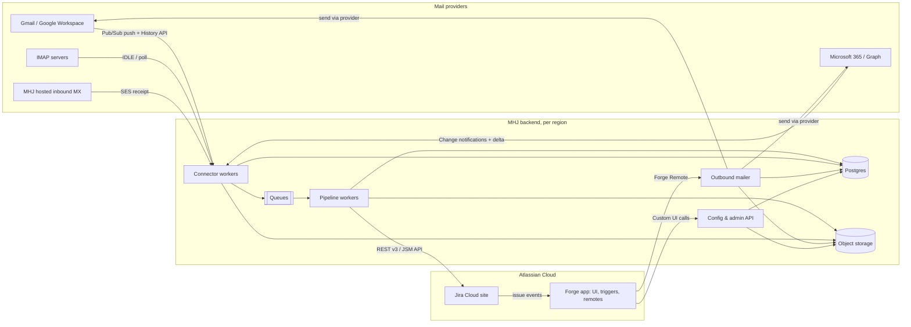
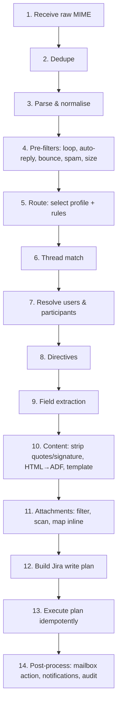

# Enterprise Mail Handler for Jira — Product & Technical Specification

| | |
|---|---|
| **Status** | Draft v0.1, for review |
| **Date** | 2026-10-12 |
| **Working name** | **MHJ** (Mail Handler for Jira). Placeholder; final name TBD (see [Open questions](#30-open-questions-for-the-reviewer)) |
| **Target platforms** | Jira Cloud (Jira, Jira Service Management, Jira Work Management) first. Jira Data Center through an adapter later |
| **Reference product** | Feature parity target: *Enterprise Mail Handler for Jira (JEMH)* by The Plugin People |

> **Clean-room note.** MHJ is an independent implementation. It aims for *functional* parity with the
> reference product, based only on publicly documented behaviour. We do not reuse its code, UI assets,
> help text, configuration file formats or trademarks. The name, branding and Marketplace listing must
> not suggest any affiliation with The Plugin People or Atlassian.

---

## Table of contents

1. [Summary](#1-summary)
2. [Goals and non-goals](#2-goals-and-non-goals)
3. [Personas and key use cases](#3-personas-and-key-use-cases)
4. [Platform and deployment model](#4-platform-and-deployment-model)
5. [System architecture](#5-system-architecture)
6. [Mail connectors](#6-mail-connectors)
7. [Inbound processing pipeline](#7-inbound-processing-pipeline)
8. [Routing: profiles and rules](#8-routing-profiles-and-rules)
9. [Threading and correlation](#9-threading-and-correlation)
10. [Users and non-Jira participants](#10-users-and-non-jira-participants)
11. [Content handling and formatting templates](#11-content-handling-and-formatting-templates)
12. [Custom field extraction](#12-custom-field-extraction)
13. [Inline command directives](#13-inline-command-directives)
14. [Attachment handling](#14-attachment-handling)
15. [Outbound notifications](#15-outbound-notifications)
16. [Jira Service Management specifics](#16-jira-service-management-specifics)
17. [Administration UI](#17-administration-ui)
18. [Message log, audit, reprocessing and test bench](#18-message-log-audit-reprocessing-and-test-bench)
19. [Data model](#19-data-model)
20. [APIs](#20-apis)
21. [Security](#21-security)
22. [Compliance, privacy and data residency](#22-compliance-privacy-and-data-residency)
23. [Non-functional requirements](#23-non-functional-requirements)
24. [Reliability and failure handling](#24-reliability-and-failure-handling)
25. [Observability](#25-observability)
26. [Licensing and billing](#26-licensing-and-billing)
27. [Technology stack and repository layout](#27-technology-stack-and-repository-layout)
28. [Testing strategy](#28-testing-strategy)
29. [Delivery phases](#29-delivery-phases)
30. [Open questions for the reviewer](#30-open-questions-for-the-reviewer)
31. [Assumptions to validate (technical spikes)](#31-assumptions-to-validate-technical-spikes)
32. [Glossary](#32-glossary)

---

## 1. Summary

MHJ is a hosted, multi-tenant service that installs into a Jira Cloud site and turns email into Jira work:

- **Ingestion and routing.** It reads mail from Gmail / Google Workspace, Microsoft 365 / Exchange Online,
  generic IMAP mailboxes and an MHJ-hosted inbound address. Ordered rules match on sender, recipients,
  headers and content, then create issues, add comments, transition issues, or drop/forward the message.
- **Participation without a Jira account.** Anyone with an email address can raise a ticket, be copied
  on it, receive templated notifications, and reply by email. Their replies thread back onto the same issue.
- **Rich processing.** Custom field extraction, inline command directives (for example setting the reporter
  or priority from the email text), HTML-to-Jira formatting, quote and signature stripping, and full
  attachment handling including inline images.
- **Enterprise posture.** OAuth 2.0 for every mail provider, encrypted token storage, tenant isolation,
  data residency, full audit trail, reprocessing, dry-run testing, and production SLOs.

## 2. Goals and non-goals

### 2.1 Goals

| # | Goal |
|---|---|
| G1 | Convert inbound email into Jira issues, comments and field updates through configurable profiles and rules. |
| G2 | Let non-Jira users take part in issue conversations entirely through email. |
| G3 | Support custom field extraction, inline directives, formatting templates and attachments. |
| G4 | Connect to Gmail and Microsoft 365 with OAuth 2.0, plus generic IMAP and a hosted inbound address. |
| G5 | Run as a production-grade, multi-tenant hosted service that can be listed on the Atlassian Marketplace. |
| G6 | Give administrators full visibility: message log, rule trace, audit history, reprocess and dry run. |
| G7 | Reach functional parity with the reference product's core Cloud feature set by end of Phase 2. |

### 2.2 Non-goals (v1)

- A general helpdesk UI. Jira and JSM remain the agent UI.
- Sending marketing or bulk email.
- Hosting full mailboxes. MHJ reads from and sends through the customer's existing provider.
- Jira Server (end of life). Jira Data Center is Phase 3 (see §4.4).
- POP3 (only if a customer needs it; IMAP covers the legacy cases).
- Microsoft national clouds (GCC High, DoD, 21Vianet) and Google sovereign offerings in v1.

## 3. Personas and key use cases

| Persona | Description |
|---|---|
| **Jira site admin** | Installs MHJ, connects mailboxes, owns global configuration and compliance settings. |
| **Project admin** | Manages profiles and rules scoped to their project(s) when delegated by the site admin. |
| **Agent / team member** | Works the issues in Jira. Replies in Jira; MHJ emails external participants. |
| **External requester** | Customer, vendor or colleague with no Jira account. Only uses email. |
| **Internal Jira user (emailer)** | Has a Jira account but prefers email, for example comments from Outlook. |
| **Automated sender** | Monitoring tools, forms, CI systems that send structured email. |

### 3.1 User stories (acceptance-level)

1. **Support inbox.** Mail to `support@acme.com` creates an issue in `SUP`. The sender becomes the reporter
   if they are a Jira user or JSM customer; otherwise the default reporter is used and the sender is stored as
   an email participant. CC'd addresses become participants.
2. **Reply threading.** A reply from any participant, whether through their mail client or to MHJ's
   notification, is added as a comment on the original issue and is never duplicated.
3. **Agent replies by email.** A Jira user replies to a notification. The reply is added as a comment
   attributed to them; quoted history and signatures are removed.
4. **Routing by recipient and content.** Mail to `billing@` goes to `FIN`, and subjects matching
   `/^\[P1\]/` get priority Highest with label `p1`.
5. **Structured alerts.** A monitoring email with `Host: db-07` and `Severity: critical` in the body
   fills custom fields *Host* and *Severity*. Repeat alerts for the same host comment on the open issue instead of
   creating duplicates.
6. **Directive.** An internal user writes `#reporter jane@customer.com` and `#priority High` at the top of
   a forwarded email. The issue is created with Jane as reporter and priority High, and the directive lines do not
   appear in the description.
7. **Attachments.** Attachments and inline images arrive as Jira attachments. Inline images render in place
   inside the description or comment. Blocked types (for example `.exe`) are rejected and the rejection is noted on the issue.
8. **Notifications to externals.** When an agent comments publicly, every external participant gets a branded
   email from `support@acme.com` with the comment, and their reply threads back.
9. **Loop safety.** Auto-replies, bounces and mail sent by MHJ itself never create issues or comment loops.
10. **Audit and recovery.** An admin can see why a message went to the wrong project (rule trace), correct
    the rule, and reprocess the message.

## 4. Platform and deployment model

### 4.1 Jira Cloud: Forge with Forge Remote (primary)

Atlassian is retiring Connect in favour of Forge, and new Marketplace apps must be built on Forge.
Forge functions cannot open raw TCP sockets (IMAP/SMTP), have execution time and memory limits, and are
not suited to long-running mailbox watchers or large MIME processing. MHJ therefore uses
**Forge with Forge Remote**:

- **Forge app (thin):** manifest, permissions/scopes, Custom UI admin pages, issue panel, custom field type,
  product event triggers, lifecycle events, and the `remotes` declaration that points to the MHJ backend.
- **MHJ backend (hosted by us):** connectors, pipeline, storage, outbound mail and the configuration API.
  It calls Jira REST APIs with Forge-issued tokens (app system token, plus user impersonation where
  allowed and configured).

> Validation needed: how the backend obtains Jira tokens at arbitrary times rather than only inside a
> Forge invocation, and whether offline user impersonation is available for our scopes. See spike **S1**.
> Fallback design: the backend sends a "write plan" through a Forge web trigger to a Forge async-event
> consumer that does the Jira writes with `asApp()` / `asUser()`.

Consequence: MHJ cannot carry the "Runs on Atlassian" badge, because it egresses customer data to our backend.
The Marketplace listing must say so clearly.

### 4.2 Alternative: Atlassian OAuth 2.0 (3LO) for private deployments

For a single company that will not go through the Marketplace, the same backend can authenticate to Jira with an
OAuth 2.0 (3LO) integration and a service account. Configuration UI is then served from the MHJ web app, not
inside Jira. This is supported by the Jira adapter abstraction (§5.3) but is not the primary path.

### 4.3 Hosting

- AWS, one isolated stack per data-residency region: **US** (us-east-1), **EU** (eu-central-1),
  **AU** (ap-southeast-2). More regions on demand.
- A tenant is pinned to one region at install time, following its Jira site's data residency location
  where possible.

### 4.4 Jira Data Center ("and similar")

Phase 3: a `JiraAdapter` implementation for Data Center (REST API v2, wiki markup instead of ADF, PAT or
OAuth 2.0 incoming application link), offered as:
- **Hosted** (MHJ backend reaches the DC instance over the internet with an allowlisted egress IP), or
- **Self-hosted** (the same backend as Docker images and a Helm chart, run by the customer).

## 5. System architecture

### 5.1 Context diagram



### 5.2 Components

| Component | Responsibility |
|---|---|
| **Forge app** | Admin and project-settings pages (Custom UI), issue panel (email thread and participants), *Email Participants* custom field, product event triggers (issue created/updated, comment created, etc.), lifecycle events (install/uninstall/license change), Forge Remote declarations. |
| **Edge API** | Receives Forge Remote invocations, Gmail Pub/Sub push, Graph notifications and SES events. Verifies signatures and tokens, then enqueues. Does no heavy work. |
| **Connector workers** | Per-mailbox sync state machines: subscription renewal, delta/history reconciliation, raw MIME fetch, post-fetch actions (label, move, mark read, delete). |
| **Pipeline workers** | Stateless stages from parse to Jira write (§7). Idempotent and horizontally scaled. |
| **Jira gateway** | The only component that calls Jira. Token acquisition, per-tenant rate limiting, retries, field-metadata cache, `JiraAdapter` interface (Cloud now, DC later). |
| **Outbound mailer** | Renders notification templates and sends through the mailbox's own provider (Gmail API, Graph or SMTP), with correct threading headers. |
| **Scheduler** | Subscription renewals, polling fallbacks, retention purges, license sync, digest notifications. |
| **Config & admin API** | CRUD for all configuration, message log queries, reprocess, dry run. Called by the Custom UI through Forge Remote. |
| **Scanner** | Attachment malware scanning (ClamAV in an isolated task, or a pluggable vendor). |

### 5.3 Key abstractions

```ts
interface MailConnector {            // Gmail, Graph, IMAP, HostedInbound
  start(mailbox): Promise<void>;
  sync(mailbox, cursor): AsyncIterable<RawMessageRef>;
  fetchRaw(ref): Promise<Readable>;  // RFC 5322 bytes
  postProcess(ref, action): Promise<void>;
  send(mailbox, mime: Buffer, threadHint?): Promise<SentRef>;
}

interface JiraAdapter {              // CloudForge, Cloud3LO, DataCenter
  createIssue(plan): Promise<IssueRef>;
  addComment(issue, body, opts): Promise<CommentRef>;
  updateFields(issue, fields): Promise<void>;
  transition(issue, transitionNameOrId, fields?): Promise<void>;
  addAttachments(issue, files): Promise<AttachmentRef[]>;
  findUsersByEmail(email): Promise<JiraUser[]>;
  getCreateMeta(project, issueType): Promise<FieldMeta[]>;
  // JSM
  createCustomer(email, displayName): Promise<JiraUser>;
  createRequest(plan): Promise<IssueRef>;
  addRequestParticipants(issue, accountIds): Promise<void>;
}
```

## 6. Mail connectors

Every mailbox ("Connection") has: provider, auth mode, address(es), the folder or label to watch,
post-fetch action, sync cursor, health status and a linked default profile.

### 6.1 Gmail / Google Workspace

| Aspect | Design |
|---|---|
| **Auth modes** | (a) **Domain-wide delegation** (recommended for Workspace): a Workspace admin grants MHJ's service-account client ID specific scopes; MHJ impersonates the mailbox address. (b) **Per-mailbox OAuth 2.0** (authorization code + PKCE, `offline_access`) for consumer Gmail or teams without Workspace admin access. |
| **Scopes** | `gmail.modify` (read, label, archive) and `gmail.send`. Both are *restricted* scopes, so publishing for external users requires Google OAuth verification and an annual CASA security assessment (see §22). |
| **Change detection** | `users.watch` on the watched label, delivering to a Google Cloud Pub/Sub topic with a push subscription to the Edge API (OIDC-authenticated push). On notification, call `users.history.list` from the stored `historyId`. Renew the watch every 24 h (it expires after 7 days). |
| **Reconciliation** | Every 5 min, plus on startup: `history.list`. If the `historyId` is too old (HTTP 404), run a full resync with `messages.list q="label:<watched> -label:<processed>"`. |
| **Fetch** | `messages.get format=raw` → base64url-decode → stream to object storage. |
| **Post-fetch** | Configurable: add label `MHJ/Processed`, remove `INBOX`, mark read, or move to trash. Failures get label `MHJ/Failed`. |
| **Send** | `messages.send` with raw MIME and `threadId` so sent mail threads in the mailbox's Sent view. |
| **Quotas** | Per-user quota units are tracked in a token bucket. Back off on 429/403 `rateLimitExceeded`. |

### 6.2 Microsoft 365 / Exchange Online (Microsoft Graph)

| Aspect | Design |
|---|---|
| **App registration** | A multi-tenant Entra ID application owned by MHJ. |
| **Auth modes** | (a) **Application permissions** (recommended): `Mail.ReadWrite` and `Mail.Send` with tenant admin consent. MHJ docs instruct admins to restrict the app to specific mailboxes with Exchange Online *RBAC for Applications* (or legacy Application Access Policies). Supports shared mailboxes. (b) **Delegated**: `Mail.ReadWrite`, `Mail.Send`, `offline_access`, `User.Read` for a single user mailbox. |
| **Change detection** | Graph subscriptions on `/users/{id}/mailFolders/{folder}/messages`, `changeType=created`, with `lifecycleNotificationUrl` for `reauthorizationRequired`, `subscriptionRemoved` and `missed`. Renew before expiry (maximum just under 7 days for messages; renew every 48 h). Notifications are validated with `clientState` and handled with "rich notifications off" (fetch on demand). |
| **Reconciliation** | `messages/delta` on the folder every 5 min and after a `missed` lifecycle event. The delta token is stored as the cursor. |
| **Fetch** | `GET /users/{id}/messages/{mid}/$value` (MIME). |
| **Post-fetch** | Mark read, move to a configured folder (default `MHJ Processed`), set category, or delete. |
| **Send** | `POST /users/{id}/sendMail` with a MIME body (base64), so MHJ fully controls `Message-ID`, `In-Reply-To` and `References`. |
| **Throttling** | Honour `Retry-After`. Concurrency is capped per mailbox (Graph allows about 4 concurrent requests per mailbox). |

### 6.3 Generic IMAP (Phase 2)

- IMAPS (993) or STARTTLS only; plaintext is refused.
- Auth: SASL `XOAUTH2` (for Gmail/Outlook IMAP if a customer insists) or username/password for other
  servers (Exchange on-premises, Zoho, Fastmail, Dovecot). Passwords are stored encrypted (§21.3).
- IDLE where supported, with a NOOP keep-alive and reconnect with jittered backoff; otherwise poll every 60 s.
- Tracks `UIDVALIDITY` and the highest processed `UID`. A `UIDVALIDITY` change triggers a resync with Message-ID dedupe.
- Connections are long-lived on dedicated connector tasks, sharded by a consistent hash of mailbox ID.

### 6.4 MHJ-hosted inbound address

- Each tenant gets addresses such as `acme-7f3k2@in.mhj-mail.example`, or a **custom subdomain**
  (`jira.acme.com`) whose MX points to MHJ after DNS verification.
- Implemented with Amazon SES inbound receipt rules → S3 (encrypted) → SNS → Edge API.
- Lets customers keep their current mail system and add a forwarding rule. It is the quickest way to start and needs no OAuth.
- SPF/DKIM/DMARC verdicts from SES are recorded and available to rules (§8) and directive security (§13.4).
- Outbound for hosted-only tenants goes through SES with the tenant's verified domain (DKIM CNAMEs) or
  a shared MHJ domain.

### 6.5 Connection health

States: `pending_auth` → `active` → `degraded` (repeated transient errors) → `auth_failed`
(refresh token revoked or consent removed) → `disabled`. A transition to `degraded` or `auth_failed` raises an
in-app banner and emails the configured admin contacts, and optionally creates a Jira issue in an ops project.

## 7. Inbound processing pipeline

Each stage is a pure function over a `MessageContext` that is persisted after every stage, so any stage can
be retried or replayed. Stages run on SQS queues with per-tenant fairness (§24.2).



| # | Stage | Details |
|---|---|---|
| 1 | Receive | Store raw bytes at `s3://…/{tenant}/{mailbox}/{yyyy}/{mm}/{msgUuid}.eml` (SSE-KMS). Create a `message` row with status `received`. |
| 2 | Dedupe | Key = `(tenant, Message-ID)`, falling back to a SHA-256 of normalised headers and body when Message-ID is missing. The same message arriving through two mailboxes (for example To and CC both monitored) is processed once, and the extra mailbox is recorded. |
| 3 | Parse | Streaming MIME parser with limits: depth ≤ 20, parts ≤ 500, header size ≤ 256 KB, total ≤ configured max (default 50 MB). Decode RFC 2047/2231, all charsets (iconv), TNEF `winmail.dat` extraction, S/MIME and PGP detection (encrypted bodies are not decrypted; the message is flagged). |
| 4 | Pre-filters | Drop or quarantine: messages from MHJ itself (signed `X-MHJ-Origin` header, §15.4); `Auto-Submitted` other than `no`; `Precedence: bulk/junk/list`; known auto-reply headers (`X-Autoreply`, `X-Autorespond`, `X-Auto-Response-Suppress`); DSN/`multipart/report` (routed to the bounce handler); sender on a deny list; DMARC fail (configurable); provider spam verdict; per-sender rate limit (default > 20 messages in 10 min to one issue → quarantine). |
| 5 | Route | Evaluate the profile and rule set for the receiving mailbox and recipient address (§8). Rules can stop processing (drop, forward, quarantine). |
| 6 | Thread match | Find the target issue if this is a reply (§9). This decides whether we create an issue or add a comment, unless a rule forces one. |
| 7 | Users | Resolve the sender, To and CC to Jira users, JSM customers or external participants (§10). |
| 8 | Directives | Parse, authorise, apply and strip directives (§13). |
| 9 | Field extraction | Run the profile's field processors (§12). Validate against Jira field metadata. |
| 10 | Content | Pick the body part, sanitise, strip quotes and signatures, convert to ADF, apply the formatting template, enforce size limits (§11). |
| 11 | Attachments | Filter, scan, dedupe, map inline `cid:` references (§14). |
| 12 | Plan | Produce a declarative `JiraWritePlan` (create or comment, fields, transitions, links, participants, attachments). It is stored for audit and dry run. |
| 13 | Execute | The Jira gateway applies the plan step by step. Each step has a deterministic idempotency key; completed steps are recorded so a retry resumes rather than repeats (§24.1). |
| 14 | Post-process | Mailbox post-fetch action, thread-map rows, outbound acknowledgement email if configured, metrics, status `processed`. |

Message states: `received`, `filtered`, `quarantined`, `processing`, `processed`, `deferred`
(retryable error), `failed` (non-retryable or retries exhausted), `deleted` (purged).

## 8. Routing: profiles and rules

### 8.1 Concepts

- **Profile:** a named bundle of processing behaviour: default project and issue type, user-matching
  policy, participant handling, field processors, directive policy, content templates, attachment
  policy, notification set and threading policy. Profiles are reusable across mailboxes.
- **Rule:** an ordered `condition → actions` entry inside a profile. Rules refine or override the profile's
  defaults for the matching message.
- **Mailbox → profile binding:** each mailbox has a default profile. Optional **address bindings** map specific
  recipient addresses or aliases (for example `billing@`, `support+fin@`) to other profiles.

Profile selection order:
1. Recipient address binding (exact address, then plus-address base, then domain).
2. Mailbox default profile.
3. Tenant fallback profile (which may simply be "quarantine").

### 8.2 Rule conditions

Conditions combine with `all` / `any` / `not`.

| Field | Operators |
|---|---|
| `from.address`, `from.domain`, `from.name` | `equals`, `in`, `matches` (RE2 regex), `in_list` (named list) |
| `to`, `cc`, `recipients` (to ∪ cc ∪ delivered-to) | `contains`, `contains_any`, `matches` |
| `subject` | `contains`, `starts_with`, `matches` |
| `body.text` | `contains`, `matches` (first 256 KB) |
| `header.<Name>` | `exists`, `equals`, `matches` |
| `attachment.count`, `attachment.name`, `attachment.type` | numeric and string operators |
| `auth.dmarc`, `auth.spf`, `auth.dkim` | `equals pass/fail/none` |
| `sender.kind` | `jira_user`, `jsm_customer`, `external`, `unknown` |
| `sender.in_group` | Jira group membership |
| `thread.matched`, `thread.issue.status_category`, `thread.issue.project` | for reply-specific rules |
| `time` | business-hours calendar, weekday |
| `size` | bytes |

Regexes use **RE2** (linear time) to rule out ReDoS.

### 8.3 Rule actions

| Action | Effect |
|---|---|
| `set_project`, `set_issue_type`, `set_request_type` | Override the create target. |
| `set_field` | Set any field to a literal or template expression. |
| `add_labels`, `set_components`, `set_priority`, `set_assignee`, `add_watchers` | Common shortcuts. |
| `force_create` / `force_comment` | Ignore or require a thread match. |
| `comment_policy` | For replies to resolved or closed issues: `comment`, `reopen` (transition name), `create_new_linked`, or `reject_with_notice`. |
| `transition` | Run a named transition after create or comment. |
| `link_to` | Link to an issue key (from a regex capture) with a link type. |
| `use_field_processor` | Run an extra named processor. |
| `drop` | Stop and mark `filtered` (with reason). |
| `quarantine` | Hold for admin review. |
| `forward` | Forward the raw message to an address (for example an escalation list). |
| `reply_with_template` | Send an auto-acknowledgement. |
| `stop` | Do not evaluate later rules. |

### 8.4 Example configuration (YAML export format)

```yaml
profile: support-default
defaults:
  project: SUP
  issueType: "[System] Service request"   # JSM request type resolved by name
  reporter:
    match: [jira_user, jsm_customer]
    createJsmCustomer: true
    fallback: { accountId: "5f1c...", recordSenderIn: "Email Participants" }
  participants: { addCc: true, addTo: true, excludeOwnMailboxes: true }
  threading: { onClosed: reopen, reopenTransition: "Reopen" }
  attachments: { maxBytes: 26214400, deny: [exe, js, vbs, scr, bat, cmd, ps1] }
  directives: { enabled: true, allowFrom: { groups: ["jira-servicedesk-users"] }, requireDmarcPass: true }
  fieldProcessors: [kv-basic]
rules:
  - name: Billing to FIN
    when: { any: [ { to: { contains: "billing@acme.com" } }, { subject: { matches: "(?i)invoice|refund" } } ] }
    then: [ { set_project: FIN }, { set_issue_type: Task }, { add_labels: [billing] } ]
  - name: P1 subject tag
    when: { subject: { matches: "^\\[P1\\]" } }
    then: [ { set_priority: Highest }, { add_labels: [p1] } ]
  - name: Drop newsletters
    when: { header.List-Unsubscribe: { exists: true } }
    then: [ { drop: "mailing list" }, { stop: true } ]
```

Configuration can be edited in the UI or imported/exported as YAML (versioned, with a JSON Schema for validation),
so it can live in source control.

### 8.5 Config versioning

Every save creates an immutable config version. Messages record the version they were processed with. Admins
can diff versions and roll back. Reprocessing can use either the original or the current version.

## 9. Threading and correlation

Replies are matched to issues by the first successful strategy below. Each strategy can be switched off per profile.

| Order | Strategy | Notes |
|---|---|---|
| 1 | **Message-ID map** | `In-Reply-To` and `References` looked up in the `thread_map` table, which holds every inbound Message-ID we processed and every outbound Message-ID we sent, mapped to the issue (and comment). The most reliable strategy. |
| 2 | **Reply-address token** | Outbound notifications use `Reply-To: support+t.<token>@acme.com` (plus-addressing), where the token is an HMAC-signed issue reference. Works even when the client drops headers. Optional, because some providers or customers dislike plus-addresses. |
| 3 | **Hidden body marker** | An invisible marker in outbound HTML plus a visible footer reference (`Ref: SUP-123 · do not edit`). |
| 4 | **Issue key in subject** | `[SUP-123]` or a configurable regex. Restricted to projects the profile is allowed to touch, and optionally to senders already on the issue (to stop key-guessing into unrelated issues). |
| 5 | **Content correlation** | Rule-driven, for alerts: "open issue in project X where field *Host* = extracted host" (JQL template). |

Security: a thread match into a project outside the profile's allowed project set is rejected and treated
as a new message. For external senders not already on the issue, the `onUnknownParticipantReply` policy
decides: `comment_and_add`, `comment_only`, `create_new`, or `quarantine`.

## 10. Users and non-Jira participants

### 10.1 Sender resolution order (configurable per profile)

1. **Jira user** with a matching email. Jira Cloud only returns emails the user has made visible, or that
   the app is approved to read. MHJ also keeps a tenant **user alias table** (email → accountId) that admins
   or users can maintain for hidden-email or multi-address cases. *See spike S2.*
2. **JSM customer** (JSM projects only): look up an existing customer, or create one if allowed by the profile.
3. **External participant**: no account. The sender is stored on the issue as an email participant.

### 10.2 Reporter

- Matched user or customer → reporter, if they have *Create issues* (or are a customer of the service project).
- Otherwise → the profile's **default reporter** (a service account or the app user). The real sender is
  recorded in the *Email Participants* field, an *Original Sender* field, and the description header.
- A directive can override the reporter (§13), subject to authorisation.

### 10.3 Email Participants

- Implemented as a **Forge custom field type** `Email Participants` (a list of `Name <address>` entries,
  with role `requester | cc | added`), shown in the issue view and editable by agents. Values are mirrored in
  MHJ's `participant` table for notification fan-out.
- CC and To addresses (minus the monitored mailboxes and configured internal domains, if excluded) are added on
  create and on every reply.
- Agents can add or remove participants from the issue panel. Participants can unsubscribe through an
  HMAC-signed link in every email (§15.5).

### 10.4 Comment authorship

| Author | Behaviour |
|---|---|
| Matched Jira user, impersonation available and enabled | Comment created as that user. |
| Matched Jira user, no impersonation | Comment created by the app, with an attribution line ("**Jane Doe** (jane@acme.com) replied by email:"). |
| JSM customer | Public comment through the JSM API on behalf of the customer where supported, otherwise app-authored with attribution. |
| External participant | App-authored with attribution. Visibility follows the profile (public by default for JSM; optional role/group restriction in Jira Software). |

## 11. Content handling and formatting templates

### 11.1 Body selection and sanitisation

- Prefer `text/html` when present; otherwise `text/plain` (format=flowed aware); otherwise the first text part.
- Sanitise HTML with an allowlist (no scripts, styles, event handlers, forms, iframes or tracking pixels).
  Remote images are **not fetched** by default (SSRF and privacy); an optional allowlisted fetch proxy can be enabled.

### 11.2 Quote and signature stripping (replies)

- Our own marker `##- Reply above this line -##` in outbound mail is the most reliable cut point.
- Client-specific detectors: Gmail (`div.gmail_quote`), Outlook (`#divRplyFwdMsg`, "From: … Sent: …" blocks,
  `-----Original Message-----`), Apple Mail (`blockquote[type=cite]`), Thunderbird (`.moz-cite-prefix`),
  plain-text `>` blocks and "On <date>, <name> wrote:" in common languages (EN, DE, FR, ES, IT, NL, PT, JA, ZH at launch).
- Signatures: RFC 3676 `-- ` delimiter, mobile footers ("Sent from my iPhone"), and per-profile custom regexes.
- If stripping removes everything, fall back to the full body (never post an empty comment).
- A per-profile option attaches the original full email as `.eml` (always, never, or only when truncated or stripped).

### 11.3 Conversion to Jira format

- HTML → **ADF** converter (our own, fully tested): paragraphs, headings, bold/italic/strike/underline,
  links, lists (nested), tables, blockquote, code/pre, horizontal rule, inline images → ADF `mediaSingle`
  referencing uploaded attachments, mentions for matched users (optional).
- For Data Center (Phase 3): HTML → wiki markup.
- Size limit: Jira text fields default to a 32,767-character limit. Content over the limit is truncated with a
  notice, and the full body is attached as `email-body.html`.

### 11.4 Formatting templates

Admins choose how the description or comment is laid out, using a **sandboxed Liquid** engine (LiquidJS
with strict variables, no filesystem access, render timeout of 200 ms and output cap). The template produces a
Markdown subset, which MHJ converts to ADF.

Available variables (subset):

```text
message.subject, message.date, message.from.{name,address}, message.to[], message.cc[],
message.body (cleaned, as markup), message.body_full, message.headers['X-Foo'],
message.auth.{spf,dkim,dmarc}, mailbox.address, profile.name,
extracted.<fieldKey>, issue.key (comments only), sender.kind, attachments[]
```

Default *new issue* template:

```liquid
{{ message.body }}

----
| From | {{ message.from.name }} <{{ message.from.address }}> |
| To | {{ message.to | join: ", " }} |
| CC | {{ message.cc | join: ", " }} |
| Received | {{ message.date | date: "%Y-%m-%d %H:%M %Z" }} |
```

The **summary** has its own template (default `{{ message.subject | strip_reply_prefixes | default: "(no subject)" }}`,
truncated to 255 characters).

## 12. Custom field extraction

### 12.1 Field processors

A profile holds an ordered list of processors. Each emits candidate `(fieldRef, rawValue)` pairs.

| Processor | Description |
|---|---|
| **Key–value lines** | Lines like `Severity: critical` or `Customer ID = 4411`. Configurable separators, key aliases (`Sev`, `Severity` → *Severity*), case-insensitive, optionally limited to a delimited block (`--- details ---`). |
| **Regex** | RE2 patterns with named groups mapped to fields; scoped to subject, body, a header, or an attachment's text. |
| **HTML table** | Two-column tables (label/value), such as web-form emails. |
| **Header mapping** | For example `X-Priority: 1` → Priority Highest; `X-Customer` → custom field. |
| **Structured attachment** | JSON, XML (XPath) or CSV attachment → fields (for machine senders). |
| **Sender lookup** | Domain or address → value from a named lookup table (for example `acme.com` → Organization "Acme", Customer Tier "Gold"). |
| **Static** | Constant values. |
| **Template** | A Liquid expression combining other extracted values. |

### 12.2 Value conversion

MHJ loads field metadata (`createmeta` per project and issue type, cached for 10 min and invalidated on
error), then converts:

| Jira field type | Accepted input |
|---|---|
| Text / paragraph (ADF) | Any string; paragraphs go through the content converter. |
| Number | Locale-aware parsing (`1,234.5`, `1.234,5`). |
| Date / date-time | ISO 8601 and common formats, plus natural phrases (`tomorrow`, `next friday`) in the profile's time zone. |
| Select / radio / multi-select / checkbox | Match option value case-insensitively, plus an alias map; unknown values follow a policy (`ignore`, `fail`, `default`). |
| Cascading select | `Parent > Child`. |
| User / multi-user picker | Email or accountId, resolved through §10.1. |
| Labels | Space- or comma-separated; normalised (no spaces). |
| Components / versions / fix versions | By name. |
| Priority, issue type, request type, organization (JSM) | By name. |
| URL | Validated URL. |
| Assets/Insight object (Phase 3) | AQL lookup. |

Extraction outcomes are written to the message trace. A field that cannot be converted never blocks issue
creation unless the field is marked `required` in the processor config; in that case the policy is `fail`
(and the message is deferred for admin attention) or `use_default`.

## 13. Inline command directives

Directives let trusted senders steer processing from inside the email.

### 13.1 Syntax

- A directive is a line whose first non-space characters are `#` followed by a registered directive name.
  Directives are recognised only in the **directive block**: the leading lines of the body before the
  first ordinary text line (configurable to also allow a trailing block, or the subject).
- An alternative prefix (for example `@mhj`) can be configured for teams who use hashtags in normal text.
- Values may be quoted. Multiple values are comma-separated.

```ebnf
directive   = ws* prefix name ( ws+ | ws* ("=" | ":") ws* ) value? ws* EOL ;
prefix      = "#" | configured-prefix ;
name        = letter { letter | digit | "-" | "_" } ;
value       = quoted | bare { ws* "," ws* (quoted | bare) } ;
quoted      = '"' { any-char-but-quote | '\"' } '"' ;
```

Example:

```text
#reporter jane.doe@customer.com
#priority High
#labels vip, renewal
#field "Customer Tier" = Gold
#watchers ops-lead@acme.com

Hi team, please see the forwarded request below...
```

### 13.2 Built-in directives

| Directive | Effect | Applies to |
|---|---|---|
| `#project KEY` | Target project. | create |
| `#issuetype Name` / `#requesttype Name` | Issue or request type. | create |
| `#summary text` | Override summary. | create, update |
| `#reporter email|accountId` | Set reporter. | create |
| `#assignee email|accountId|unassigned|me` | Set assignee. | create, comment |
| `#priority Name` | Set priority. | create, comment |
| `#labels a, b` / `#label+ x` / `#label- y` | Set, add or remove labels. | create, comment |
| `#component(s) A, B` | Set components. | create, comment |
| `#duedate 2026-11-01 | +3d` | Due date. | create, comment |
| `#watchers a@x, b@y` | Add watchers (Jira users). | create, comment |
| `#cc a@x` / `#uncc a@x` | Add or remove email participants. | create, comment |
| `#field "Name" = value` | Set any field, converted per §12.2. | create, comment |
| `#transition "In Progress"` | Run a transition. | comment |
| `#resolve [Resolution]` | Transition to done with a resolution. | comment |
| `#link KEY [link-type]` | Create an issue link. | create, comment |
| `#internal` / `#public` | JSM comment visibility. | comment |
| `#nocomment` | Apply directives but don't post the body. | comment |
| `#new` | Force a new issue even if a thread matches. | any |

### 13.3 Processing

1. Parse the directive block, then **strip** the directive lines from the body before content processing.
2. Validate each directive (known name, value converts, target exists).
3. Authorise each directive (§13.4).
4. Apply to the write plan. Results (applied, rejected, and why) are logged in the message trace and optionally
   reported to the sender in a "directive results" reply.

### 13.4 Security model

Directives are powerful (a `#reporter` can attribute an issue to someone else), so:
- **Off by default.** Enabled per profile.
- **Sender allow policy:** Jira groups, specific addresses or domains. External participants can never use
  directives unless explicitly allowlisted.
- **Authenticated mail required:** by default the message must pass **DMARC** (or SPF+DKIM alignment) according
  to the receiving provider's `Authentication-Results`. This stops spoofed `From:` headers from applying directives.
- **Per-directive allowlist:** each profile chooses which directives are enabled (for example allow `#priority`,
  deny `#reporter`).
- **Permission check:** when the sender is a Jira user, a directive is applied only if that user would hold the
  matching Jira permission (for example *Modify Reporter*, *Assign Issues*, *Transition Issues*), checked with
  `mypermissions` on their behalf, or `permissions/check` for their accountId.

## 14. Attachment handling

| Concern | Design |
|---|---|
| **Sources** | Regular attachments, inline parts (`Content-Disposition: inline` with `Content-ID`), TNEF contents, attached `.eml`/`message/rfc822` (option: attach as file, or extract its attachments as well). |
| **Filtering** | Per-profile allow/deny by extension *and* sniffed MIME type (magic bytes; a mismatch is treated as deny). Minimum size to ignore tracking pixels and tiny signature logos (default < 2 KB images in a signature block). Optional "ignore duplicate images already on this issue" using a SHA-256 hash. |
| **Size limits** | Per file and per message; also capped by the Jira site's attachment limit (read from `/rest/api/3/attachment/meta`). Oversize files are skipped with a notice comment and logged. |
| **Malware scanning** | Each file is scanned in an isolated scanner task before upload. Infected files are dropped and noted; on scanner outage the policy is `hold` (default) or `allow_unscanned`. |
| **Archives** | Not expanded. Zip bombs are irrelevant because we don't expand, but nested `.eml` depth is limited. |
| **Naming** | Decode RFC 2231 filenames, strip path characters, de-duplicate with suffixes (`image (1).png`); unnamed inline images get `inline-<n>.<ext>`. |
| **Inline mapping** | `cid:` references in HTML are replaced with ADF media nodes pointing at the uploaded attachment's media ID. If media IDs can't be resolved, fall back to the attachment name and a link. |
| **Comments** | Attachments on replies are attached to the issue and referenced in the comment ("Attachments: a.pdf, b.png"). |
| **Upload** | Streaming multipart upload to `/rest/api/3/issue/{key}/attachments` (`X-Atlassian-Token: no-check`), up to 3 in parallel, each step idempotent by hash + issue. |
| **Outbound** | Notifications may include new issue attachments (configurable, size-capped) or links only. |

## 15. Outbound notifications

### 15.1 Triggers

Forge product event triggers (`issue created`, `issue updated`, `comment created/updated`, `issue
transitioned`, `assignee changed`, and JSM events where available) are forwarded to the MHJ backend through Forge Remote.
Events caused by MHJ's own writes are tagged (with the plan step ID stored as an entity property) so they can be
suppressed or treated differently.

### 15.2 Notification rules

Per project (or profile):
- **Event → template → recipients.** Recipients can be email participants, reporter (if external),
  assignee, watchers who opted into email, or static addresses.
- Conditions: comment visibility (never send internal JSM comments or role-restricted comments to externals),
  author kind, issue type, status category, field values (JQL-like predicate evaluated on the event payload).
- Batching: changes within 60 s are combined into one email per recipient (configurable).
- The sender's own action is not echoed back to them (configurable).
- Digest mode (Phase 2): hourly or daily summaries.

### 15.3 Templates

- Liquid templates for subject, HTML body and text body, with a responsive base layout and a per-tenant
  branding block (logo, colours, footer, legal text).
- Variables: `issue.*` (key, summary, status, fields by name), `event.*`, `comment.*` (rendered from ADF to
  email-safe HTML), `recipient.*`, `links.view` (JSM portal link for customers; Jira link for users),
  `links.unsubscribe`.
- Per-language variants chosen by recipient locale (from JSM customer, Jira user, or a profile default).
- Live preview against a real issue in the admin UI; test-send to the admin.

### 15.4 Sending and headers

- Sent through the **same mailbox connection** the thread came in on (or a configured default per project), so
  mail comes from `support@acme.com`, with the provider's DKIM signing and Sent-folder history.
- Headers: unique `Message-ID` (`<mhj.{uuid}@{domain}>`), `In-Reply-To` and `References` built from the thread map,
  `Reply-To` (optional plus-token, §9), `Auto-Submitted: auto-generated` for automated acknowledgements,
  `X-MHJ-Origin` (an HMAC over tenant + message ID, used for loop detection), and `List-Unsubscribe` with
  `List-Unsubscribe-Post`.
- Subject format default: `[{{issue.key}}] {{issue.summary}}`.

### 15.5 Bounces and suppression

- DSNs (from §7 stage 4) are parsed (RFC 3464). Hard bounces mark the participant `bouncing` and stop sends.
  Admins see a warning on the issue panel.
- Unsubscribe links set the participant to `unsubscribed` for that issue (or for all issues, per tenant policy).
- A tenant-wide suppression list is available.

## 16. Jira Service Management specifics

- Create requests through the JSM API (`/rest/servicedeskapi/request`) with `requestTypeId`, `raiseOnBehalfOf`
  (the customer) and `requestParticipants`, so SLAs, portal visibility and customer notifications behave natively.
- Optionally create customers for unknown senders and add them to an **Organization** chosen by a domain lookup table.
- Comment visibility: replies from customers are **public**; replies from agents are public unless `#internal`.
  Externals are never notified of internal comments.
- MHJ notifications can complement or replace JSM's own customer notifications. Recommended setup: let JSM
  notify JSM customers and let MHJ handle non-customer participants. A configuration check in the UI warns about
  double notifications.
- Approvals by email (Phase 2): parse `approve` / `decline` replies to approval notifications and call the
  approvals API as the approver (requires impersonation; see spike S1).

## 17. Administration UI

Built as Forge Custom UI (React + Atlaskit-style components), loaded inside Jira.

| Page | Purpose |
|---|---|
| **Getting started** | Guided setup: connect a mailbox → pick a project → send a test email → see the issue. |
| **Mailboxes** | Add, authorise and re-authorise connections (OAuth popup flows); health, last sync, backlog; pause/resume; post-fetch action. |
| **Profiles** | Defaults, user and participant policy, threading, attachments, directives, templates; clone; YAML import/export. |
| **Rules** | Ordered rule editor with a visual condition builder, raw YAML view, and per-rule hit counts. |
| **Field processors** | Processor editor with a live test panel (paste text, see extracted fields). |
| **Templates** | Content and notification templates, with a code editor, variable reference, preview and test-send. |
| **Notifications** | Per-project notification rules and branding. |
| **Users & participants** | Alias table, lookup tables, suppression list, bounce status. |
| **Message log** | Search and filter; detail view (§18). |
| **Quarantine** | Review, release (with profile choice) or delete. |
| **Test bench** | Dry run (§18.3). |
| **Audit log** | Configuration changes: who, what, when, diff. |
| **Settings** | Data retention, data residency display, security policies (DMARC requirement, remote images), admin contacts, project-admin delegation. |
| **Project settings page** | Project admins see and edit only profiles and notification rules scoped to their project, if the site admin has delegated this. |
| **Issue panel** | Email thread timeline (in and out, with delivery status), participants (add/remove), "send email" action. |

Access control: site admins (Jira `ADMINISTER` permission) have full access. Project admins can only use
delegated, project-scoped pages. Every API call is re-authorised server-side against the Forge context
(accountId and permissions), never only in the UI.

Accessibility: WCAG 2.1 AA.

## 18. Message log, audit, reprocessing and test bench

### 18.1 Message log

- Columns: received time, mailbox, from, subject, status, profile, result (issue key, comment link),
  duration, and errors.
- Filters: status, mailbox, date range, sender, issue key, free text (subject/from).
- Detail view: headers, authentication results, rendered body, attachments with scan results, a **rule trace**
  (each rule: matched or not, and why), directive results, extraction results, the Jira write plan, executed steps
  with Jira responses, and timings.
- Actions: **Reprocess** (same or different profile, original or current config version), download `.eml`,
  release from quarantine, delete message (GDPR), and copy a diagnostic bundle for support (redacted).

### 18.2 Audit log

Immutable, append-only record of configuration changes, connection auth events, reprocess and delete actions,
and admin logins to MHJ pages. Exportable as CSV/JSON. Retained for 1 year by default.

### 18.3 Test bench (dry run)

- Input: upload `.eml`, paste raw MIME, compose a simple message, or pick a logged message.
- Choose mailbox/profile and config version (current or draft).
- Output: everything in §18.1's detail view **without any Jira write or email send**, plus a preview of the
  resulting issue and comment, and the notifications that would be sent.
- **Draft configs:** admins can edit a draft profile, run the test bench against it, then publish.

## 19. Data model

Postgres with a `tenant_id` column on every tenant-owned table, enforced by **row-level security** using a
session variable set by the data-access layer. Main tables:

| Table | Key columns |
|---|---|
| `tenant` | id, cloud_id, site_url, installation_id, region, license_state, plan, created_at, uninstalled_at |
| `mailbox` | id, tenant_id, provider, auth_mode, address, aliases[], watch_folder, post_action, default_profile_id, status, cursor (jsonb), last_sync_at |
| `credential` | id, tenant_id, mailbox_id, kind (oauth/dwd/password), ciphertext, wrapped_dek, kms_key_id, scopes[], expires_at, rotated_at |
| `profile` / `profile_version` | id, tenant_id, name, current_version_id; version: id, config (jsonb, schema-validated), created_by, created_at, is_draft |
| `address_binding` | tenant_id, address_pattern, profile_id, priority |
| `named_list` / `lookup_table` | tenant_id, name, entries (jsonb) |
| `template` / `template_version` | id, tenant_id, kind (content/summary/notification), locale, body, version |
| `notification_rule` | id, tenant_id, project_id, event, condition (jsonb), template_id, recipients (jsonb) |
| `message` | id, tenant_id, mailbox_id, message_id_hdr, dedupe_hash, from_addr, subject, received_at, status, profile_version_id, issue_key, s3_key, size, error_code, trace (jsonb, or S3 if large) |
| `plan_step` | message_id, seq, kind, idempotency_key, status, jira_response_ref, attempts |
| `thread_map` | tenant_id, message_id_hdr, issue_id, comment_id, direction (in/out), created_at |
| `participant` | tenant_id, issue_id, address, display_name, role, status (active/unsubscribed/bouncing), account_id? |
| `user_alias` | tenant_id, email, account_id, source (admin/self/verified) |
| `outbound_message` | id, tenant_id, issue_id, event_id, recipients, message_id_hdr, status, provider_ref, sent_at |
| `suppression` | tenant_id, address, reason, created_at |
| `audit_event` | id, tenant_id, actor_account_id, action, target, diff (jsonb), at, ip_hash |
| `quota_usage` | tenant_id, period, messages_in, messages_out, bytes |

Raw MIME, large traces and attachment staging live in S3 (per-region bucket, SSE-KMS, object lock off,
lifecycle rules applying retention).

## 20. APIs

### 20.1 Inbound endpoints (Edge API)

| Endpoint | Caller | Verification |
|---|---|---|
| `POST /forge/remote/*` | Forge (UI resolvers, triggers, lifecycle) | Verify the Forge Invocation Token (JWT, Atlassian JWKS, `aud` = app ID); derive tenant from `installationId`/`cloudId`. |
| `POST /hooks/gmail` | Google Pub/Sub push | OIDC token from the push subscription's service account; audience check. |
| `POST /hooks/graph` | Microsoft Graph | Validation-token handshake; `clientState` secret per subscription; optional rich-notification signature check. |
| `POST /hooks/ses` | SNS | SNS message signature verification; topic ARN allowlist. |
| `GET /oauth/{provider}/callback` | Browser | `state` (signed, bound to tenant + admin accountId + nonce), PKCE verifier. |
| `GET /u/{token}` | Recipient | HMAC-signed unsubscribe/preferences link. |

### 20.2 Admin API (behind Forge Remote)

REST, JSON, versioned at `/v1`. Resources: `mailboxes`, `profiles` (+ `versions`, `drafts`, `import`, `export`),
`rules`, `field-processors`, `templates`, `notification-rules`, `lookups`, `aliases`, `messages`
(+ `reprocess`, `raw`, `release`), `dry-run`, `audit`, `settings`, `health`. An OpenAPI 3.1 document is generated
from the code (zod schemas) and used to type the Custom UI client.

### 20.3 Public API (Phase 3)

A tenant API key (scoped, rotatable) for CI/CD config deployment (`PUT /v1/profiles/{name}` from YAML) and
message log export.

## 21. Security

### 21.1 Threat model highlights

| Threat | Mitigation |
|---|---|
| Spoofed sender sets reporter or fields | DMARC/SPF/DKIM verdicts; directives off by default and allowlisted; permission checks (§13.4). |
| Reply injection into unrelated issues | Project scope check on thread match; HMAC-signed reply tokens; unknown-participant policy (§9). |
| Mail loops and floods | Origin header, auto-reply detection, per-sender and per-issue rate limits, quarantine. |
| Malicious attachments | Type sniffing, deny lists, malware scanning, no archive expansion. |
| XSS through HTML email | Strict sanitiser; ADF output only (no raw HTML rendered in Jira); outbound templates escape by default. |
| SSRF via remote images or templates | No remote fetch by default; template sandbox has no network or filesystem access. |
| ReDoS through admin regexes | RE2 only; per-message processing time budget. |
| Parser exploits | Hardened streaming parser with limits; processing in memory-capped worker containers. |
| Token theft | Envelope encryption with KMS; least-privilege IAM; tokens never sent to the browser; access audited. |
| Cross-tenant data leak | Postgres RLS, tenant-scoped S3 prefixes with IAM conditions, tenant ID derived only from verified Forge tokens, automated cross-tenant tests. |
| Forged webhooks | Signature/OIDC verification on every inbound hook (§20.1). |

### 21.2 Transport

TLS 1.2+ everywhere (TLS 1.3 preferred); HSTS on public endpoints; IMAP/SMTP require TLS.

### 21.3 Secrets and keys

- OAuth refresh tokens and passwords: AES-256-GCM with a per-tenant data key wrapped by a regional KMS key.
  Decrypted only in the connector process memory.
- Platform secrets (Google service-account key, Entra client secret or certificate, SES credentials) in AWS
  Secrets Manager, rotated at least every 90 days. Entra uses **certificate** credentials, not client secrets.
- Uninstall → credentials crypto-shredded immediately (data key deleted); data purge per §22.

### 21.4 Application security

- Secure SDLC: threat modelling per feature, mandatory code review, SAST (Semgrep/CodeQL), dependency scanning
  (Dependabot/Snyk), container scanning, secret scanning, signed images.
- Annual third-party penetration test; Atlassian Marketplace security bug bounty participation; aim to meet
  Atlassian *Cloud Fortified* requirements.
- Production access: SSO + MFA, just-in-time and audited; no standing access to customer data.

## 22. Compliance, privacy and data residency

- **Data processed:** email content, addresses, names, attachments, Jira accountIds. MHJ acts as a **processor**
  for the customer (DPA provided).
- **Retention defaults** (configurable per tenant): raw MIME 30 days (0–365), message metadata and traces 90 days,
  audit log 1 year, outbound log 90 days. Content already written into Jira is governed by Jira.
- **GDPR / Atlassian personal data reporting:** MHJ stores accountIds, so it implements the Atlassian personal data
  reporting cycle (closed accounts → erase or anonymise). Admin-initiated subject erasure by email address.
- **Data residency:** tenant pinned to a region stack (§4.3); all storage and processing for that tenant stays in
  region. Global components (DNS, the Forge app itself) hold no customer content.
- **Google API Services User Data Policy:** limited-use compliance; restricted-scope verification and annual
  **CASA** assessment before general availability with per-mailbox Gmail OAuth.
- **Microsoft:** Publisher verification for the Entra app; target Microsoft 365 App Compliance (Publisher Attestation).
- **Certifications roadmap:** SOC 2 Type I at GA, Type II within 12 months; ISO 27001 later.
- **Uninstall:** processing stops immediately. Data is retained 30 days to allow re-install, then permanently deleted
  (shorter on request).

## 23. Non-functional requirements

| Category | Requirement |
|---|---|
| Availability | 99.9% monthly for ingestion and outbound (excluding provider and Atlassian outages). Admin UI 99.5%. |
| Latency (push providers) | p50 ≤ 15 s, p95 ≤ 60 s from provider receipt to Jira write, for messages ≤ 5 MB. |
| Latency (polling/IMAP) | p95 ≤ 2 min. |
| Outbound latency | p95 ≤ 90 s from Jira event to send (excluding batching window). |
| Throughput | 50 msgs/s sustained per region at launch with headroom to 500 msgs/s by horizontal scaling; no single tenant can take > 20% of pipeline capacity. |
| Message size | Up to 50 MB by default (provider maximums permitting); configurable up to 150 MB on Enterprise plans. |
| Durability | No accepted message is lost: raw MIME is durably stored before the provider message is marked or moved. |
| RPO / RTO | RPO ≤ 5 min (Postgres PITR, S3 versioning on config exports); RTO ≤ 1 h per region. |
| Scalability of config | ≥ 500 mailboxes, 200 profiles and 2,000 rules per tenant without UI degradation. |
| Internationalisation | UI in English at launch, ready for translation; full Unicode in mail and fields; time zones per profile. |

## 24. Reliability and failure handling

### 24.1 Idempotency and exactly-once effects

- Queues are at-least-once; effects are made **effectively once** by:
  - message dedupe (§7 stage 2),
  - plan steps with deterministic idempotency keys (`hash(messageUuid, stepSeq, kind)`), stored before the
    Jira call; for creates, an entity property `mhj.sourceMessage=<uuid>` is written atomically in the create
    request, and on retry MHJ first runs a JQL search for that property to avoid duplicate issues,
  - comments carry a hidden ADF marker or comment property, which is checked before re-posting.
- The provider-side post-fetch action runs only after durable storage (stage 1), and is itself retried.

### 24.2 Fairness and backpressure

- Work is partitioned per tenant (SQS FIFO message groups or per-tenant virtual queues) with weighted fair
  scheduling. Per-tenant concurrency caps in the Jira gateway respect Atlassian rate limits (honour `Retry-After`
  and `X-RateLimit-*`; adaptive concurrency).
- If Jira is down or rate-limited, messages wait in `deferred` with exponential backoff (max 24 h). Raw mail is safe
  in storage. Admins see a backlog indicator.

### 24.3 Error classes

| Class | Examples | Handling |
|---|---|---|
| Transient | 5xx, 429, timeouts, token refresh races | Retry with jittered exponential backoff (up to 10 attempts / 24 h). |
| Config | Unknown project, invalid field value, missing permission | `failed` with an actionable error ("Field 'Severity' option 'crit' not found"); admin notified (digest); reprocess after fix. |
| Content | Unparseable MIME, encrypted body | Process what is possible (raw `.eml` attached) or quarantine per policy. |
| Auth | Revoked consent, expired license | Pause the mailbox or tenant; keep messages in the provider mailbox; alert. |

Dead-letter queues per stage, with alarms and a replay tool.

### 24.4 Deployments

Blue/green or rolling with health checks; DB migrations backward-compatible (expand/contract); feature flags per
tenant; canary region and canary tenants.

## 25. Observability

- **Logs:** structured JSON, tenant ID and message UUID on every line, PII-minimised (no bodies; addresses hashed
  in platform logs; full detail only in the tenant's own message log).
- **Metrics:** messages by status and stage, stage latency histograms, Jira API latency and 429 rate, provider
  sync lag, subscription expiry horizon, queue depth and age, DLQ size, outbound send success and bounce rate,
  per-tenant usage.
- **Tracing:** OpenTelemetry across Edge → queue → stages → Jira gateway.
- **SLO alerting:** burn-rate alerts on latency and availability SLOs; on-call rotation with runbooks.
- **Tenant-facing health:** connection status, backlog and recent errors in the UI; status page.

## 26. Licensing and billing

- Paid through the Atlassian Marketplace (Forge licensing). The license state is read from the Forge invocation
  context and lifecycle events, and synced to `tenant.license_state` daily.
- **Unlicensed or expired:** ingestion pauses (mail stays in provider mailboxes; hosted-inbound mail is held up to
  14 days), admin UI shows a banner, outbound stops.
- Pricing is per Jira user tier (Marketplace standard). Plan limits (messages/month, mailboxes, retention, max size)
  are configurable per plan in case Atlassian allows usage-based terms later. Fair-use throttling only, never
  silent dropping.
- Free trial: Marketplace standard (30 days).

## 27. Technology stack and repository layout

| Layer | Choice | Reason |
|---|---|---|
| Language | TypeScript (Node.js 22 LTS) across Forge app and backend | One language, shared schemas (zod) and types end to end. |
| Forge UI | React 18, Custom UI, Atlassian Design System tokens | Native look in Jira. |
| Backend runtime | AWS ECS Fargate services (Edge API, workers, connectors); EventBridge Scheduler | Long-running connectors, predictable cost, no cold starts on hot paths. |
| Queues | Amazon SQS (FIFO with message groups per tenant/mailbox where ordering matters; standard elsewhere) + DLQs | Managed, durable. |
| Database | Amazon Aurora PostgreSQL 16, RLS, PITR | Relational config + log queries; tenant isolation. |
| Cache / locks | ElastiCache (Redis/Valkey) | Rate-limit buckets, short-lived locks, metadata cache. |
| Object storage | S3 with SSE-KMS | Raw MIME, attachments staging, large traces. |
| Inbound SMTP | Amazon SES receiving | Managed MX with authentication verdicts. |
| MIME | `mailparser`/`postal-mime` (streaming), `libmime`, custom TNEF | Proven libraries, wrapped with limits. |
| HTML → ADF | In-house converter on `parse5` + `@atlaskit/adf-schema` validation | Correctness and full control. |
| Templates | LiquidJS (sandboxed) | Safe, admin-friendly. |
| Regex | `re2` bindings | ReDoS safety. |
| AV | ClamAV sidecar tasks (pluggable) | Self-hosted, data stays in region. |
| IaC | Terraform (per-region stacks), GitHub Actions CI/CD | Repeatable regions. |
| Observability | OpenTelemetry → Grafana stack or Datadog | Standard. |

Proposed monorepo (pnpm workspaces), to live in a **dedicated repository** rather than this site repo:

```text
mhj/
  apps/
    forge-app/          # manifest.yml, Custom UI (admin, project settings, issue panel), resolvers
    edge-api/           # webhooks, Forge Remote endpoints, admin API
    worker-pipeline/    # stages 2–14
    worker-connectors/  # Gmail, Graph, IMAP, SES
    worker-outbound/    # notification rendering + send
  packages/
    core/               # MessageContext, rules engine, directives, extraction, threading
    adf/                # HTML/Markdown → ADF, ADF → email HTML
    jira-adapter/       # Cloud (Forge Remote / 3LO), later Data Center
    mail-connectors/    # provider SDK wrappers
    config-schema/      # zod + JSON Schema for profiles/rules/templates
    db/                 # migrations (e.g. Drizzle/Kysely), RLS policies
  infra/terraform/      # region stacks
  test/                 # corpus of real-world .eml fixtures, e2e harness
```

## 28. Testing strategy

| Level | Scope |
|---|---|
| Unit | Rules engine, directive parser (property-based tests), extractors, HTML → ADF (golden files), quote stripping (per-client corpus), threading. Target ≥ 90% line coverage in `core` and `adf`. |
| Email corpus | ≥ 1,000 anonymised real-world `.eml` fixtures (Outlook desktop/web/mobile, Gmail web/mobile, Apple Mail, Thunderbird, Lotus/HCL, ticket-system notifications, DSNs, auto-replies, TNEF, S/MIME, odd charsets, malformed MIME). Golden outputs for summary, body ADF, attachments and extraction. |
| Fuzzing | MIME parser and HTML sanitiser fuzzing in CI (nightly). |
| Contract | Recorded and replayed Jira, JSM, Gmail and Graph API contracts; schema drift alarms. |
| Integration | Docker-compose stack with LocalStack (SQS/S3/SES), Postgres, Greenmail (IMAP/SMTP), and a Jira fake for fast CI. |
| End-to-end | Nightly against real test tenants: a Jira Cloud dev site with JSM, a Google Workspace test domain, an M365 developer tenant. Scenario suite covers every user story in §3.1. |
| Security | Cross-tenant isolation tests, authz tests for every admin API route, DAST on public endpoints, annual pentest. |
| Load | k6 / custom generators at 2× target throughput, with Jira rate-limit simulation and a provider outage game day. |
| Chaos | Kill workers mid-plan to verify no duplicates (§24.1). |

## 29. Delivery phases

Estimates assume a team of 4–5 engineers, 1 designer (part-time), 1 QA/SDET. Confirm after spikes.

| Phase | Scope | Indicative duration |
|---|---|---|
| **0. Spikes** | S1–S6 in §31; architecture decision records; Marketplace and Google/Microsoft verification paperwork started (long lead time). | 2–3 weeks |
| **1. MVP (private beta)** | Forge app + backend skeleton, US region; Gmail (DWD + OAuth) and M365 (app permissions) connectors; hosted inbound address; create and comment with Message-ID and subject-key threading; basic rules (sender/recipient/subject); user matching + default reporter; Email Participants field; attachments with inline images; HTML → ADF; quote and signature stripping; outbound notifications for public comments to participants; message log + reprocess; test bench (basic); audit log. | 10–12 weeks |
| **2. GA (Marketplace)** | Full rule conditions/actions; field processors; directives with security model; JSM deep integration (customers, organizations, request types, visibility); formatting and notification template editors with branding and locales; IMAP; malware scanning; quarantine; config versioning, drafts, YAML import/export; project-admin delegation; bounce/unsubscribe handling; EU and AU regions; SOC 2 Type I; CASA; Marketplace listing. | 12–14 weeks |
| **3. Enterprise+** | Jira Data Center adapter and self-hosted packaging; Assets fields; email approvals; digests; public config API; optional AI-assisted classification and extraction (opt-in, in-region); more regions; SOC 2 Type II. | ongoing |

## 30. Open questions for the reviewer

1. **Distribution:** Atlassian Marketplace (multi-tenant SaaS, Forge) or a private deployment for one organisation
   first? This changes the Jira auth model (§4.1 vs §4.2) and whether Google CASA is needed up front.
2. **"Jira Cloud and similar":** does "similar" mean Jira Data Center (planned for Phase 3), Jira Service
   Management (in v1), or other trackers entirely?
3. **Product name and domain** for the hosted inbound addresses and Marketplace listing.
4. **Cloud provider and regions:** AWS assumed. Is there a preference (Azure / GCP) or required region?
5. **JSM vs Jira Software priority:** which matters more for the first customers?
6. **Comment authorship:** is "app-authored with attribution" acceptable for v1 if impersonation turns out to be
   limited (spike S1)?
7. **Directive syntax:** `#name value` at the top of the body acceptable, or a different prefix?
8. **Migration:** do we need an importer for existing JEMH configurations (from customers' exports)? Feasible only
   if customers supply the export; we would map it without copying their format into ours.
9. **Pricing model and plan limits.**
10. **Compliance targets** required by first customers (SOC 2, ISO 27001, HIPAA, FedRAMP).
11. **Repository:** this spec sits in the `papileks.github.io` site repo for review only. Should the implementation
    get a new dedicated repository?

## 31. Assumptions to validate (technical spikes)

| ID | Assumption | Why it matters | Exit criteria |
|---|---|---|---|
| **S1** | The backend can obtain Jira Cloud tokens on demand (outside a Forge invocation) and impersonate users offline for comments and approvals. | Core write path and authorship. | A working prototype that creates an issue and a user-attributed comment from a backend job; otherwise adopt the Forge-executor fallback (§4.1) and app-authored comments. |
| **S2** | Email → accountId lookup is reliable enough under Atlassian's email privacy rules. | Reporter matching. | Measured match rate on a test site; decide on alias table UX and any Atlassian email-access approvals needed. |
| **S3** | Gmail Pub/Sub push and Graph change notifications give p95 < 60 s end to end. | Latency SLO. | Measured over 1,000 messages per provider. |
| **S4** | HTML → ADF with inline images (media IDs from attachment upload) renders correctly in the Jira issue view. | Content quality. | Golden corpus renders correctly on a real site. |
| **S5** | Forge product event triggers deliver all needed events (including JSM comment visibility) with enough data, and can be forwarded to the remote. | Outbound notifications. | Event coverage matrix completed. |
| **S6** | Forge Remote supports per-region remote base URLs for data residency, and the Marketplace accepts our data-egress disclosures. | Residency and listing. | Confirmed with Atlassian docs/partner contact; prototype in 2 regions. |

## 32. Glossary

| Term | Meaning |
|---|---|
| **ADF** | Atlassian Document Format, the JSON rich-text format used by Jira Cloud REST API v3. |
| **CASA** | Cloud Application Security Assessment, required by Google for apps using restricted Gmail scopes. |
| **DWD** | Google Workspace domain-wide delegation. |
| **DMARC / SPF / DKIM** | Email authentication standards used to verify the sender's domain. |
| **DSN** | Delivery Status Notification (bounce). |
| **Forge Remote** | Forge capability letting a Forge app call, and be called by, an externally hosted backend. |
| **Profile** | A reusable bundle of processing behaviour applied to messages (§8). |
| **Directive** | A command line in an email body that sets values or triggers actions (§13). |
| **Email participant** | A person on an issue conversation identified only by email address. |
| **Write plan** | The declarative list of Jira operations derived from one message (§7). |
